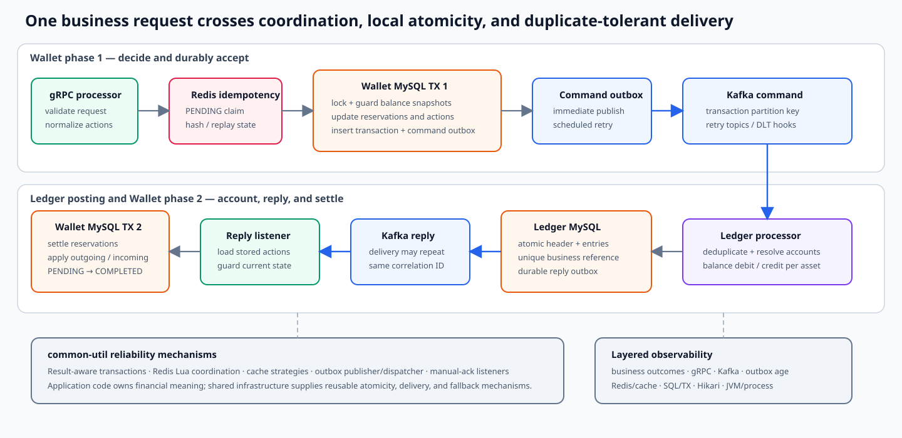
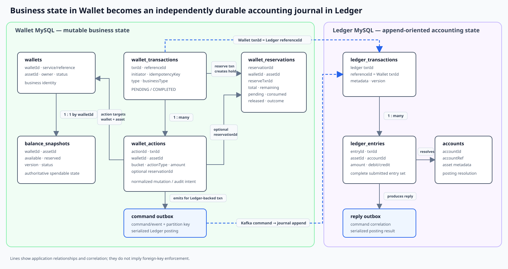

# z-exchange

z-exchange is a technique-focused backend project for durable money movement and double-entry accounting. It demonstrates how a Wallet state machine and a passive Ledger journal can cooperate through local database transactions, transactional outboxes, Kafka, Redis, and idempotent processing—without claiming commercial-production maturity.

## Architecture and Technical Flow

| Component | Responsibility |
|---|---|
| **Wallet Service** | Decides whether funds may move; owns available/reserved balances, reservations, transaction state, and settlement finalization. |
| **Ledger Service** | Validates per-asset debit/credit equality and atomically appends the accounting journal. |
| **common-util** | Supplies shared transaction, Redis, cache, idempotency, Kafka/outbox, error, and metrics mechanisms. |
| **MySQL** | Holds authoritative service state, local transaction boundaries, locks, unique identities, and outbox rows. |
| **Redis** | Accelerates duplicate coordination and reads; failure degrades to the database path. |
| **Kafka** | Carries Wallet commands and Ledger replies with duplicate-permitting delivery; exhausted rows are not automatically recovered. |

Wallet answers **“may this money move?”** Ledger answers **“how is it accounted for?”** Their databases are not joined by a distributed transaction: an accepted Ledger-backed Wallet operation remains `PENDING` until accounting succeeds and Wallet consumes the reply. No database transaction or thread context crosses a service boundary. The [system overview](design/business/system-overview.md) and [end-to-end flow](design/business/end-to-end-transaction-flow.md) own the fuller walkthrough.

## Wallet business flow

Wallet converts each request into a small action vocabulary—reserve, consume, release, transfer-out, and transfer-in. Reserve and pure release complete locally. Transfer-bearing work commits as `PENDING`, posts balanced entries through Ledger, and becomes `COMPLETED` only when Wallet applies the durable reply.

The two balance buckets answer whether money is spendable; reservations explain why a particular amount is held and how it progresses. Moving value into `reserved` before remote work prevents reuse during uncertainty, while `pendingSettle` distinguishes requested consumption from Ledger-confirmed consumption.

## Core data model

Wallet persists mutable business intent and money state. Its transaction owns normalized actions and, when accounting is required, a command outbox. The Wallet transaction ID becomes Ledger's stable business reference; Ledger stores its own transaction header and complete debit/credit entry set, then emits a durable reply. These are application relationships—this project intentionally does not claim foreign-key enforcement for them.

## Engineering highlights

- **No-double-spend state:** outgoing value moves from `available` to `reserved` before remote accounting. Each hold tracks `remaining`, `pendingSettle`, `consumed`, and `released`.
- **Double-entry journal:** Ledger checks debit equals credit independently for every asset, then commits the transaction header and complete entry batch atomically.
- **Layered idempotency:** Redis provides fast `PENDING`/`ACCEPTED` coordination; MySQL unique business identities remain the durable duplicate-effect boundary.
- **Durable asynchronous handoff:** business state and its outgoing outbox row commit together. Eligible rows may be published repeatedly, so consumers use stable identities and guarded state transitions.

## Correctness and reliability model

The primary cross-service flow has three local durability boundaries:

1. Wallet commits phase-1 balances, reservations, transaction/actions, and the Ledger-command outbox together.
2. Ledger commits at most one balanced journal per business reference, then makes a reply durable before acknowledging the command.
3. Wallet applies a successful reply through guarded phase-2 settlement before acknowledging it.

This protects committed effects from ordinary retries, duplicate delivery, and crashes around publication for the supported request shapes. It does **not** mean exactly-once messaging, eventual delivery after retry exhaustion, or strong Wallet–Ledger consistency. Material open work includes Wallet re-drive after Ledger-side completion, compensation for a valid Ledger rejection, durable request-equivalence checks, and correct action correlation when one request affects multiple reservations on the same Wallet. The precise guarantees and failure matrix are in [Wallet–Ledger Consistency and Reliability](design/consistency/wallet-ledger-consistency.md).

## Performance and observability

Prometheus/Grafana metrics, deterministic k6 workloads, and SQL reconciliation distinguish foreground acceptance from settlement and financial correctness. Retained investigations are historical, configuration-specific evidence; they do not establish sustainable TPS, a latency SLO, or production capacity for the current revision.

## Documentation guide

Start with the overviews:

- [System Overview](design/business/system-overview.md) — business model, service split, and core guarantees
- [End-to-End Transaction Flow](design/business/end-to-end-transaction-flow.md) — reserve, transfer, posting, and settlement lifecycle
- [Wallet Service Overview](design/wallet/wallet-service-overview.md) — balances, reservations, concurrency, idempotency, and cache reads
- [Ledger Service Overview](design/ledger/ledger-service-overview.md) — accounting, atomic posting, replay, replies, and queries
- [Common-util Overview](design/infrastructure/common-util-overview.md) — shared infrastructure and current adoption
- [Wallet–Ledger Consistency and Reliability](design/consistency/wallet-ledger-consistency.md) — duplicates, partial failures, recovery, and remaining risks

For focused interview topics:

| Topic | Deep dive |
|---|---|
| Wallet transaction lifecycle | [Transaction Lifecycle and Asynchronous Settlement](design/wallet/transaction-lifecycle-and-settlement.md) |
| Balance invariants and locking | [Balance and Concurrency Correctness](design/wallet/balance-and-concurrency-correctness.md) |
| Reservations and no-double-spend state | [Reservation Lifecycle](design/wallet/reservation-lifecycle.md) |
| Wallet / Ledger idempotency | [Wallet Idempotency](design/wallet/transaction-idempotency-and-replay.md) · [Ledger Idempotency](design/ledger/posting-idempotency-and-replay.md) |
| Ledger accounting and database atomicity | [Posting and Accounting Correctness](design/ledger/posting-and-accounting-correctness.md) |
| Kafka, outbox, retry, and recovery | [Kafka and Outbox Reliability](design/infrastructure/kafka-outbox-reliability.md) · [Ledger Async Posting and Replies](design/ledger/async-posting-and-reply.md) |
| Redis caching and read models | [Redis Cache Coherency](design/infrastructure/redis-cache-coherency.md) · [Wallet Reads](design/wallet/balance-query-and-cache.md) · [Ledger Reads](design/ledger/transaction-query-and-cache.md) |
| MySQL transaction conventions | [Database Foundation](design/infrastructure/database-foundation.md) |
| Metrics and diagnostics | [Observability](design/operations/observability.md) |
| Stress testing and retained evidence | [Wallet Performance](design/operations/wallet-performance.md) · [Ledger Performance](design/operations/ledger-performance.md) |
