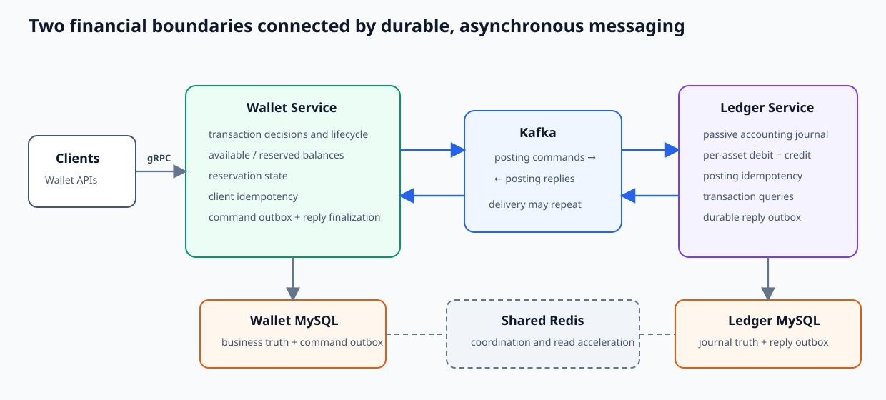
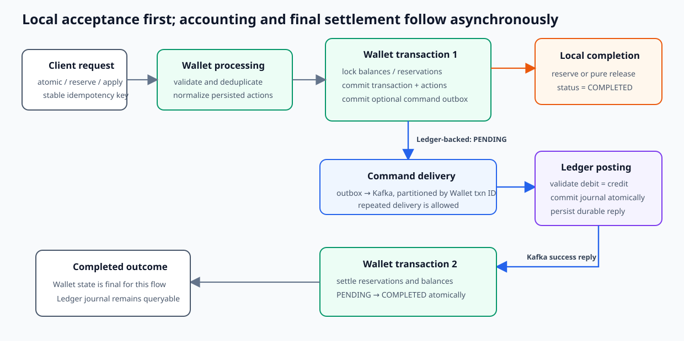

# z-exchange System Overview

**Scope:** business model and cross-system architecture  
**Evidence state:** synthesized from verified Wallet, Ledger, and common-util designs on 2026-09-09

## System in five minutes

z-exchange is a technique-focused backend project for durable money movement and double-entry accounting. Its central design separates two questions:

- **May this money move?** Wallet owns spendability, holds, transaction decisions, and settlement state.
- **How is the movement accounted for?** Ledger owns an append-oriented, balanced journal.

The services communicate asynchronously through transactional outboxes and Kafka. This keeps financial database transactions local and short while making delivery retryable. The trade-off is deliberate eventual consistency: an accepted transfer can remain `PENDING` until Ledger posts it and Wallet applies the reply.

## Business and domain model

| Concept | Meaning |
|---|---|
| Wallet | User- or system-facing identity that owns balance snapshots and participates in transactions |
| Balance snapshot | Authoritative integer-minor-unit amounts split into `available` and `reserved` |
| Reservation | A durable hold partitioned into `remaining`, `pendingSettle`, `consumed`, and `released` |
| Wallet transaction | The business decision and lifecycle record, initially `PENDING` when Ledger work is required |
| Wallet action | Normalized reserve, consume, release, transfer-out, or transfer-in intent |
| Ledger transaction | The accounting header identified by the Wallet transaction ID |
| Ledger entry | One debit or credit in a particular asset and account |
| Outbox event | A database-backed command or reply that may be republished while its row remains eligible |

Wallet and Ledger account provisioning supports these concepts but is not the project's primary engineering focus.

## Why Wallet and Ledger are separate

Wallet is optimized for mutable business state: it answers whether funds are available, prevents reuse of held value, serializes concurrent updates, and records whether a transaction is awaiting settlement. Ledger is optimized for immutable accounting history: it validates that each submitted transaction balances per asset and appends the complete journal atomically.

This boundary keeps authorization and reservation rules out of the accounting journal and keeps accounting append logic out of Wallet. A Ledger posting can be balanced yet still represent the wrong business decision if Wallet supplied incorrect facts; the separation therefore depends on each service enforcing its own invariants.

## Primary business operations

| Operation | Wallet behavior | Cross-service behavior |
|---|---|---|
| Reserve | Move available funds to reserved and create a reservation | Completes locally; no Ledger posting |
| Release | Move unconsumed reservation value back to available | Pure release completes locally |
| Consume / earmark | Move reservation value from remaining to pending settlement | Ledger confirms the outgoing accounting transfer before final consumption |
| Atomic transfer | Reserve outgoing value and record incoming intent | Ledger posts balanced entries; Wallet then removes outgoing reserved value and credits incoming available value |

The action vocabulary makes the timing explicit: outgoing value becomes non-spendable before remote accounting, while final debit/credit effects occur after Ledger success. The detailed walkthrough is in [End-to-End Transaction Flow](end-to-end-transaction-flow.md).

## Correctness model

The important invariants are layered rather than enforced by one component:

| Boundary | Core invariant or guarantee |
|---|---|
| Wallet balance | Normal accepted operations cannot spend value already moved from available to reserved |
| Reservation | `total = remaining + pendingSettle + consumed + released` is maintained by the active transition arithmetic |
| Wallet transaction | Each local phase commits its related balances, reservations, actions, status, and outbox work atomically |
| Wallet transfer | Transfer-in and transfer-out totals balance by asset before a Ledger command is created |
| Ledger posting | Debit totals equal credit totals independently for every asset |
| Ledger journal | One database transaction commits the header and its complete submitted entry batch |
| Duplicate effects | Stable business identities plus MySQL unique keys select one durable Wallet acceptance and one Ledger posting |

Wallet's active balance path uses locked current rows, application validation, old-value/version predicates, and rollback. Ledger uses application accounting validation followed by an atomic append. The schema provides primary/unique identities and conditional updates, not an independent encoding of every domain rule.

## Consistency and reliability

The system does not use a distributed transaction. Instead, three local durability boundaries cooperate:

1. Wallet commits phase-1 financial state and the command outbox together.
2. Ledger idempotently commits the journal, then makes a reply durable before acknowledging the command.
3. Wallet finalizes balances, reservations, and transaction status through guarded updates before acknowledging the reply.

Kafka/outbox delivery permits repeated attempts, so duplicate messages are expected. Redis accelerates live idempotency coordination, but MySQL unique identities and guarded state changes protect durable effects. A committed outbox closes the database/Kafka dual-write window; immediate publishing is only a latency optimization. Exhausted outbox rows are not automatically re-driven, so this is not an eventual-delivery guarantee.

The unresolved business cases are bounded: Wallet has no implemented scheduled re-drive for a transaction that stays pending after Ledger commit/reply failure, and a valid Ledger rejection has no compensation transition. Retry/DLT signals are operational evidence rather than repair. See [Wallet–Ledger Consistency and Reliability](../consistency/wallet-ledger-consistency.md).

## Infrastructure roles

| Technology | Role in the design |
|---|---|
| MySQL | Authoritative per-service state, local atomicity, locks, unique identities, and outboxes |
| Redis | Soft-dependency idempotency coordination and read acceleration |
| Kafka | Asynchronous command/reply transport with per-transaction partitioning |
| common-util | Shared Result/error, transaction, Redis, cache, outbox/listener, and metrics mechanisms |
| Prometheus/Grafana | Cross-layer visibility into business, transport, database, cache, pool, and runtime behavior |

Checked-in TTLs, retries, schedules, concurrency, and pool sizes are pre-launch snapshots rather than supported operating limits. Retained load evidence demonstrates investigation and reconciliation techniques, not commercial-production capacity.

## Documentation guide

- Wallet responsibilities, lifecycle, balances, reservations, and reads → [Wallet Service Overview](../wallet/wallet-service-overview.md)
- Ledger posting, accounting, replay, queries, and replies → [Ledger Service Overview](../ledger/ledger-service-overview.md)
- end-to-end operation timing and state changes → [End-to-End Transaction Flow](end-to-end-transaction-flow.md)
- failures, partial commits, duplicate delivery, and recovery boundaries → [Wallet–Ledger Consistency and Reliability](../consistency/wallet-ledger-consistency.md)
- shared Redis, database, messaging, errors, and observability → [Common-util Overview](../infrastructure/common-util-overview.md)
