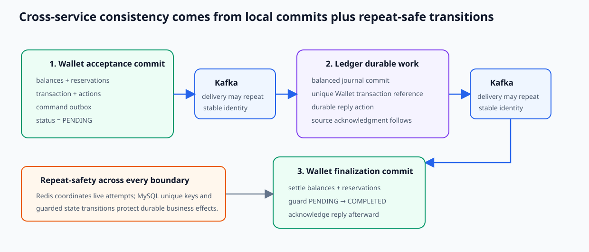

# Wallet–Ledger Consistency and Reliability

**Scope:** cross-service guarantees, failure behavior, and recovery boundaries  
**Evidence state:** synthesized from verified Wallet, Ledger, idempotency, database, and Kafka/outbox designs on 2026-09-09

## Consistency model in one minute

Wallet and Ledger are eventually consistent by design. They do not share a database transaction. Cross-service correctness instead composes three local commits, stable business identities, database uniqueness, guarded state transitions, and duplicate-tolerant delivery while outbox and listener retries remain eligible.

The intended steady-state outcome is one accepted Wallet transaction, one balanced Ledger journal, and one completed Wallet settlement. During processing, Wallet's `PENDING` state and reserved/pending-settle amounts make the incomplete outcome explicit and keep outgoing value non-spendable.

## Durability and idempotency boundaries

| Boundary | Durable protection | What it does not prove |
|---|---|---|
| Wallet acceptance | one transaction per `(initiator, idempotency_key)`; phase-1 money state and command outbox commit together | durable equality of the retried payload after Redis state expires |
| command delivery | unique outbox event; stable Wallet transaction partition/reference; repeated publication allowed | exactly-once Kafka delivery or eventual delivery after retry exhaustion |
| Ledger posting | unique `reference_id`; header and complete entry batch commit atomically | durable request-payload equivalence or successful reply convergence |
| reply delivery | durable reply outbox before source acknowledgment; repeated publication allowed | atomicity between Ledger journal commit and reply-outbox persistence |
| Wallet finalization | row locks/guards and `PENDING → COMPLETED` in the phase-2 transaction | clean success convergence for every concurrent duplicate reply |

Redis supplies fast `PENDING`/`ACCEPTED` coordination and visible hash conflict while its value exists. MySQL is the durable effect authority. An expired Redis lease can admit overlapping work, but database uniqueness and Wallet state guards limit what can commit.

## Failure and risk matrix

| Failure or risk | Prevention / detection | Current recovery | Classification and remaining risk |
|---|---|---|---|
| Duplicate client API request | Redis live claim/hash plus Wallet DB unique `(initiator, key)` | replay committed Wallet transaction ID; duplicate insert loser rolls back | **Effect prevented.** Durable same-payload equivalence and latest replay shape are incomplete. |
| Duplicate Wallet command | Ledger Redis coordination plus unique Wallet transaction `reference_id` | DB replay can return the existing Ledger transaction | **Journal duplication prevented.** Concurrent loser/reply reconstruction may not converge cleanly. |
| Duplicate success reply | Wallet checks transaction status; locked/guarded finalization | sequential replay is a no-op | **Second effect prevented.** A concurrent loser can fail and reach DLT instead of succeeding idempotently. |
| Wallet crashes before phase-1 commit | Wallet database rollback | client safely retries with the same identity | **Prevented by local transaction.** |
| Wallet commits, then crashes before command publish | command outbox is in the same commit | scheduled dispatcher publishes pending row | **Recoverable while retry remains eligible.** Exhausted rows stay pending and are no longer claimed. |
| Broker accepts but outbox finalization fails | pending row and metrics expose another attempt | scheduled republish | **Duplicate-delivery mitigation.** Another delivery is expected. |
| Publisher times out | timeout is treated as unknown; row remains pending | later retry with same identity | **Mitigated.** A late broker acknowledgment can create a duplicate delivery. |
| Ledger rejects before journal commit | failed attempt rolls back; listener retry/failure policy applies | transient failures retry | **Detected.** A final valid rejection has no Wallet compensation and can strand reserved value. |
| Ledger commits, then Redis completion fails | unique journal row remains authoritative | later DB replay after coordination permits | **Accounting effect protected.** A stale Redis `PENDING` can temporarily block reconstruction. |
| Ledger commits, then usable reply is not persisted/delivered | Wallet remains `PENDING`; DLT/outbox signals may expose symptoms | planned Wallet scheduled repost using the same reference | **Not currently repaired end to end.** The recovery job is not implemented. |
| Wallet finalization fails before commit | phase-2 rollback; reply is not acknowledged on retryable handling | retry-topic/outbox redelivery | **Recoverable for ordinary retryable failure.** Terminal failure can leave Wallet pending. |
| Consumer crashes after business commit but before durable offset | Kafka can redeliver | service business idempotency and outbox/state guards | **Effects mitigated.** Ledger reply same-intent payload conflict and Wallet concurrent convergence remain gaps. |
| Concurrent distinct Wallet operations | snapshot row locks, application sufficiency checks, version/old-state guards | failed contender retries as a new/idempotent attempt | **Normal balance overspend prevented.** Reservation lock order is not deterministic. |
| Multiple reservations on one Wallet in one request | validation finds referenced reservations | rollback may prevent a partial commit | **Not safely supported.** Action application is grouped by Wallet rather than strictly by reservation reference. |
| Stale balance/transaction cache | MySQL authority, version CAS, tombstones, stale-reference repair | expiry or later DB-backed refresh | **Mitigated, not eliminated.** Normal reads are best-effort and no explicit authoritative-read API exists. |
| Wallet balance and Ledger journal disagree | pending status, reservation/balance state, business metrics, and verification SQL expose expected shape | offline reconciliation tooling; no automated repair | **Detectable during controlled verification.** No runtime reconciliation/repair workflow exists. |

## Database/Kafka dual-write model

Wallet does not independently update its database and then create an in-memory-only Kafka command. The command outbox is inserted in the same phase-1 transaction as the business changes. If the transaction rolls back, neither state nor event exists; if it commits, a durable pending event exists even when immediate publishing fails.

Ledger has a different boundary. Journal posting commits first; the listener then inserts or verifies the reply outbox before acknowledging the source. This intentional split avoids coupling journal correctness to reply construction, but creates the main cross-service convergence window: accounting may exist while Wallet has no usable success reply.

The outbox permits at-least-once attempts rather than exactly-once delivery. Broker acknowledgment and the database `PENDING → SENT` update are separate, and a timeout does not cancel a potentially successful send. Consumer idempotency is therefore part of the correctness contract, not an optional optimization. Because exhausted rows are no longer selected, the current mechanism does not guarantee eventual delivery.

## Unknown results and safe retries

Two unknown-result cases use the same rule: preserve the original business identity.

- If a client loses the Wallet response after phase-1 commit, it retries with the same initiator/idempotency key and payload. Wallet DB uniqueness prevents another accepted effect.
- If Wallet must recover a stuck Ledger-backed transaction, it must repost the same logical command using the same Wallet transaction ID as Ledger reference. Ledger DB uniqueness prevents a second journal header.

This is effect-safe, but full semantic equivalence is not yet durable: request hashes live only in Redis, and Ledger reply reconstruction has a deterministic-ID/whole-payload conflict. Recovery must not generate a new business reference for the same intended effect.

## Ordering and concurrency

Commands and replies use the transaction ID as Kafka partition key, which preserves append order within one partition/topic while its partitioning is stable. There is no global order, no order across command and reply topics, and retry-topic routing can change relative timing. Correctness therefore comes from identity and state transitions rather than assumed global message order.

Wallet locks balance snapshots in ascending primary-key order and guards updates by old values/version. Reservation rows are locked but not explicitly ordered. Ledger posting is append-oriented and contends mainly on identities rather than shared balance rows.

## Recovery and reconciliation status

| Mechanism | Current status |
|---|---|
| pending outbox scheduled retry | implemented in both services |
| listener retry topics and DLT observability | implemented; operational signal only |
| duplicate-effect protection | implemented through DB identities and guarded transitions |
| Wallet stuck-transaction scan/repost | accepted future direction; not implemented |
| compensation after valid Ledger rejection | required future design; not implemented |
| runtime Wallet/Ledger reconciliation and repair | not implemented |
| verification SQL for balances, reservations, outboxes, and journal shape | available for controlled tests/stress runs |

## Highest-priority follow-ups

1. Implement the Wallet-owned stuck-transaction scanner with claiming, age/state selection, unchanged command identity/payload, retry limits, and convergence tests.
2. Define an idempotent compensation state machine for valid Ledger rejection so held funds reach a deliberate terminal outcome.
3. Resolve Ledger reply identity/equivalence so redelivery after journal commit reliably produces a usable success outcome.
4. Make concurrent successful Wallet reply processing converge as success, enforce deterministic reservation lock order, and fix same-Wallet multi-reservation action correlation.
5. Persist canonical request identity in both service databases and make Redis completion owner-conditional.
6. Add live crash-window, broker-timeout, Redis-loss, concurrency, and reconciliation tests before making end-to-end delivery or capacity claims.

These are technique-focused enhancements for the project's next iteration; checked-in retry counts, TTLs, schedules, and concurrency values remain provisional.

## Deep dives

- system and business context → [z-exchange System Overview](../business/system-overview.md)
- operation-by-operation progression → [End-to-End Transaction Flow](../business/end-to-end-transaction-flow.md)
- shared messaging guarantees → [Kafka and Outbox Reliability](../infrastructure/kafka-outbox-reliability.md)
- Wallet acceptance and settlement → [Wallet Transaction Lifecycle](../wallet/transaction-lifecycle-and-settlement.md)
- Ledger posting and durable replies → [Ledger Asynchronous Posting and Replies](../ledger/async-posting-and-reply.md)
- service idempotency → [Wallet Idempotency](../wallet/transaction-idempotency-and-replay.md) and [Ledger Idempotency](../ledger/posting-idempotency-and-replay.md)
