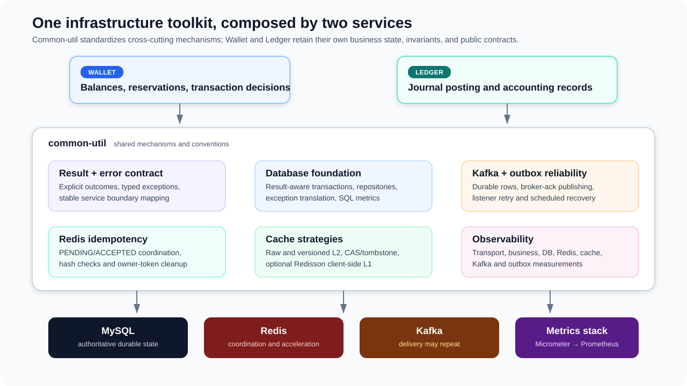
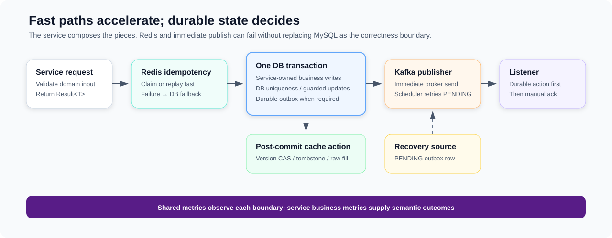

# Common Util Overview

**Scope:** reusable infrastructure shared by Wallet and Ledger  
**Evidence state:** synthesized from verified D-001–D-006 on 2026-09-09

## Common-util in five minutes

`common-util` is the project's infrastructure toolkit. It gives Wallet and Ledger the same building blocks for explicit outcomes, transaction handling, Redis coordination and caching, Kafka/outbox delivery, and application metrics. The services compose those mechanisms around their own workflows; domain decisions, business invariants, database identities, and public error contracts remain service-owned.

The central engineering idea is separation of **acceleration**, **durability**, and **meaning**:

- Redis accelerates duplicate detection and reads, but MySQL remains authoritative.
- Immediate Kafka publication reduces latency, but the committed outbox row remains the recovery source.
- Shared `Result<T>` and error metadata carry failures internally, while each service maps them into its stable public contract.
- Metrics observe each boundary independently, so transport success is not confused with business success.

## Capability map and adoption

| Capability | What it contributes | Current adoption | Deep dive |
|---|---|---|---|
| Result and errors | Explicit success/failure values, namespaced error codes, typed exceptions, and service-owned boundary mapping | **CURRENTLY USED** across common-util and both services | [Result and Error Contract](result-and-error-contract.md) |
| Database foundation | Result-aware Spring transactions, thin MyBatis repository conventions, DB exception translation, and SQL/transaction metrics | **CURRENTLY USED** by both services and outbox recovery | [Database Foundation](database-foundation.md) |
| Redis idempotency | Atomic `PENDING` claims, request-hash comparison, accepted-result replay, and owner-token cleanup | **CURRENTLY USED** in Wallet and Ledger transaction paths | [Redis Idempotency Coordination](redis-idempotency-coordination.md) |
| Cache strategies | Raw and versioned Redis caches, negative entries, tombstones, and absent-or-newer Lua CAS | **CURRENTLY USED**; Redisson client-side L1 is **PARTIALLY ADOPTED** by Wallet only | [Redis Cache Coherency](redis-cache-coherency.md) |
| Kafka and outbox | Durable outbox rows, broker-ack publishing, scheduled recovery, manual-ack listeners, retry topics, and DLT policy hooks | **CURRENTLY USED** for Wallet–Ledger messaging | [Kafka and Outbox Reliability](kafka-outbox-reliability.md) |
| Observability | Shared gRPC, DB, Redis, cache, idempotency, Kafka, listener, DLT, and outbox-age instrumentation | **CURRENTLY USED**; services add business metrics and Actuator export | [Shared Observability](../operations/observability.md) |

Three retained facilities are **AVAILABLE BUT CURRENTLY UNUSED**: the blocking Kafka `DefaultErrorHandler` container factory, `CacheExceptionToResultAop`, and the Caffeine dependency. Current listeners use retry topics, cache strategies use explicit exception-downgrade decorators, and Redisson—not Caffeine—provides Wallet's client-side cache. Their long-term retention is still open.

## How the mechanisms fit together

### 1. Explicit outcomes and database atomicity

`Result<T>` represents expected success or failure without making exceptions the normal control path. `DbTxnExecutor` strengthens that convention: a successful result commits, a failed result marks the transaction rollback-only, and an exception rolls back before it is propagated or translated. Service repositories remain thin enough that locks, unique keys, version predicates, and affected-row semantics stay visible at the workflow boundary.

This provides a reusable atomicity mechanism, not domain correctness by itself. Wallet and Ledger select the rows, constraints, lock order, and validation rules that make a particular transaction correct.

### 2. Layered idempotency

Redis is the fast coordination tier. `SET NX` admits one live claimant, the stored request hash detects visible same-key/different-request conflicts, and an accepted value can replay a transaction identifier without a database round trip. Redis faults degrade to a database lookup.

The service database is the durable duplicate-effect boundary: Wallet and Ledger use unique business identities and commit the transaction row with related writes. The current DB rows do not retain a canonical request hash, so uniqueness prevents duplicate durable effects but cannot always prove request equivalence after Redis loss or expiry. Likewise, completion is not yet an atomic token-owned transition. The accepted target design is summarized in [DB-Authoritative Idempotency with Redis-Owned Claims](../proposals/redis-idempotency-db-authoritative.md).

### 3. Cache coherency by data shape

The cache framework deliberately offers more than one consistency strategy:

| Data shape | Strategy | Why |
|---|---|---|
| Stable reference mappings | Raw value plus optional negative cache | Simple cache-aside behavior is sufficient for rarely changed identity lookups. |
| Mutable snapshots/transactions | Versioned value, tombstone, and Lua absent-or-newer CAS | A delayed reader cannot overwrite a newer cached database revision. Equal versions may overwrite intentionally. |
| Selected Wallet hot keys | Redisson server-assisted client-side L1 over Redis L2 | Reduces repeated remote reads after process-local promotion; adoption is Wallet-specific. |

Database writes complete before best-effort cache refresh or invalidation. Cache failures therefore do not roll back committed business state when they are normalized through the intended cache exception path. Reads may still be stale: TTLs, tombstones, version CAS, and DB fallback bound or mitigate races but do not provide linearizability.

### 4. Duplicate-tolerant messaging and bounded recovery

Services insert an outbox row in the transaction that establishes the event-producing state. They may publish immediately for latency; a scheduled worker claims due `PENDING` rows in short transactions and retries after the claim commits. Producer success means broker acknowledgment, after which the caller separately marks the row `SENT`. A crash or finalization failure can therefore duplicate delivery, so consumers must be idempotent.

Listeners acknowledge only after their required durable action. Ledger's request path durably posts before constructing a reply outbox in a separate transaction; Wallet's reply path applies its terminal action before acknowledgment. Retry topics and DLT handling classify transport failures, while service idempotency protects effects. The detailed design records the remaining terminal-outbox and Ledger reply-convergence gaps without treating them as guarantees.

### 5. Layered observability

Common-util measures transport, transaction, SQL, Redis, cache semantics, idempotency failures, Kafka publication, listener processing, DLT delivery, and outbox publish age. Wallet and Ledger add operation/outcome metrics because a protobuf response can contain a business error while gRPC still closes with status `OK`. Actuator exports application/JVM/Hikari series to Prometheus; provisioned Grafana dashboards combine them.

Metric labels avoid request IDs, transaction IDs, Redis keys, SQL text, and error detail. Failure isolation is intentionally qualified: several Kafka/MyBatis metric paths suppress instrumentation faults, but not every decorator is guarded. Distributed tracing, infrastructure exporters, consumer lag, and complete outbox backlog/exhaustion metrics are future enhancements rather than current capabilities.

## Current guarantees at a glance

| Area | Currently provided | Important boundary |
|---|---|---|
| Transactions | Atomic commit/rollback for work composed inside one executor callback; failed `Result` rolls back | No automatic retries or universal lock/constraint policy |
| Idempotency | Live Redis claim coordination plus database uniqueness against duplicate effects | Request equivalence after Redis loss and token-owned completion are not yet guaranteed |
| Caching | MySQL authority; atomic versioned Redis writes reject older revisions | Freshness is best effort, not linearizable or numerically bounded |
| Messaging | Durable outbox retry while rows remain eligible; Kafka delivery may repeat | No automatic recovery after retry exhaustion; service-owned idempotency remains part of the model |
| Errors | Consistent internal taxonomy and stable service-owned public mapping | Retryable metadata alone does not prove that replay is safe |
| Observability | Distinct shared measurements from ingress through dependencies and messaging | No trace-exact cross-service correlation; metric failure isolation is partial |

Checked-in TTLs, timeouts, retry counts, concurrency, schedules, and pool sizes are pre-launch snapshots. They explain the present wiring but are not validated operating or capacity guarantees.

## Engineering trade-offs

- **Composable mechanisms over a hidden framework.** Services can see and choose transaction, cache, idempotency, and listener boundaries; the cost is that correct composition remains a call-site responsibility.
- **Database authority with soft Redis dependencies.** Redis improves hot-path behavior without becoming the durable truth; this accepts short-lived overlap and stale-read windows.
- **Short local transactions over distributed transactions.** Outbox retry avoids holding database locks during Kafka I/O; duplicate-permitting delivery shifts correctness toward idempotent consumers.
- **Layer-specific measurements over high-cardinality correlation.** Bounded metrics make dashboards practical, while exact causal tracing is not currently available.

## Future enhancements

The highest-value next steps are already separated from the current implementation:

- make DB request identity authoritative and Redis completion token-owned in [DB-Authoritative Idempotency](../proposals/redis-idempotency-db-authoritative.md);
- define terminal outbox state, alerts, and recovery, then add backlog/exhaustion/finalization metrics in [Kafka and Outbox Reliability](kafka-outbox-reliability.md) and [Shared Observability](../operations/observability.md);
- resolve Ledger reply identity/convergence after the intentional posting/reply transaction split; compare [Unique Ledger Reply Events](../proposals/ledger-reply-event-identity.md) with [Durable Inbox/Outbox Processing](../proposals/inbox-outbox-processing.md);
- selectively expose safely retryable dependency outages as public `UNAVAILABLE` using [Public Infrastructure Error Boundary Policy](../proposals/public-infrastructure-error-boundary-policy.md);
- validate Redisson tracking, cache/Lua races, real database failure semantics, retry-topic marker propagation, and metric lifecycle/failure isolation with live integration tests.

## Supporting utilities

Small shared helpers cover JSON conversion, enum mapping, hashing, ownership tokens, TTL jitter, and time conversion. They support the designs above but do not form independent architecture boundaries.

## Documentation guide

Start with the capability that matches the interview question:

- overall business architecture → [z-exchange System Overview](../business/system-overview.md)
- cross-service reliability composition → [Wallet–Ledger Consistency and Reliability](../consistency/wallet-ledger-consistency.md)
- delivery, retries, outbox state, or listener durability → [Kafka and Outbox Reliability](kafka-outbox-reliability.md)
- duplicate requests and Redis/DB coordination → [Redis Idempotency Coordination](redis-idempotency-coordination.md)
- hot data, stale reads, tombstones, or version CAS → [Redis Cache Coherency](redis-cache-coherency.md)
- transactions, repositories, SQL exceptions, or database metrics → [Database Foundation](database-foundation.md)
- `Result<T>`, exception policy, error taxonomy, or public mapping → [Result and Error Contract](result-and-error-contract.md)
- metrics, dashboards, cardinality, or diagnostic boundaries → [Shared Observability](../operations/observability.md)
