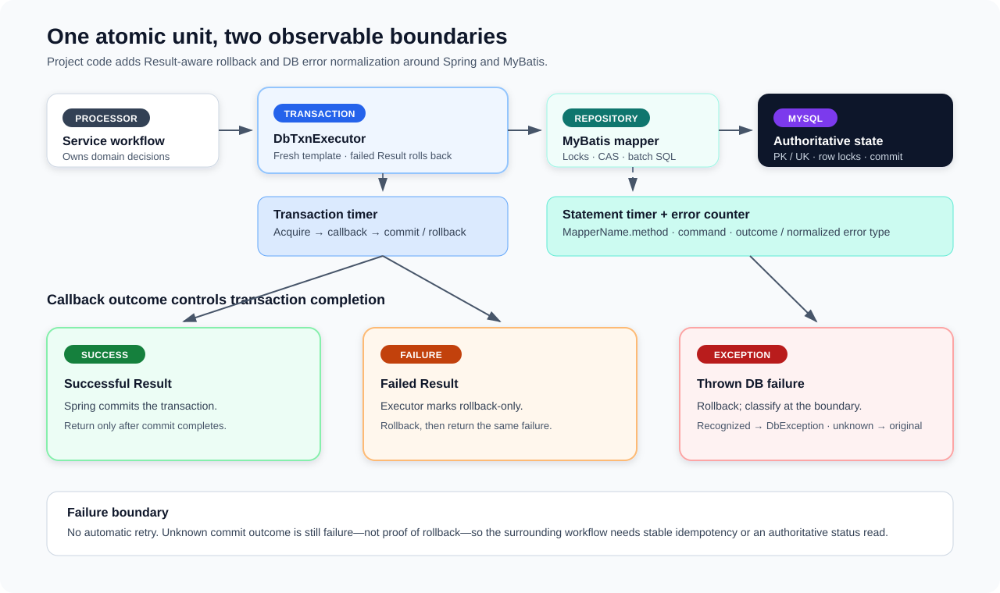

# Database Transaction, Persistence, Exception, and SQL-Metrics Foundation

**Design:** D-004  
**Status:** Verified against the current implementation on 2026-09-09 (quick pass)

**Module overview:** [Common Util Overview](common-util-overview.md)

## Foundation in one minute

The shared database layer gives Wallet and Ledger one result-aware transaction boundary, a small MyBatis-Plus repository foundation, normalized infrastructure exceptions, and separate statement-versus-transaction metrics. MySQL remains authoritative; service processors still own domain validation, lock ordering, conditional-update interpretation, and idempotency decisions.

The central project convention is stronger than a plain exception-only transaction callback: a returned failed `Result<?>` explicitly marks the transaction rollback-only. A successful result is returned only after Spring completes the transaction. A thrown exception also rolls back and propagates, with recognized database failures translated at repository or transaction-executor boundaries.

| Layer | Provided behavior | Source of behavior |
|---|---|---|
| Resource transaction | Connection-bound begin, participation, commit, rollback, and rollback-only handling. | Spring `PlatformTransactionManager` and `TransactionTemplate`. |
| Result-aware boundary | Failed `Result` means rollback; successful `Result` means commit; exceptions roll back and escape. | Project `DefaultDbTxnExecutor`. |
| Persistence primitives | Typed mapper access, lambda query/update wrappers, duplicate-key-to-zero insert helper, timestamp fill, and an optimistic-lock plugin. | Project wrappers over MyBatis-Plus. |
| Error normalization | Conservative mapping to internal, timeout, unavailable, or transient DB errors. | Project AOP and `DbExceptionTranslator`. |
| Observability | JDBC-adjacent statement duration/errors plus full transaction duration. | Project Micrometer decorators/interceptor. |

## Transaction contract

`DbTxnExecutor.executeWithDefault` creates a fresh `TransactionTemplate` for every invocation. The template is not shared or mutated across callers, so later per-call configuration cannot race through singleton state. The underlying transaction manager remains a shared framework component.

The executor uses Spring defaults: `REQUIRED` propagation, the resource's default isolation, the default timeout, and a read-write transaction. The current code and configuration do not override those values, and current callers do not nest executor calls. Consequently, each inspected call starts a service-local transaction; a future call made inside an existing Spring transaction would participate through `REQUIRED` rather than establish an independent commit boundary.

| Callback outcome | Transaction action | Caller-visible outcome |
|---|---|---|
| Non-null successful `Result` | Commit. | Return the result after commit completes. |
| Failed `Result` | Mark rollback-only; Spring rolls back. | Return the same failed result after rollback. |
| Throwable from callback | Mark rollback-only; Spring rolls back. | Rethrow; recognized DB failures are normalized by boundary AOP. |
| Begin/commit/rollback failure | Spring throws from transaction execution. | Translate when recognized; otherwise propagate the original exception. |

The supplier contract implicitly requires a non-null `Result`; returning `null` reaches `value.isFailed()` and fails the transaction. Transaction timing begins before acquisition and ends after commit or rollback, so it includes pool/transaction-manager delay, callback work, and transaction completion. It excludes work deliberately performed after `executeWithDefault` returns.

### Current multi-write adoption

- Ledger posting inserts one transaction and its entry batch inside one executor call. A failed duplicate insert or short batch count returns a failed result, rolling back the whole unit.
- Wallet's pre-Ledger phase locks the rows it will mutate, updates balances/reservations, inserts transaction/action/reservation records, and inserts the command outbox in one transaction. This is the business-state/outbox atomic boundary.
- Wallet's successful-reply phase locks and updates reservation and balance state, then conditionally advances the Wallet transaction in one transaction.
- Outbox recovery uses a short transaction to select due rows with `FOR UPDATE SKIP LOCKED` and advance their retry claim together. Kafka publishing occurs after that claim transaction.

Cache refreshes, Redis idempotency completion, and immediate Kafka publishing are post-commit or separately coordinated actions. They cannot turn an already committed database operation back into a rollback.

## Persistence and concurrency conventions

`DbBaseRepository` is deliberately thin. It holds a typed `BaseMapper`, creates lambda query/update wrappers, and supplies `insertIgnore`. Service repositories define the actual query predicates, locks, batch SQL, affected-row expectations, and domain meaning.

Despite its name, `insertIgnore` does not emit MySQL `INSERT IGNORE`. It calls the normal mapper insert, catches a direct Spring `DuplicateKeyException`, and returns `0`; other failures escape. It therefore answers only “inserted or duplicate.” Some callers map a duplicate to a business conflict, while outbox code performs its own same-intent verification. The common layer cannot decide whether two records express the same request.

Current concurrency safeguards are composed by the services:

- Primary and unique keys choose a durable winner for identifiers such as Ledger `reference_id`, Wallet `(initiator, idempotency_key)`, and outbox `event_id`.
- Wallet selects mutable rows with `FOR UPDATE`; balance IDs and the balance query are ordered by primary key to reduce inconsistent lock ordering. Reservation locking has a source comment claiming PK order, but the processor does not sort its IDs and the repository query has no `ORDER BY`, so deterministic reservation lock order is not currently enforced.
- Conditional updates compare old status/value fields and require the caller to interpret the affected-row count. This is the effective CAS boundary for several state transitions.
- `OptimisticLockerInnerInterceptor` activates MyBatis-Plus version checks for entities carrying `@Version`: currently Wallet `BalanceSnapshot` and Ledger `LedgerTxn`. The plugin increments the in-memory version on a successful update; service repositories still must treat an affected-row count other than one as failure.

`BaseEntity` and `AutofillMetaObjectHandler` provide `createdAt` on insert and force a fresh `updatedAt` on update for entities that opt in. Current opt-in entities include Wallet transactions and balance snapshots, Ledger transactions, and outbox rows; it is not a universal schema timestamp policy.

The schema intentionally relies on primary/unique keys and conditional SQL rather than additional foreign keys, `CHECK` constraints, or business stored procedures. Transactions make related writes atomic, but they do not independently validate domain invariants. Those validations and their concurrency safety belong to the service designs.

## Exception and result propagation

`DbExceptionTranslateAop` advises public methods on `DbBaseRepository` subclasses and `DbTxnExecutor` implementations. Repository SQL failures are therefore normalized close to persistence; transaction begin/commit/rollback failures are caught at the outer executor boundary. An existing `DbException` is preserved instead of wrapped again, and an unrecognized exception keeps its original type.

Classification is ordered and conservative:

| Normalized code | Recognized examples | Retryable flag |
|---|---|---:|
| `DB_TRANSIENT` | Spring lock/deadlock exceptions, `SQLTransactionRollbackException`, MySQL 1205/1213, SQL state `40001`. | Yes |
| `DB_TIMEOUT` | Query/transaction timeouts and typed SQL, socket, or generic timeout root causes. | Yes |
| `DB_UNAVAILABLE` | Connection acquisition/resource failures and typed connect/network root causes. | Yes |
| `DB_INTERNAL` | Transaction-system, bad-SQL, general Spring data-access/transaction, or other typed SQL failures. | No |

Free-form exception messages are not parsed, avoiding driver-message-dependent retry decisions. This also means an unfamiliar wrapper can remain unclassified. In particular, a commit exception reports failure but does not prove that the database rolled back; an unknown-result caller must retry idempotently or query authoritative state.

The convention is: expected business outcomes use `Result`, while database infrastructure faults remain exceptions until a workflow or boundary deliberately converts them. Kafka's durable-reply listener maps retryable `DbException`s to transport retry and non-retryable ones to DLT handling. Wallet and Ledger result-boundary mappers collapse a common DB-coded failed `Result` to service-owned `INTERNAL_ERROR`; a `DbException` that escapes a gRPC processor instead reaches the service's generic exception guard and becomes `SERVER_ERROR`. Neither public path currently preserves DB retryability. The accepted future policy is described in [Public Infrastructure Error Boundary Policy](../proposals/public-infrastructure-error-boundary-policy.md).

## SQL and transaction observability

The metrics separate “which SQL is slow or failing?” from “which atomic unit is slow or failing?”

| Metric | Boundary | Labels |
|---|---|---|
| `zexchange.db.operation.duration` | `StatementHandler.query`, `update`, or `batch`; includes JDBC execution and result handling in that call, but excludes connection acquisition, statement preparation/binding, and commit/rollback. | `statement`, `command`, `outcome` |
| `zexchange.db.operation.errors` | One increment when the intercepted statement throws; the original exception is preserved. | `statement`, `command`, `error_type` |
| `zexchange.db.transaction.duration` | Entire executor call through transaction acquisition and commit/rollback. | `outcome` |

The MyBatis interceptor captures the public `MappedStatement` at `Executor` level, shortens its ID to `MapperName.method`, transfers it through a one-shot `ThreadLocal`, and consumes it at the narrower `StatementHandler` timing boundary. Cleanup also runs when a cache hit or pre-JDBC failure bypasses the statement handler. Missing metadata and missing handoff context use distinct bounded labels.

Statement commands are limited to `select`, `insert`, `update`, `delete`, and `unknown`; outcomes are `success` or `error`; error types come from the four DB codes or `unknown`. SQL text, parameters, exception messages, request IDs, and business IDs are never labels.

Duration-timer admission is capped at 512 named statement/outcome series across both timer caches. New keys after the observed limit share `cardinality_overflow`; lock-free admission may exceed the limit slightly during concurrent first registration. This cap does not apply to the error counter, which retains normalized mapper statement IDs for diagnosis. Those IDs normally come from a finite mapper registry, but the common code does not impose a separate counter-series bound.

The MyBatis statement interceptor suppresses its own extraction, classification, registration, and recording failures, so those statement metrics do not change SQL results. `MeteredDbTxnExecutor` does not guard timer creation or `sample.stop`; a Micrometer failure there can mask the transaction's caller-visible result even though it cannot undo a commit already completed by the delegate. Both services enable histograms and identical SLO bucket snapshots for statement and transaction timers; the checked-in three-second MyBatis statement timeout and Hikari pool settings are pre-launch configuration, not validated operating guarantees. Hikari saturation and dashboard interpretation belong to the broader observability design.

## Guarantees and failure boundaries

| Classification | Current behavior |
|---|---|
| **Atomic** | Writes executed in one successful executor callback commit together; a failed `Result` or callback exception rolls them back. |
| **Concurrency-safe when composed correctly** | Unique keys, row locks, version checks, and conditional predicates protect only the identities/fields selected by each service repository. |
| **Normalized** | Recognized DB faults receive stable retryability metadata at repository/executor boundaries. |
| **Best effort** | MyBatis statement metrics explicitly ignore instrumentation failures. Transaction timing is observational but is not fully failure-isolated. |
| **Not guaranteed** | A known rollback after every commit exception, automatic transaction retry, universal same-intent duplicate verification, globally enforced lock ordering, schema-level domain validity, or per-workflow transaction latency labels. |

Important failure windows are:

- **Business validation fails after earlier writes:** the failed `Result` rolls back those writes, provided all of them used the same thread-bound transaction.
- **Repository throws:** the translated or original exception crosses the callback, marks rollback-only, and escapes; the executor does not retry it.
- **Deadlock or lock timeout:** translation marks the failure retryable, but the surrounding listener/request/idempotency workflow decides whether replay is safe and actually retries.
- **Reservation lock-order conflict:** concurrent Wallet requests that lock overlapping reservations in different input orders can acquire rows inconsistently; the DB may resolve a cycle by aborting one transaction, after which normal retry/idempotency policy applies.
- **Commit outcome is unknown:** the caller sees failure without proof of rollback. Stable idempotency identity or a database status read is required before repeating effects.
- **Duplicate insert:** `insertIgnore` returns zero and hides which unique constraint matched; caller-specific verification or conflict handling is required.
- **Affected-row count is ignored:** neither the optimistic-lock plugin nor a conditional predicate converts zero rows into failure automatically.
- **Work crosses threads:** Spring's transaction context is thread-bound; the executor provides no cross-thread transaction propagation.
- **Transaction metric recording fails:** an unguarded Micrometer failure can replace the result or exception observed by the caller after the delegate has completed. If the transaction already committed, the metric failure cannot roll it back.

## Trade-offs

Programmatic transactions make failed `Result` rollback explicit and keep orchestration visible in processors, at the cost of one uniform default profile and a non-null callback contract. Fresh templates add a small allocation per transaction in exchange for eliminating shared mutable transaction configuration.

The thin repository base avoids hiding SQL and domain concurrency choices behind a generic abstraction. It also leaves affected-row interpretation, lock ordering, and same-intent duplicate semantics to every caller. Conservative exception translation avoids false retry classification, while some valid database failures can remain unnormalized.

Statement metrics use mapper identities rather than normalized SQL, which is cheap and readable for fixed statements but cannot distinguish different parameter-driven query shapes. Suppressing metric failures protects correctness, at the cost of silent loss of observability if instrumentation itself breaks.

## Future enhancements

1. Add an optional bounded transaction name to `DbTxnExecutor` so transaction latency can be attributed to a workflow without exposing high-cardinality values. Keep configuration on a fresh per-call template.
2. Add a focused repository-AOP proxy test and live MySQL integration tests for deadlock, lock-wait timeout, optimistic-lock loss, duplicate handling, nested `REQUIRED` behavior, and begin/commit/rollback failure semantics; current unit tests exercise the executor, classifier, and executor pointcut without a real resource manager.
3. Revisit explicit timeout/isolation/propagation APIs only when a concrete workflow needs behavior different from the current defaults.
4. Enforce and test primary-key ordering for Wallet reservation lock queries; the current comment describes an intent that the executed query does not guarantee.
5. Add a bounded admission policy for DB error-counter statement labels if mapper identities ever become dynamic or the mapper set grows enough to make the existing finite-registry assumption unsafe.
6. Consider a rate-limited internal diagnostic for suppressed metric failures if operational evidence shows silent instrumentation loss is hard to diagnose.

## Implementation evidence

The shared foundation is implemented by `DbTxnExecutor`, `DefaultDbTxnExecutor`, `MeteredDbTxnExecutor`, `DbBaseRepository`, `DbExceptionTranslator`, `DbExceptionTranslateAop`, `BaseEntity`, `AutofillMetaObjectHandler`, `MybatisStatementMetricsInterceptor`, and `CommonDbComponentRegister`.

Current adoption is established by both service bootstraps, all service repositories, Ledger posting, Wallet's pre/post-Ledger transaction processors, outbox claiming, the `@Version` entities, mapper batch inserts, schemas, service DB/metrics configuration, and provisioned DB/Hikari dashboards. Focused common-util tests cover successful commit, failed-result rollback, thrown and commit exceptions, translation categories, transaction-executor pointcut matching, transaction outcome metrics, statement metadata transfer, error preservation, cleanup, and timer overflow. Repository advice is source-validated but has no equivalent focused pointcut test. No real-MySQL failure or lock test was run for this draft.
