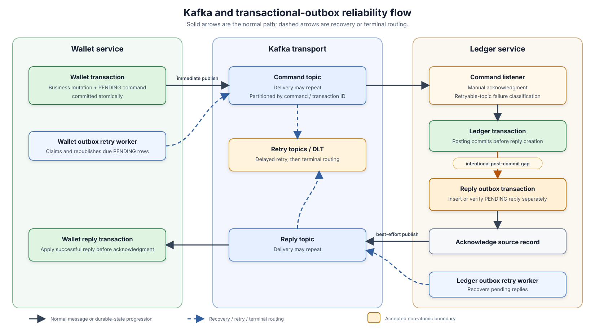

# Kafka Transport, Listener Durability, and Transactional-Outbox Recovery

**Design:** D-001  
**Status:** Verified against the current implementation on 2026-09-09

**Module overview:** [Common Util Overview](common-util-overview.md)

## Reliability model in one minute

The system uses a database outbox to avoid treating an in-memory Kafka send as the source of truth. An event is stored as `PENDING`, publishing is attempted immediately for latency, and a scheduled worker recovers rows that remain pending. A send is successful only when Kafka completes its producer future successfully; the publisher never changes database state. The caller marks the row `SENT` afterward.

This is a **duplicate-permitting, at-least-once attempt model while delivery remains eligible**, not a guarantee that every event eventually arrives. A broker acknowledgment followed by a failed `PENDING → SENT` database update causes a later republish with the same `event_id`. The checked-in producer configuration enables idempotence, but that does not deduplicate application-level republishes, late acknowledgments after the three-second application timeout, or consumer reprocessing. Consumers and business state transitions must therefore be idempotent. This is an adopter contract: common-util coordinates retry and the application acknowledgment call, but every service using the listener must define a stable business identity and make repeated handling safe. With manual acknowledgment, `acknowledge()` records the application's intent to commit the offset; it is not proof that the broker has durably stored that offset before the method returns, so a crash can still redeliver already-processed work.

The two service directions have different durable boundaries:

| Flow | Durable action before listener acknowledgment call | Current classification |
|---|---|---|
| Wallet → Ledger command | Wallet business changes and the request outbox are committed in one Wallet database transaction. | Currently guaranteed by the Wallet call site. |
| Ledger command consumption | Ledger posting commits, then the reply outbox is inserted separately; the listener requests acknowledgment only after the reply row is durable. | Intentional accepted gap. Redelivery and Ledger idempotency mitigate some paths, but do not guarantee clean reply reconstruction. |
| Ledger → Wallet reply consumption | Wallet applies a successful reply in its database transaction; the ack-only listener requests acknowledgment only after the handler returns. | Sequential replay after completion is a no-op. A concurrent loser rolls back through the transaction-status guard but currently fails instead of converging as success. |

There is no current guarantee that every event is eventually delivered: exhausted outbox rows become ineligible while still `PENDING`, and DLT records have logging and metrics but no implemented re-drive or reconciliation workflow.

## Responsibilities and transaction boundaries

| Owner | Responsibility |
|---|---|
| Service business code | Build the domain payload and outbox row; choose event identity, topic, and partition key; decide whether business state and outbox share a transaction. |
| `OutboxRepository` | Insert rows, verify same intent, guard finalization, and coordinate concurrent retry claims. |
| `DefaultPublisher` | Build the common protobuf envelope and map producer acknowledgment, timeout, or failure to `Result<Void>`. |
| `OutboxRetryHandler` | Claim due rows, publish a page concurrently, and finalize acknowledged rows. |
| Common `DefaultListener` | Parse the envelope, classify failures, require a durable listener action before acknowledgment, and start best-effort reply publication. |
| Service listener adapters | Choose request/reply versus ack-only behavior, retry thresholds, DLT policy, public error mapping, and provide effect-level idempotency for every handler that can be retried or redelivered. |

Wallet performs its immediate request publish synchronously after its database commit, so the caller may spend up to the publisher timeout waiting without making Kafka success part of business success. Ledger reply publishing starts asynchronously only after the source acknowledgment call succeeds; a dedicated executor keeps reply finalization work off Kafka producer network threads.

## Message and outbox state model

The stored outbox row contains stable intent plus mutable delivery state:

| Field group | Meaning |
|---|---|
| Intent | `event_type`, unique `event_id`, `command_id`, `destination`, `partition_key`, and raw protobuf `payload`. |
| Delivery state | `outbox_status`, `attempt_count`, `next_attempt_at`, `last_attempt_at`, `last_error`, and `finalized_at`. |
| Audit | `created_at`, `updated_at`, and optional `metadata`. |

The common publisher converts the service-local numeric `event_type` into a wire string and creates `EventEnvelopePb(event_id, command_id, event_type, payload, occurred_at)`. The envelope is rebuilt on every send. Consequently, duplicate deliveries preserve `event_id`, `command_id`, event type, and payload but currently receive a new `occurred_at` value.

| State | Entry and exit behavior |
|---|---|
| `PENDING` | Inserted with `attempt_count = 1` and a future `next_attempt_at`. Both immediate and scheduled publish paths operate from this state. |
| `SENT` | Set only after a successful producer future; updates are guarded by the expected old `PENDING` state. It records transport acknowledgment, not consumer processing. |
| `DEAD` | Declared in the enum and schema model but never entered by current code. |

Both service schemas enforce uniqueness on `event_id` and provide `idx_outbox_claim(outbox_status, next_attempt_at, id)`. The index matches the retry worker's equality filter, due-time range, and oldest-due-first order. `attempt_count` is a retry-budget field, not a complete audit of actual Kafka sends: immediate duplicate attempts do not increment it, while a scheduled claim increments it before the send result is known. The audit timestamps are also approximate: the shared retry path does not update `last_attempt_at` or `last_error`, Wallet immediate finalization reuses the row's pre-send `last_attempt_at`, and retry finalization uses the cycle-start time.

## Publishing and scheduled recovery

`DefaultPublisher` sends the serialized envelope to `destination` with `partition_key`. Its future succeeds only after the `KafkaTemplate` future succeeds. The application applies a three-second timeout without cancelling the underlying send. A timeout is therefore an **unknown transport outcome**, not proof that Kafka rejected the record; a late broker acknowledgment followed by outbox retry can duplicate delivery.

The scheduled recovery cycle works as follows:

1. Capture one fixed right boundary, `now`, for the cycle.
2. In a short database transaction, select the oldest due `PENDING` rows with `attempt_count < maxRetries` using `(next_attempt_at, id)` keyset pagination and `FOR UPDATE SKIP LOCKED`.
3. Claim the page by moving `next_attempt_at` forward and incrementing `attempt_count`, then commit before contacting Kafka.
4. Start every publish in the page before waiting, allowing producer acknowledgments to overlap.
5. Batch-finalize only successful rows from `PENDING` to `SENT`. Failed, timed-out, or incompletely finalized rows remain pending.

The fixed boundary prevents a busy worker from chasing newly eligible rows forever. The tuple cursor is taken from pre-claim values because claiming changes `next_attempt_at`. `SKIP LOCKED` allows multiple service instances to make progress without waiting on the same rows. A skipped row whose competing transaction rolls back is not revisited in that cycle; it is eligible in a later cycle.

The checked-in pre-launch configuration runs the dispatcher every five seconds with pages of two. New rows reserve the intended immediate attempt by starting at count one and are first scheduled roughly 15 seconds later; subsequent claims use the common five-second interval. With `maxRetries = 5`, the claim query stops selecting a row once its count reaches five. These values describe the current wiring, not validated recovery-time or capacity guarantees.

## Listener durability and failure policy

Both service listeners currently use manual acknowledgment, delivery-attempt headers, seven total `@RetryableTopic` attempts, pre-provisioned `.retry-*` topics, and a `.dlq` DLT. Only `KafkaListenerRetriableException` enters the configured retry path. Ledger begins materializing a retry-exhausted reply at attempt five; Wallet keeps retrying through attempt seven and then routes its ack-only failure to DLT. These counts are configuration snapshots rather than tuned service guarantees. The common listener distinguishes two durable actions:

- `OutboxReply`: insert or verify the reply outbox before acknowledging the source record.
- `AckOnly`: trust that the injected service handler completed its durable work before it returned, then acknowledge.

| Condition | Common listener action | Current service behavior |
|---|---|---|
| Envelope cannot be parsed | Throw `DlqException`; no ack and no reply because request identity is unavailable. | Spring routes to DLT. |
| Handler succeeds | Persist/verify `OutboxReply`, or accept `AckOnly`; then acknowledge. | Ledger returns a reply outbox; Wallet is ack-only. |
| Parseable non-retryable or unexpected failure | Ask the service handler for a failure action before ack. | Ledger persists a failure reply. Wallet deliberately throws to DLT rather than silently acknowledging an unapplied reply. |
| Retryable failure below threshold | Rethrow without ack or reply. | Spring routes through retry topics. |
| Retryable failure at/above threshold | Ask for a durable retry-exhausted failure action. | Ledger persists a failure reply from attempt five; Wallet's ack-only policy routes to DLT on its final threshold. |
| Reply insert returns zero rows | Read by `event_id` and classify the existing state. | Same intent is accepted; missing state is retryable ambiguity; different intent is a DLT conflict. |
| Ack call fails after durable work | Add `zx-ack-failed` and throw a retryable exception. | A retry carrying the marker skips business/outbox work and attempts only the ack. |
| Immediate reply publish/finalization fails | Log and suppress the error after source acknowledgment. | The durable reply remains `PENDING` for scheduled recovery. |

The ack-failure marker is an optimization, not the correctness foundation. Its propagation through real retry topics is covered only by unit tests today. If the marker is absent, service business idempotency and reply-outbox same-intent verification must tolerate reprocessing. That fallback is currently incomplete because Ledger can rebuild the same success event ID with different payload detail on idempotent replay.

Envelope parsing validates only protobuf syntax. The common listener does not require nonblank `event_id`, `command_id`, or `event_type`; service handlers reject unsupported types and malformed inner payloads, but there is no shared envelope-identity validation before a parseable failure can become a durable reply.

Retry is part of the common listener's normal contract, not an exceptional add-on. The listener cannot supply business idempotency because it does not own domain identities or state transitions. Its users must make both successful handler effects and any durable reply action safe under duplicate delivery, source-ack failure, retry-topic delivery, and later re-drive. DLT and retry-exhaustion observations may drive alerts and metrics, but business recovery must not depend on receiving either signal.

## Idempotency and ordering boundaries

`event_id` gives durable duplicate detection meaning only when the service chooses it consistently:

- Wallet request IDs are `{commandId}-{process-local sequence}` and the request outbox is co-committed with the Wallet transaction. The database unique key rejects collisions, but the current time-plus-process-local generators are not verified as unique across horizontally scaled instances.
- Ledger reply IDs are deterministic by request event and outcome: `reply:{requestEventId}:success` or `reply:{requestEventId}:error:{namespace}:{errorIdentity}`. Repeating the same reply intent reuses the same ID; a materially different outcome does not collapse into that duplicate.
- Reply same-intent equality compares event type, event ID, command ID, destination, partition key, and payload. Lifecycle timestamps, status, and metadata do not change intent.

The ID rule and payload rule are not fully aligned today. A newly created Ledger success result uses detail `success`, while its Redis/DB idempotent replay uses `already exists`; both use the same success event ID, but the serialized payload bytes differ. If the first reply row already exists when an unmarked source record is redelivered, `insertWithClaimAndVerify` treats this as conflicting intent and sends the record to DLT.

More fundamentally, byte-level payload equality is not a sound way to compare independently reconstructed logical replies. It makes successful deduplication depend on business code reproducing every serialized field—including diagnostic detail—identically on every replay. The proposed future direction avoids that comparison by assigning a UUID to each newly persisted Ledger reply and moving logical outcome convergence to Wallet. Exact payload equality would remain only as protection against reuse of the same UUID. See [Unique Ledger Reply Events and Wallet Outcome Convergence](../proposals/ledger-reply-event-identity.md).

`partition_key` is the transaction/command ID in both current directions, so related records on one topic map to the same Kafka partition while the partition count is stable. Kafka orders records as appended within a partition; this design does not provide global ordering, ordering across the command and reply topics, or preservation of original relative order after non-blocking retry-topic routing. The common retry worker also does not serialize different outbox rows by business key. Current correctness therefore relies on event identity and guarded domain transitions, not on a global message order.

## Guarantees and important failure windows

| Scenario | Current outcome |
|---|---|
| Wallet process crashes after Wallet commit but before publish | The atomic request outbox remains `PENDING`; a later dispatcher can publish it. |
| Broker accepts, then `SENT` finalization fails | The row remains pending and is republished: no exactly-once guarantee. |
| Publisher returns timeout, then broker accepts late | The row remains pending and may be republished; timeout is an unknown outcome. |
| Ledger crashes after posting commit but before Redis completion/reply-outbox insert | If the Redis claim remains `PENDING`, current Kafka retries can exhaust before its 120-second TTL and persist a failure reply even though posting committed. A DB/Redis replay can reconstruct success only when the stale claim no longer blocks it; no current end-to-end mechanism guarantees that re-drive. |
| Ledger reply is inserted, then the process crashes before the source offset is durable | An unmarked redelivery can rebuild the same success ID with different detail bytes and be classified as a reply-outbox conflict; the intended idempotent recovery is incomplete. |
| Ledger reply cannot be persisted before retry/DLT termination | Ledger business may already be committed while Wallet remains unfinalized. The accepted future recovery is a Wallet scheduled job that finds stuck transactions and reposts the same logical Ledger command; it is not implemented yet. |
| Duplicate success reply reaches Wallet | A later sequential replay sees a finalized transaction and succeeds without mutation. Concurrent consumers cannot both commit effects because the losing transaction's status update affects zero rows and rolls back, but that loser currently returns failure and can be routed to DLT rather than acknowledged as an idempotent no-op. |
| Valid Ledger failure reply reaches Wallet | Wallet deliberately throws it into the DLT path and does not compensate the pending Wallet transaction. Compensation is accepted future design work. |
| Outbox reaches `maxRetries` | It remains `PENDING` but is excluded from future claims. No `DEAD` transition or alert is implemented. |
| DLT receives a record | Service DLT handler records a metric and structured log. This is operational detection only; business correctness must not depend on DLT re-drive or reconciliation. |
| Checked-in Docker Kafka loses its single broker | The default deployment uses replication factor one, so the application mechanisms do not provide broker high availability. |

## Trade-offs

The design chooses short database transactions and asynchronous, duplicate-tolerant recovery instead of holding database locks during Kafka I/O or coordinating a distributed transaction. Immediate sends reduce normal-path latency; the outbox remains the durable recovery source. The cost is duplicate delivery, explicit consumer-idempotency requirements, and operational work for terminal cases.

## Future enhancements

Priority follow-ups are:

1. **Detach Wallet's immediate publish from API latency.** Keep the committed outbox as the durable boundary, initiate publication without joining the producer future, and isolate callback/finalization failures; see [Asynchronous Wallet Immediate Outbox Publishing](../proposals/async-wallet-immediate-outbox-publish.md).
2. **Define terminal outbox handling.** Atomically transition exhausted rows to `DEAD`, update `last_attempt_at`/`last_error`, define alerts and operator recovery, and ensure backlog queries do not hide exhausted `PENDING` rows.
3. **Implement Wallet-owned recovery for the accepted Ledger post-commit gap.** Add a scheduled Wallet job that finds stuck transactions and reposts the same logical Ledger command with unchanged business identity and payload. Ledger's business idempotency makes the accounting effect safe to retry. DLT and retry-exhaustion signals should support alerts and metrics only, not gate correctness. Exact stuck-state selection, scheduling, and convergence behavior remain for the Wallet design; the current Ledger reply-payload conflict must also be resolved.
4. **Evaluate unique reply-event identity.** The proposed future optimization assigns a UUID to each newly persisted Ledger reply, keeps that ID stable across outbox publish retries, retains exact-payload conflict detection only for reuse of that UUID, and makes Wallet transaction state the logical convergence boundary. Validate its concurrency, traffic, correlation, failure, and DLT preconditions before implementation; see [Unique Ledger Reply Events and Wallet Outcome Convergence](../proposals/ledger-reply-event-identity.md).
5. **Define reply-outcome lifecycle.** Under the proposed UUID model, failure-then-success and repeated replies are allowed. Define monotonic Wallet handling, terminal no-success recovery, and whether valid failure replies should be acknowledged, observed, reconciled, or routed elsewhere rather than treated as poison messages.
6. **Clarify `occurred_at`.** Decide whether it intentionally means publish-attempt time or should be a stable event creation/occurrence timestamp persisted with the outbox.
7. **Add integration evidence.** Exercise real MySQL concurrent claims, broker timeout/late acknowledgment, retry-topic/DLT routing, ack-marker propagation, and crash/finalization failure windows. Current coverage is primarily unit-level.
8. **Complete operational signals.** Add outbox pending age/count, exhausted/dead rows, claim/finalization outcomes, and Kafka consumer lag after terminal semantics are defined.
9. **Refresh generated protobuf code.** Focused tests emit the protobuf runtime's pre-22 generated-code denial-of-service warning; regenerate the message classes with a supported compiler before treating Kafka parsing as production-hardened.
10. **Tighten identity validation.** Validate required envelope identifiers before creating failure replies, and replace or qualify the process-local service ID generators before claiming collision-free identities across instances.

### Alternative future architecture

A more extensive alternative is to persist each consumed request into a durable inbox, acknowledge Kafka after that local handoff, and move business retry/recovery to an inbox worker. This can absorb source redelivery before business execution and make post-ack recovery queryable, but it introduces a second durable queue and a complete claim/retry/terminal-state lifecycle. It also reopens the Ledger transaction-boundary decision: business changes, reply-outbox insertion, and inbox completion can be atomic, or a durable `BUSINESS_COMPLETED` state can preserve business/reply decoupling. See [Durable Inbox/Outbox Processing Refactor](../proposals/inbox-outbox-processing.md).

## Implementation evidence

The principal executable evidence is `OutboxRepository`, `OutboxRetryHandler`, `DefaultPublisher`, the common `DefaultListener`, and the Wallet/Ledger listener and publisher configurations. The Wallet `BeforePostLedgerProcessor` establishes the atomic command-outbox boundary; `LedgerCommandMessageHandler` and `PostLedgerProcessor` establish the separate Ledger posting and reply-outbox boundary; `WalletLedgerReplyMessageHandler` and `AfterPostLedgerProcessor` establish terminal ack-only consumption.

Focused tests cover producer acknowledgment and timeout mapping, outbox insert decisions and claim SQL, fixed-boundary tuple pagination, listener durable-action-before-ack ordering, retry thresholds, duplicate intent, ack-failure shortcuts, and immediate-publish/finalization failures. The 2026-09-09 verification passed 86 common-util tests, 10 focused Ledger tests, and 8 focused Wallet tests. They do not provide a broker/MySQL end-to-end reliability proof; the root reactor command is also blocked by the missing `client-test` module, so service checks were run from their module POMs.
