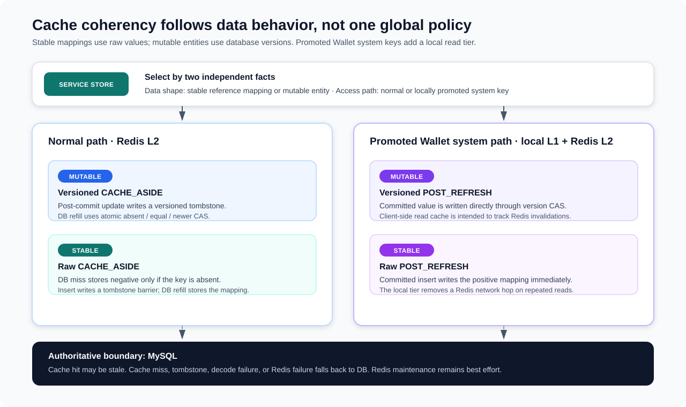

# Redis Cache Coherency and Hot-Data Strategies

**Design:** D-003  
**Status:** Verified against the current implementation on 2026-09-09 (quick pass)

**Module overview:** [Common Util Overview](common-util-overview.md)

## Coherency model in one minute

MySQL is authoritative. Redis accelerates reads, absorbs repeated misses, and reduces stale cache-fill races, but a cache hit is not a linearizable database read. The strategies selected by both services downgrade translated `CacheException`s to failed results, allowing stores to continue through MySQL; unexpected runtime or instrumentation failures are outside that soft-failure contract.

The framework selects consistency mechanics from the data's behavior:

| Data behavior | Encoding and safeguard | Current use |
|---|---|---|
| Mutable entity | `version|marker:content`; Lua accepts absent, equal, or newer versions and rejects older writes. | Wallet balance snapshots; Ledger transactions. |
| Stable reference mapping | `marker:content`; negative entries use `SET NX`, and insertion establishes a tombstone or positive value. | Wallet `(service, reference) → wallet ID`; Ledger reference → transaction ID. |
| Normal mutable reads/writes | Redis read-through plus `CACHE_ASIDE`: committed updates install a versioned tombstone, then a later DB read refills by CAS. | User Wallet snapshots; Ledger transaction cache. |
| Hot mutable reads/writes | Redisson client-side L1 over Redis L2 plus `POST_REFRESH`: committed values are refreshed by version CAS. | Locally promoted system-owned Wallet snapshots. |
| Hot reads / rare writes | Client-side L1 over a raw Redis mapping; `POST_REFRESH` writes the positive mapping after insert. | Locally promoted system-owned Wallet reference mappings. |

“Hot” is a Wallet-specific routing choice, not a separate source of truth. Normal and hot strategies share the same Redis keys. A process promotes system-owned wallet and scoped-reference IDs after observing them; subsequent reads on that process use Redisson's client-side reader.

## Cache states and read contract

Raw values use `S:<string>`, `J:<json>`, `N:`, or `T:`. Versioned values prefix the same representation, for example `17|J:<json>` or `17|T:`. `ValueCodec` and `VersionCodec` expose four typed outcomes:

| Read status | Store behavior |
|---|---|
| `VALUE_HIT` | Return the decoded value. |
| `NEGATIVE_HIT` | Return not found without querying MySQL or renewing the negative TTL. |
| `CACHE_MISS` | Query MySQL, then best-effort fill a value or negative entry. |
| `TOMBSTONE_HIT` | Query MySQL and attempt a fresh fill; a tombstone is a race barrier, not a not-found result. |

Malformed markers, versions, or JSON raise a translated cache error. The configured self-recovery hook attempts to delete the bad key; the exception-suppressing strategy converts the error to a failed `Result`, and the store falls back to MySQL. Read and delete are not atomic, so recovery can remove a valid value installed concurrently. This affects cache efficiency rather than authoritative database state.

## Read paths and L1/L2 behavior

Both service stores implement the same read-through pattern:

1. Select the registered strategy and read the cache.
2. Return a value or stable negative hit immediately.
3. On miss, tombstone, or cache failure, query MySQL.
4. Best-effort refill the value, or write a negative entry only after a real DB miss.
5. For a positive reference hit whose entity is missing, query again by reference instead of trusting the stale mapping.

Ledger uses normal Redis reads only. Wallet adds client-side reads for IDs promoted by `DefaultPromotionClassifier`:

- Promotion is lazy, process-local, and limited to `OwnerType.SYSTEM`; the first read can use the normal strategy.
- The classifier is a concurrent in-memory set with no expiry, size bound, or demotion. Promotion is lost on restart and can differ across instances.
- The Redisson client-side cache uses RESP3 and has a configured local lifetime; the code intends Redis server-assisted invalidation to keep L1 aligned with L2. No retained integration evidence currently proves invalidation behavior for the deployed Redis/Redisson combination.
- L1 changes latency, not correctness. A local miss continues to Redis, and a Redis/cache error still reaches MySQL through the store fallback.

The checked-in services do not override `RedissonProperties`' default 100-millisecond client-side lifetime. This and every other numeric cache setting are pre-launch snapshots rather than validated freshness or performance contracts.

## Database writes and cache actions

Cache maintenance is deliberately outside the authoritative business transaction.

| Strategy event | `CACHE_ASIDE` | `POST_REFRESH` |
|---|---|---|
| DB hit | Store the value; versioned values use Lua CAS. | Same. |
| DB miss | If enabled, write a negative entry with `SET NX`. | Same. |
| Insert | If negative caching is enabled, install a tombstone; otherwise do nothing. | Store the committed value immediately. |
| Update | Raw cache writes the value; versioned cache installs a same-version tombstone. | Store the committed value immediately; versioned cache uses CAS. |

Wallet's transaction processors call `BalanceSnapshotStore.postDbUpdate` only after `DbTxnExecutor` returns successfully, so balance cache work follows the database commit. Wallet creation and Ledger posting similarly call their `postInsert` hooks after their database operations succeed. Cache failures are logged and do not change those results.

`LedgerTxnStore.updateMetadataByPk` orders the repository update before its cache hook, but no current production call site uses that metadata-update method; its exercised adoption is integration-test-oriented. Therefore, the active Ledger transaction cache is primarily a read-through cache for rarely modified records, while its versioned update path demonstrates the reusable mutable-entity mechanism.

## Version CAS and tombstone protection

`set-if-absent-or-newer.lua` atomically reads the current Redis value, extracts its version, and writes only when `newVersion >= oldVersion`. This closes the classic stale-fill race:

1. Reader A misses and begins a database query at version 4.
2. Writer B commits version 5 and installs either version-5 data or a version-5 tombstone.
3. Reader A finishes late and tries to cache version 4.
4. Lua rejects version 4, preserving the newer cache state.

Equal-version overwrite is intentional. The version represents the database revision, so equal versions are expected to carry the same cache-visible entity. Equality also lets version-0 data or a version-0 tombstone replace a version-0 negative entry. This guarantee requires every cache-visible mutation to advance the database version; different payloads at one version would break the contract.

A cache-aside update writes a tombstone with the newly committed version. A following read treats it as a DB-reload signal and can replace it with equal-version data. For inserts, a tombstone prevents a delayed pre-insert miss from installing a negative value; negative writes are `SET NX`, so they cannot overwrite the marker or a positive mapping.

The tombstone is temporary. It materially reduces stale repopulation only while its TTL covers the in-flight read/fill window and Redis is available. An unusually delayed fill can arrive after expiry, and a failed tombstone write can leave the previous cached value in place. The current entity and tombstone TTLs are 120 seconds, reference TTL is one hour, negative TTL is 30 seconds, and positive jitter is 0–99 milliseconds. These values are not yet validated operating bounds.

## Current adoption

| Cache | Shape | Strategy | Negative cache | Client-side L1 |
|---|---|---|---|---|
| Wallet normal snapshot | Mutable entity | Versioned `CACHE_ASIDE` | Disabled | No |
| Wallet promoted system snapshot | Hot mutable entity | Versioned `POST_REFRESH` | Enabled | Yes |
| Wallet normal reference | Stable mapping | Raw `CACHE_ASIDE` | Enabled | No |
| Wallet promoted system reference | Hot stable mapping | Raw `POST_REFRESH` | Enabled | Yes |
| Ledger transaction | Rarely modified entity | Versioned `CACHE_ASIDE` | Disabled | No |
| Ledger reference | Stable mapping | Raw `CACHE_ASIDE` | Enabled | No |

Reference mappings are cached separately from entities to avoid duplicating mutable objects under two keys. A reference hit resolves the entity ID and then enters the entity cache path. The two keys are not updated atomically, but the store's DB-by-reference fallback repairs stale or incomplete composition on demand.

## Guarantees and failure boundaries

| Classification | Current behavior |
|---|---|
| **Authoritative** | MySQL owns stored values and versions; business writes do not depend on Redis success. |
| **Atomic in Redis** | Versioned writes reject older revisions in one Lua execution; negative writes cannot replace an existing positive value or tombstone. |
| **Best effort** | Post-commit refresh, tombstone installation, malformed-value cleanup, and reference/entity cache repair when failures are represented as `CacheException`/failed `Result`. |
| **Bounded by expiry/configuration** | Old entries left by failed cache maintenance, negative entries, tombstones, and local L1 entries. Numeric TTL adequacy is unvalidated. |
| **Not guaranteed** | Linearizable reads, read-your-write across instances, a numerical maximum stale-read window, cache-fill single-flight, deterministic cluster-wide hot classification, or verified Redisson tracking behavior. |

Important failure scenarios are:

- **Redis unavailable:** the read path queries MySQL; a failed post-commit cache action leaves database success intact.
- **Refresh/tombstone fails after commit:** an older cached value may remain until Redis expiry. Wallet normal reads explicitly tolerate occasional staleness; the intended real-time mode is a direct DB read, but no separate public bypass path is implemented yet.
- **Concurrent cache fills:** multiple misses or tombstone hits can query MySQL simultaneously. Version CAS prevents an older entity revision from winning, but the framework has no request coalescing.
- **Unpromoted system-key write:** that process uses the normal cache-aside strategy and writes a tombstone rather than direct post-refresh. Correctness still falls back to DB, but the intended hot path is temporarily lost.
- **Malformed version in Lua:** a missing `|` is defensively overwritten, but a non-numeric old version can make the script fail; the service suppresses the cache failure and uses MySQL.
- **Unexpected or metric failure:** the selected soft-failure wrapper catches `CacheException`, not every runtime exception. An unguarded metric failure can therefore alter the caller-visible outcome even when the database operation already committed; it cannot roll back that commit.
- **Stable mapping changes:** raw mappings have no version ordering. Their safety depends on the current service invariant that reference-to-ID mappings do not change after creation.

## Observability and performance

Metric decorators count cache outcomes by bounded cache type: value hit, miss, negative hit, tombstone hit, and error. They also record failures by operation and normalized error type. Low-level RedisTemplate, Redisson client-side, and Lua operations emit duration timers. These signals can distinguish ordinary miss pressure, tombstone-triggered reloads, corruption, and Redis latency; they do not measure end-to-end staleness or prove L1 invalidation correctness.

TTL jitter spreads expirations slightly to reduce synchronized churn. Client-side caching can remove one Redis network hop for repeated promoted reads, while `POST_REFRESH` avoids the next read paying a DB refill. No current benchmark isolates either gain, so the document makes no latency or capacity claim.

## Trade-offs

The design favors database correctness and service availability over strongly fresh cached reads. Keeping Redis outside database transactions avoids coupling business success to cache availability, but creates an unavoidable post-commit window and makes cache freshness best effort.

Versioned entities pay serialization and Lua costs to reject stale fills. Stable mappings avoid that overhead because their identity is intended to be immutable. Wallet's local L1 targets a known system-owned hot set without changing store APIs, at the cost of process-local promotion state and an additional client whose invalidation behavior must match the deployed environment.

## Future enhancements

1. Add focused common-util tests for both codecs, all four read states, strategy transitions, negative/tombstone races, and Lua absent/equal/older/newer/malformed cases.
2. Validate Redisson client-side caching against the deployed Redis/Redisson versions, including writes made through RedisTemplate and Lua, disconnect/reconnect behavior, invalidation timing, and the local TTL fallback.
3. Replace or bound the process-lifetime promotion sets if the system-owned key population can grow materially; evaluate deterministic routing or expiry/demotion rather than inferring cluster-wide hotness from local observation.
4. Expose and test the intended Wallet real-time read mode that bypasses Redis, and define which callers may use it without turning MySQL into an uncontrolled hot path.
5. Consider cache-fill coalescing only if metrics show tombstone or miss-driven database bursts; it is not required for current correctness.
6. Harden write-side malformed-version handling so every invalid existing value takes a deterministic recovery path instead of relying on service fallback.

## Implementation evidence

The shared design is implemented by `CacheReadResult`, the raw and versioned codecs and strategies, `VersionCacheWriter`, `RawCacheWriter`, `set-if-absent-or-newer.lua`, exception suppression, self-recovery features, Redisson client-side support, and cache/Redis metric decorators.

Current adoption is established by `BalanceSnapshotCacheRegister`, `BalanceSnapshotStore`, Wallet's post-commit transaction cache calls and process-local promotion register, plus `LedgerCacheRegister`, `LedgerTxnStore`, both services' cache configuration, versioned entities, and checked-in schemas. Focused service tests cover strategy decoration, Ledger negative-hit behavior, DB fallback for stale reference mappings, and Ledger's metadata/tombstone exercise. There is no direct common-util cache correctness suite or retained live Redis client-side invalidation test.
