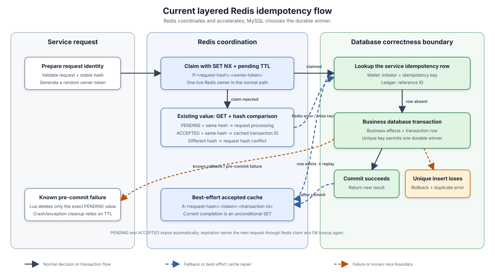

# Layered Redis Idempotency Coordination

**Design:** D-002  
**Status:** Verified against the current implementation on 2026-09-09 (quick pass)

**Module overview:** [Common Util Overview](common-util-overview.md)

## Layered model in one minute

Redis is a coordination and acceleration layer. It normally admits one live owner, rejects a conflicting request hash while the key is visible, reports an in-flight duplicate, and caches the completed transaction ID for fast replay. Redis failure does not fail the business operation: Wallet and Ledger continue through their database lookup and transaction paths.

The database is the final duplicate-effect boundary. Wallet has a unique key on `(initiator, idempotency_key)`; Ledger has a unique key on `reference_id`. Each transaction row is committed with its associated business writes, so a losing unique insert rolls back that attempt. The current database rows do not store the request hash, however. They prevent two durable effects for one database identity, but cannot prove that a later request has the same intent after Redis expires or loses data.

| Layer | Current responsibility | Current guarantee |
|---|---|---|
| Service request preparation | Validate input, build a stable request hash, and generate a per-attempt owner token. | Equivalent field sets are intended to produce the same hash; this is service-defined. |
| Shared Redis idempotency client | Claim, read and compare, cache completion, release an owned pending value, normalize errors, and emit bounded metrics. | Fast coordination while Redis state is available. |
| Service database transaction | Persist the transaction identity with all business changes and any required outbox row. | Unique keys and rollback prevent a losing attempt from committing duplicate effects. |
| Service processor | Interpret Redis outcomes, query the database, return replay/conflict/processing results, and decide when cleanup is safe. | Redis errors degrade to the database path. |

## Redis protocol and states

The shared key is `idemp_k:{service}:{scope}:{idempotency-id}`. Current scopes are:

| Service | Redis scope and identity | Durable database identity |
|---|---|---|
| Wallet | `wallet:post_transaction:{idempotency_key}` | `(initiator, idempotency_key)` |
| Ledger | `ledger:post_ledger:{reference_id}` | `reference_id` |

Wallet's Redis identity currently omits `initiator`, although its database uniqueness includes it. Two initiators using the same idempotency key can therefore conflict in Redis even though the database treats them as separate identities.

Values use an intentionally simple colon-delimited representation:

| State | Stored value | Meaning and transition |
|---|---|---|
| Absent | — | A caller may atomically claim with `SET NX` and a pending TTL. |
| `PENDING` | `P:{hash}:{token}` | The token identifies the claimant. A matching request receives `REQUEST_IN_PROCESSING`; a different visible hash receives `REQUEST_HASH_CONFLICT`. |
| `ACCEPTED` | `A:{hash}:{token}:{transaction-id}` | A matching request replays the transaction ID; a different visible hash receives a conflict. The value expires after the done TTL. |

The current service configuration uses a 120-second pending TTL, a 24-hour accepted TTL, and up to 99 milliseconds of positive jitter where jitter is applied. These are pre-launch configuration snapshots, not validated timing guarantees. Wallet's normal post-commit completion currently uses the exact done TTL; its replay path and Ledger's paths add jitter.

The format assumes the service, scope, identity, hash, token, and accepted content do not contain `:`. This constraint is intentional for simple Lua handling and is acceptable for current internal values. Parsing rejects malformed accepted values, while a pending value with extra segments is currently tolerated and its extra data is ignored.

## Request hashes and owner tokens

Both services sort repeated line/entry inputs before hashing, so request-list ordering does not change the intended identity.

| Service | Hash input |
|---|---|
| Wallet | Reference ID, initiator, idempotency key, business type, transaction type, request type, and sorted transaction-line fields. |
| Ledger | Reference ID, description, and sorted entry fields: account reference, direction, amount, and asset. |

`StableHashHelper` applies Murmur3-128 and stores its `asLong()` decimal representation. The hash is a compact comparison signal, not a persisted canonical request. Its correctness depends on deterministic, unambiguous service serialization and acceptable collision risk; neither service currently persists it in MySQL.

Each attempt receives a UUID-based token. Token ownership is enforced only during release: the Lua script atomically compares the complete current value with the expected `P:{hash}:{token}` and deletes it only on an exact match. A stale worker therefore cannot release another worker's pending claim.

Completion has weaker semantics. `markIdempDone` accepts the token but performs an unconditional `SET` of the accepted value. It does not confirm that the token still owns `PENDING`, so an expired owner can overwrite a newer claim or recreate an already expired key.

## Main decision flow

1. The service validates the request, computes its hash, and generates a token before business mutation.
2. `claimIdempIfAbsent` atomically writes `PENDING` with a TTL. A successful claim proceeds to a database lookup because Redis may have lost an earlier accepted value.
3. If the claim is rejected, the client reads and parses the current value, then compares its hash. Matching `PENDING` becomes `REQUEST_IN_PROCESSING`; matching `ACCEPTED` returns the cached transaction ID; mismatch becomes `REQUEST_HASH_CONFLICT`.
4. Redis claim/read failures become typed failed `Result` values. Both services log the failure and continue with their database lookup. A claim-rejected key that expires before the following `GET` also reaches this path without a new Redis claim.
5. An existing database row is treated as a replay and its transaction ID repopulates `ACCEPTED`. Because the database has no request hash, this replay does not validate request equivalence.
6. If no row exists, the service runs its database transaction. Wallet commits balance/reservation/action changes, the Wallet transaction, and any command outbox together. Ledger commits its transaction and entries together.
7. The unique transaction identity chooses one durable winner. `DbTxnExecutor` marks a failed `Result` rollback-only, so a duplicate transaction insert rolls back preceding writes in the same attempt. The loser currently receives a duplicate error rather than the winner's replay result.
8. After commit, the service writes `ACCEPTED` best effort. Failure does not reverse the committed database result, but a surviving `PENDING` value can temporarily mask it from duplicate requests. After that value expires—or when Redis lookup fails—a later request can reach the database row and repair the cache.

## Expiration, cleanup, and retries

- A known failure before commit, or a database transaction that returns a failed `Result` and rolls back, triggers token-owned Lua release. A mismatched or already missing value is left untouched.
- A process crash, a post-commit completion failure, or an exception that bypasses the service's error-return path can leave `PENDING` until its TTL expires. There is no lease renewal or background idempotency cleanup worker. Whether the database operation committed determines the consequence, but stale coordination state is the underlying condition.
- When `PENDING` expires during a slow operation, another caller can claim and execute concurrently. Database uniqueness still prevents two matching durable transaction identities from committing, but it does not prevent duplicate computation or contention.
- When `ACCEPTED` expires, the next caller can claim, look up the database row, return its transaction ID, and recreate the accepted cache. Request equivalence is not checked on this path today.
- Wallet returns `REQUEST_IN_PROCESSING` to its caller. Ledger's Kafka adapter classifies the same outcome as retryable, so the transport retry path invokes it again later; the [Kafka reliability design](kafka-outbox-reliability.md) owns those transport details.
- The shared wrapper does not retry Redis operations internally. Service fallback is immediate, which avoids making Redis availability a prerequisite for business progress.

Malformed values are treated as cache corruption. Wallet and Ledger force-delete the key and continue to the database. Because `GET` and deletion are separate operations, this recovery can delete a valid value installed concurrently; database uniqueness remains the effect-level backstop.

## Guarantees and race boundaries

| Classification | Current behavior |
|---|---|
| **Guaranteed by Redis while the key is live** | `SET NX` admits one claimant for that key; exact-value Lua release cannot delete another owner's value. |
| **Guaranteed by the service database** | At most one Wallet transaction per `(initiator, idempotency_key)` and one Ledger transaction per `reference_id` can commit. Related business writes roll back when the duplicate insert returns a failed transaction result. |
| **Best effort** | Completed transaction IDs are cached after commit; Redis errors are logged and measured, then services use the database path. |
| **Conditional** | Same-key/different-request conflicts are detected only while a parseable Redis value with the original hash remains visible. Fast replay trusts accepted content. |
| **Not currently guaranteed** | Request-equivalence checks after Redis loss/expiry; atomic token-owned completion; replay of the winning result after a duplicate-insert race; exact historical response reconstruction; Wallet Redis/DB scope parity. |

The most important race is pending expiration. Worker A can claim, outlive its TTL, and commit after worker B claims the same key. Database uniqueness still chooses one durable row, but A's unconditional completion can overwrite B's Redis claim. Token ownership therefore protects cleanup but not completion.

## Failure behavior and observability

| Failure window | Current outcome |
|---|---|
| Redis unavailable before processing | Query the database; if absent, execute and rely on its unique key. |
| Redis disappears after database commit | Business success remains committed; a later request can repopulate Redis. |
| Redis completion fails while the original `PENDING` value remains | The database result remains authoritative, but matching duplicates can receive `REQUEST_IN_PROCESSING` until the claim expires; a transport retry window can end before DB replay becomes reachable. |
| Accepted entry expires and a different request reuses the key | The database row is returned as a replay because no durable request hash exists. |
| Two callers both observe no database row | Both may execute; one commits, while the unique-key loser rolls back and receives a duplicate error. |
| Old owner completes after its pending TTL expires | Unconditional `markIdempDone` can overwrite the new owner's Redis value. |
| Release races with completion or another owner | Exact-value Lua comparison prevents deletion unless the original pending value still matches. |
| Malformed value is replaced between read and deletion | Force-delete may remove the replacement; later requests fall back to database uniqueness. |

`DefaultIdempotencyClient` converts translated cache exceptions and unexpected runtime exceptions into typed failures. It increments `zexchange.idempotency.errors` with bounded `service`, `scope`, `operation`, and normalized `error_type` tags. The metered Redis value and script adapters also time low-level operations. Claim rejection, replay, and processing are normal outcomes and are not counted by the error metric.

## Trade-offs

The design keeps Redis outside the business transaction and allows it to fail independently. This reduces normal duplicate work and gives fast replay without coupling business availability to Redis. The cost is a two-layer protocol whose guarantees differ: TTL expiry can admit overlapping work, and the database currently guarantees one effect without retaining enough information to validate the original request.

The compact delimiter format is easy to inspect and simple for Lua. It relies on internal value constraints rather than a general escaping scheme. Short pending leases recover abandoned claims automatically, while any lease shorter than real processing time increases overlap and stale-owner races.

## Future enhancements

The accepted next direction is [DB-Authoritative Idempotency with Redis-Owned Claims](../proposals/redis-idempotency-db-authoritative.md). It preserves Redis as the coordination layer while closing the current gaps:

1. Persist an immutable canonical request hash with each Wallet and Ledger transaction and compare it on every database replay and duplicate-race resolution.
2. Replace unconditional completion with an atomic `markIdempDoneIfOwned` transition. Lost ownership must not overwrite Redis or turn an already committed database result into a business failure.
3. Align Wallet's Redis identity with its `(initiator, idempotency_key)` database scope.
4. Resolve a losing unique insert by reading the durable winner and returning replay or conflict rather than a generic duplicate error.
5. Choose and test an unambiguous canonical request encoding. The pre-launch system can introduce the target protocol directly without a compatibility-version segment.

Open design choices are whether exact replay requires a persisted response snapshot, whether legitimate processing durations justify lease renewal or fencing, and which Lua-friendly encoding should represent the target state.

## Implementation evidence

The shared protocol is implemented by `IdempotencyClient`, `DefaultIdempotencyClient`, `IdempRedisClient`, `CommonIdempHelper`, and `release-idemp-if-owned.lua`. `BaseRedisSupport` supplies Redis primitives, `CacheExceptionTranslateAop` normalizes client failures, and the metered wrappers provide timing and error signals.

Current adoption is established by Wallet's `IdempPrecheckProcessor` and `BeforePostLedgerProcessor`, Ledger's `PostLedgerProcessor`, their request-hash builders, `DbTxnExecutor`, transaction repositories/entities, checked-in schemas, and Ledger's Kafka handler. Focused tests cover Wallet Redis fallback, visible hash conflict, malformed-value recovery, and the Redis claim/release Lua behavior. The Redis integration test uses a fixed external address and is excluded from the default Surefire naming pattern; it is evidence of intended integration coverage rather than a reproducible test in this documentation pass.
