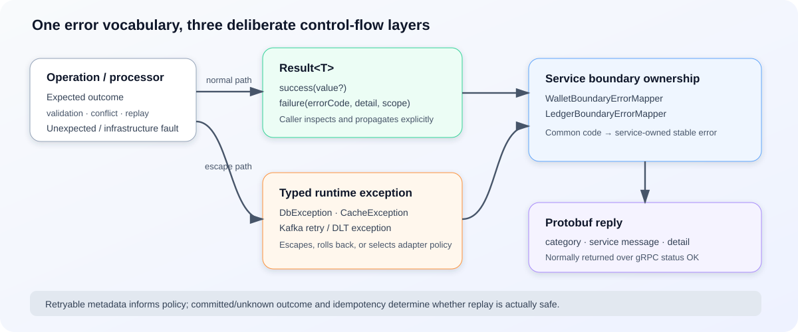

# Shared Result, Error, Exception, and Boundary Contract

**Design:** D-005  
**Status:** Verified against the current implementation on 2026-09-09 (quick pass)

**Module overview:** [Common Util Overview](common-util-overview.md)

## Contract in one minute

The shared contract separates three concerns:

1. `Result<T>` represents an expected operation outcome that callers must inspect.
2. Typed runtime exceptions carry the same `ErrorCode` vocabulary when control must escape the current call, trigger rollback, or select Kafka retry/DLT behavior.
3. Wallet and Ledger own their public error surfaces. Boundary mappers translate common failures before protobuf conversion, so dependency-specific codes do not leak to clients.

This is a control-flow convention rather than one automatic global policy. Each integration layer chooses its deliberate conversion point: cache and idempotency wrappers commonly downgrade infrastructure exceptions to failed results; database failures normally remain exceptions; Kafka adapters convert typed failures into retry or DLT actions; gRPC services catch unexpected exceptions and return a service-owned server error inside the reply payload.

## Result state model

`Result<T>` is immutable and factory-created. Its constructor enforces the states below.

| State | Value | Error code | Detail / scope |
|---|---|---|---|
| Success | Optional, including `null` | Must be absent | Optional metadata |
| Failure | Must be absent | Required | Optional metadata |

`Result.failure(existingFailure)` changes the generic type while preserving error code, detail, and scope; it rejects a successful input. `Result.from(...)` copies either state and can replace only the success value. `Result.is(result, code)` provides a null-safe exact error-code comparison.

A successful `null` value is valid and is used to represent a cache or database miss. It is therefore different from a `null` `Result`, which violates the effective method contract. Defensive treatment is not uniform: metrics and several adapters classify a null result as an internal error, while ordinary processors often dereference it directly. Implementations returning `Result` should always return a non-null instance.

The transaction executor gives a failed result operational meaning: if a database callback returns failure, `DbTxnExecutor` marks the transaction rollback-only. [Database Foundation](database-foundation.md) owns the exact transaction and exception boundary.

## Error identity and taxonomy

Every `ErrorCode` supplies four fields:

| Field | Purpose |
|---|---|
| `namespace` | Owning domain such as `db`, `redis`, `idemp`, `cache`, `outbox`, `kafka`, `wallet`, or `ledger`. |
| `code` | Numeric identifier within that owner. It is not globally unique by itself. |
| `message` | Stable machine-oriented name such as `db_timeout` or `wallet_not_found`. |
| `category` | Transport-neutral class used for boundary conversion. |

The common categories are `INTERNAL`, `UNAVAILABLE`, `FAILED_PRECONDITION`, `CONFLICT`, `PROCESSING`, `INVALID_ARGUMENT`, `UNAUTHENTICATED`, `UNAUTHORIZED`, `NOT_FOUND`, and `ALREADY_EXISTS`. Common infrastructure families refine those categories:

- database codes distinguish internal, timeout, unavailable, and transient failures;
- Redis codes distinguish connection, timeout, access, serialization or malformed state, script, configuration, and unexpected failures;
- idempotency exposes request-hash conflict;
- Kafka producer/listener codes identify publish, parse, retry exhaustion, reply-outbox, listener, and acknowledgment failures;
- cache and outbox expose their current contract or internal failures.

Retryability is opt-in through `RetryableErrorCode`; it is currently implemented by database and Kafka error enums. A category of `UNAVAILABLE` alone is not a safe-retry guarantee. Replay safety also depends on whether an effect committed and whether the request has complete idempotency protection.

## Result versus exception policy

The executable convention is:

| Situation | Current representation | Why |
|---|---|---|
| Expected validation, business rejection, duplicate, in-progress state, or successful replay | `Result` or a use-case-specific result object | The caller can continue normal control flow and preserve a stable outcome. |
| Cache or Redis failure on a soft-dependency path | `CacheException` internally, deliberately downgraded to failed `Result` by the selected strategy/idempotency wrapper | The service can fall back to MySQL or continue after a best-effort cache action. |
| Database resource, statement, or transaction failure | Typed `DbException` when recognized; original exception otherwise | The failure must escape the callback to roll back and let the surrounding workflow choose retry or recovery. |
| Kafka listener retry or DLT decision | `KafkaListenerRetriableException` or `DlqException` | Exception type is the adapter signal consumed by Spring Kafka policy. |
| Programming defect, malformed internal state, or unexpected failure | Runtime exception until an explicit boundary catches it | It must not be mistaken for a normal business rejection. |

Conversions are intentional and local. `CacheExceptionTranslateAop` classifies Spring Data/Redisson failures into `CacheException`. `StrategyFactory` and `DefaultIdempotencyClient` convert those failures into results at soft-failure boundaries. The unused `CacheExceptionToResultAop` is retained but has no active annotation adoption. `DbExceptionTranslateAop` preserves or creates typed database exceptions rather than downgrading them.

Kafka illustrates why representation depends on the boundary. A service handler may turn a failed `Result` into a `CustomizedException`; the common listener then decides whether to retry, persist a failure reply, or route to DLT. The error identity is preserved even though control flow changes from value to exception.

## Public boundary mapping

Wallet and Ledger processors may return service-owned codes directly. If a failed `Result` carries a common code, `WalletBoundaryErrorMapper` or `LedgerBoundaryErrorMapper` normalizes it before `PbErrorBuilder` creates `ErrorPb`.

Current mappings are intentionally narrow:

| Internal error | Public service error today |
|---|---|
| Existing Wallet or Ledger code | Preserved. |
| `IdempErrorCode.HASH_CONFLICT` | Service `REQUEST_HASH_CONFLICT`. |
| Recognized common DB, Redis, cache, or outbox families | Service `INTERNAL_ERROR`. |
| Common Kafka family | Ledger maps to `INTERNAL_ERROR`; Wallet reaches the generic fallback if presented. |
| Null or unknown foreign code | Service `INTERNAL_ERROR`; unknown non-null codes are logged. |
| Exception escaping a gRPC processor | Service `SERVER_ERROR`. |

`ProtoErrorMapper` converts the service code's category to the shared protobuf `ErrorCodePb`. `PbErrorBuilder` publishes that category, the service code's stable message, and detail. It does not publish the internal namespace or numeric code. `scope` is not included in the current protobuf error.

Business failures are embedded in normal protobuf replies. Current service implementations call `onNext` and `onCompleted`, so the gRPC transport status is normally `OK` even when `ErrorPb` describes a business or server failure. Callers must inspect the reply error; transport status alone is insufficient.

Remote failures are also re-owned. For example, Wallet wraps an upstream Ledger `ErrorPb` in a Wallet failure and retains upstream facts only in diagnostic detail rather than exposing the Ledger code as Wallet's public contract.

The accepted future refinement is [Public Infrastructure Error Boundary Policy](../proposals/public-infrastructure-error-boundary-policy.md): selected temporary failures may become a service-owned `UNAVAILABLE` only after fallback or retry is exhausted and replay is known safe. Current mappers have TODOs but still collapse those failures to internal errors.

## Guarantees and failure boundaries

| Classification | Current behavior |
|---|---|
| **Guaranteed by `Result`** | Success, failure, value, and error-code states cannot contradict each other; failure propagation preserves code, detail, and scope. |
| **Stable ownership boundary** | Public replies use service-owned messages and shared categories rather than common-util namespaces/codes. |
| **Explicit, not automatic** | Callers must inspect failed results; unchecked results do not throw themselves. |
| **Context-dependent retry** | A retryable marker informs infrastructure policy but does not prove end-to-end replay safety. |
| **Not guaranteed** | A non-null result from every implementation, public exposure or redaction safety of detail, cross-service parity for every common namespace, or public `UNAVAILABLE` for retryable infrastructure failures. |

Important failure cases are:

- **Failed result ignored:** the type cannot force a caller to branch; an effect may continue unless the surrounding transaction or workflow checks it.
- **Null result returned:** callers may throw before a stable mapping. Some boundaries convert it to a server/internal outcome, but this is defensive rather than a valid state.
- **Unknown common code reaches a service:** the mapper logs the metadata and returns `INTERNAL_ERROR`, preserving API stability at the cost of specificity.
- **Typed exception bypasses a result mapper:** the gRPC guard returns `SERVER_ERROR`; Kafka instead uses exception type and error metadata for retry or DLT behavior.
- **Retryable flag used without outcome analysis:** blindly retrying an unknown commit or acknowledgment result can duplicate work; retryability is necessary but not sufficient.
- **Detail crosses a boundary:** current `PbErrorBuilder` forwards detail, while no project-wide redaction or sensitivity policy is enforced.

## Trade-offs

A value-based failure contract makes business branching and transaction rollback intent visible without exception-driven normal flow. It also depends on disciplined propagation and allows valid success-with-null semantics that readers must distinguish from an invalid null result.

Namespaced internal errors give infrastructure precise classification while service-owned mapping keeps APIs stable. The cost is deliberate information loss at the public boundary and mapper maintenance when a new common family appears.

Embedding errors in protobuf replies keeps one uniform response shape, but gRPC transport metrics cannot identify business failures; the [Shared Observability](../operations/observability.md) service-level result metrics provide that view.

## Future enhancements

1. Implement and test the accepted selective `UNAVAILABLE` policy in both service mappers, including unknown-result and replay-safety cases.
2. Define whether `detail` and `scope` may cross RPC or event boundaries, including redaction, size, and logging rules. Until then, treat them as diagnostic metadata rather than a stable public schema.
3. Add focused tests for `Result` factories/invariants, namespace-and-code uniqueness, complete category-to-protobuf mapping, boundary fallbacks, and Wallet/Ledger mapper parity where parity is intended.
4. Consider a static rule or helper for propagating failed results so unchecked failures and accidental null returns are easier to detect.

## Implementation evidence

The shared model is implemented by `Result`, `IResult`, `ErrorCode`, `ErrorCategory`, `RetryableErrorCode`, the common error enums, `CustomThrowable`, `CustomizedException`, and the database, cache, and listener exception specializations. Conversion behavior is implemented by DB and cache AOP, `StrategyFactory`, `DefaultIdempotencyClient`, `DefaultListener`, and service handlers.

Current adoption is established by the Wallet/Ledger error enums, boundary mappers, protobuf mappers/builders, gRPC services, Kafka handlers, database transaction callers, cache stores, publisher/outbox flows, and service business metrics. The shared protobuf defines category, message, and detail but no namespace, numeric service code, or scope. Existing tests exercise many outcomes indirectly, but no focused end-to-end taxonomy/boundary suite currently locks the complete contract.
