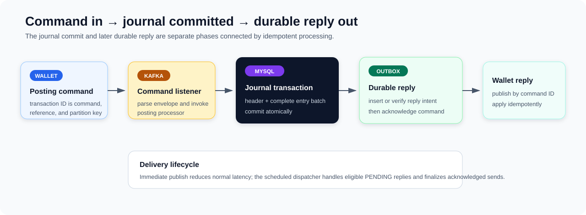

# Ledger Service Overview

**Scope:** passive accounting journal for Wallet-originated transactions  
**Evidence state:** synthesized from verified D-007–D-011 on 2026-09-09

## Ledger in five minutes



Ledger is the accounting boundary of z-exchange. Wallet decides whether an operation is allowed and converts it into debit and credit entries; Ledger validates that the submitted journal balances per asset and appends it. Ledger does not maintain spendable balances or reservations, so the business state machine stays in Wallet while accounting records remain independently queryable.

The active service-to-service write path is asynchronous Kafka. Redis accelerates coordination and reads, MySQL remains authoritative, and an outbox makes the result reply independently retryable.

This flow separates three kinds of correctness: application validation establishes the accounting shape, a database transaction makes the header and entries atomic, and unique keys select one durable effect for a business reference. The details are in [Posting and Accounting Correctness](posting-and-accounting-correctness.md) and [Posting Idempotency and Replay](posting-idempotency-and-replay.md).

## Responsibilities and boundaries

| Ledger owns | Ledger relies on elsewhere |
|---|---|
| Per-asset debit/credit validation | Wallet authorization, balances, reservations, and transaction decisions |
| Resolution of submitted account references | Wallet constructing the intended accounting entries |
| Atomic journal append and durable reference uniqueness | Kafka/outbox duplicate-tolerant delivery and bounded retry |
| Idempotent posting decisions and Ledger transaction identity | Wallet applying replies idempotently and recovering stuck transactions |
| Query by Ledger transaction ID or business reference | MySQL as authority; Redis as a soft dependency |

Account and asset bootstrap exists to support posting, but it is deliberately not a major design boundary in this overview.

## Accounting model and invariants

A posting creates one `ledger_transactions` header and a set of `ledger_entries`. Each entry names an asset, resolved internal account, integer minor-unit amount, and debit or credit direction. The caller's `referenceId`—currently the Wallet transaction ID—is both the stable business identity and the durable replay key.

For every asset in one request, Ledger requires:

```text
sum(debit amounts) = sum(credit amounts)
```

The check is per asset, so a multi-asset request cannot use one asset to offset another. At least one debit and one credit are required, and zero amounts and unknown directions are rejected. The current arithmetic uses signed Java `long` values and unchecked summation; strict positivity and overflow-safe accumulation are future contract work rather than current guarantees.

Ledger is intentionally passive: a balanced journal can still be commercially invalid if Wallet supplied the wrong facts. Posting also resolves accounts only by reference today and does not yet validate service scope, status, owner, or account/asset compatibility. These limits keep the accounting and business-responsibility boundary explicit.

## Posting and database correctness

After pre-validation and account lookup, Ledger constructs the header and all entries in memory. One Spring/MySQL transaction inserts the unique header and the complete multi-values entry batch. A failed result or exception rolls the unit back, so this path does not expose a committed header without its submitted entries.

The project uses application-side domain and cross-row validation. The schema supplies primary/unique identities—not foreign keys, `CHECK` constraints, or a posting stored procedure—while the transaction separately supplies atomicity. That is a deliberate project-scope and coordination trade-off, not a benchmark-proven performance claim.

Posting is append-oriented and does not update shared balance rows. Contention therefore concentrates around identity/index insertion rather than balance locks. The entry set is immutable by active service convention, but the schema does not yet permanently close it against another writer. See [Posting and Accounting Correctness](posting-and-accounting-correctness.md).

## Idempotency and concurrent replay

Ledger combines two layers:

| Layer | Purpose | Guarantee boundary |
|---|---|---|
| Redis `PENDING` / `ACCEPTED` state | Fast in-flight ownership, visible request conflict detection, and completed-ID replay | Temporary coordination; Redis failure falls back to MySQL |
| MySQL unique `reference_id` | Durable winner selection | At most one committed transaction header per business reference |

A matching accepted Redis value replays the stored Ledger transaction ID; matching pending work reports `REQUEST_IN_PROCESSING`; a visible hash mismatch is rejected. If Redis is missing or unavailable, Ledger consults MySQL and may continue to the append attempt. This preserves the authoritative write path when Redis fails.

The durable database row does not store the canonical request hash. MySQL therefore prevents a second accounting effect but cannot prove after Redis loss that the same reference carried the same payload. Concurrent insert losers can also receive `LEDGER_DUPLICATED` instead of uniformly replaying the winner. Redis completion is best effort and not token-owned, so an expired claimant can overwrite a newer coordination state without defeating MySQL uniqueness. These bounded semantics and planned protocol improvements are detailed in [Posting Idempotency and Replay](posting-idempotency-and-replay.md).

## Kafka, outbox, and recovery

Kafka is the supported Wallet-to-Ledger ingress; direct `postTransaction` gRPC is retained for tests and workload isolation, not as the production integration path. Commands and replies use the Wallet transaction ID for correlation and partitioning, giving per-transaction ordering within a topic rather than global or cross-topic ordering.

Ledger deliberately has two durability phases:

1. commit the journal header and entries;
2. insert a reply outbox row, or verify an equivalent existing row, before acknowledging the source message.

Immediate reply publication reduces latency. If publication or finalization fails, the durable `PENDING` outbox row remains eligible for scheduled delivery until its retry budget is exhausted. Delivery may repeat, so both Ledger posting and Wallet reply application must be idempotent. No database lock is held while waiting for Kafka.

The split leaves an important convergence window: Ledger can commit before it persists or delivers a usable reply. Retry exhaustion and DLT delivery provide operational evidence, not business repair. The accepted future recovery direction is a Wallet-owned scheduled job that finds stuck transactions and reposts the same logical request with the same identity; Ledger's unique reference prevents duplicating the journal effect. Clean convergence also requires resolving the current deterministic reply-ID/whole-payload conflict. See [Asynchronous Posting and Durable Replies](async-posting-and-reply.md) and [Kafka and Outbox Reliability](../infrastructure/kafka-outbox-reliability.md).

## Query and cache read model

Ledger exposes lookup by internal transaction ID and caller reference. The reference path first resolves a raw `referenceId → txnId` cache entry, then follows the versioned transaction-entity path. Entries are not cached; when requested, MySQL loads them with keyset pagination and the RPC assembles the complete set.

Redis is an optimization. Cache failures and malformed values fall back to MySQL, stale positive reference mappings are rechecked and repaired, and external-reference misses may be negatively cached. After posting, a short-lived tombstone protects against a delayed pre-commit miss overwriting the new reference mapping. Its configured lifetime is a pre-launch snapshot: the design principle is to cover the relevant stale-fill overlap while bounding obsolete Redis keys, not to claim a validated duration.

The current response places an internal account ID in a protobuf field named `accountRef`; whether to preserve the original reference or rename/version the field remains deferred. See [Transaction Query and Cache](transaction-query-and-cache.md) and [Redis Cache Coherency](../infrastructure/redis-cache-coherency.md).

## Observability and performance

Ledger business metrics separate operation, ingress, outcome, created transactions, idempotent replays, and entries per new transaction. Shared instrumentation adds gRPC, Kafka listener/publisher, Redis, SQL/transaction, Hikari, JVM, and outbox-delivery-age signals. The useful diagnostic order is offered versus completed work, errors and tail latency, then dependency timing and pool/resource pressure.

Retained direct-gRPC write ramps recorded zero unexpected errors and successful SQL reconciliation, but their incomplete environment/revision provenance does not support carrying a throughput number into this overview. Later evidence showed database/adjacent periodic latency rising before pool exhaustion; connection queueing amplified the tail at higher load. The initiating stall remains unresolved. No retained query benchmark or Kafka end-to-end settlement benchmark exists, and current pool sizes, TTLs, pages, retries, and schedules are not validated operating contracts. See [Ledger Observability and Performance Evidence](../operations/ledger-performance.md).

## Guarantees at a glance

| Area | Current guarantee or mitigation | Important limit |
|---|---|---|
| Accounting | Debit equals credit per asset on the active processor path | Signed/overflow and account-eligibility gaps remain |
| Journal write | Header and complete submitted entry batch commit atomically | Schema alone does not enforce accounting validity or permanent entry-set closure |
| Duplicate effect | Unique business reference allows one committed header | Durable request equivalence and uniform loser replay are not implemented |
| Messaging | Durable reply action before source acknowledgment; outbox delivery may repeat while eligible | Journal and reply are separate durability phases; exhausted rows lack automatic re-drive |
| Recovery | Stable-identity repost is safe for the journal effect | Wallet stuck-transaction re-drive is planned, not implemented |
| Reads | MySQL authority with cache fallback, repair, versioning, and tombstones | Freshness is best effort; query performance is unmeasured |

## Focused future enhancements

The highest-value follow-ups are identifier validation before commit, scoped account/asset eligibility, overflow-safe amount semantics, durable canonical request equivalence, token-owned Redis completion, permanent transaction-local entry sequencing, reply convergence, and live Kafka/MySQL/cache fault testing. The detailed documents own their precise evidence and priority; this overview does not treat them as implemented guarantees.

## Documentation guide

- overall business architecture → [z-exchange System Overview](../business/system-overview.md)
- complete Wallet-to-Ledger walkthrough → [End-to-End Transaction Flow](../business/end-to-end-transaction-flow.md)
- cross-service failures and recovery boundaries → [Wallet–Ledger Consistency and Reliability](../consistency/wallet-ledger-consistency.md)
- accounting rules, schema enforcement, atomic append, and journal immutability → [Posting and Accounting Correctness](posting-and-accounting-correctness.md)
- request identity, Redis ownership, MySQL replay, and duplicate races → [Posting Idempotency and Replay](posting-idempotency-and-replay.md)
- Kafka commands, reply outbox, acknowledgments, and recovery → [Asynchronous Posting and Durable Replies](async-posting-and-reply.md)
- transaction/reference lookup, tombstones, entry pagination, and cache behavior → [Transaction Query and Cache](transaction-query-and-cache.md)
- metrics, stress workloads, retained results, and bottleneck evidence → [Ledger Observability and Performance Evidence](../operations/ledger-performance.md)
- shared transaction, Redis, messaging, error, and observability mechanisms → [Common-util Overview](../infrastructure/common-util-overview.md)
