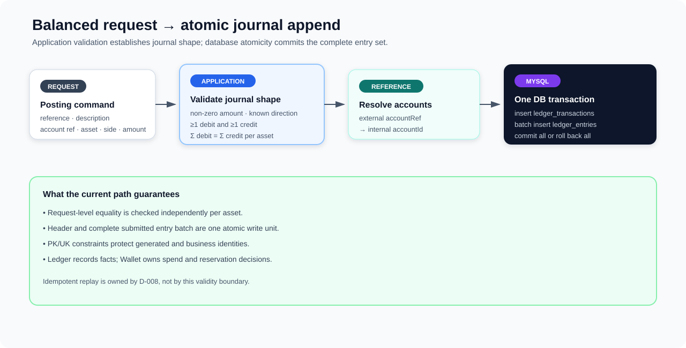

# Ledger Posting and Accounting Correctness

**Design:** D-007
**Status:** Verified against the current implementation on 2026-09-09 (time-boxed pass)

**Module context:** [Ledger Service Overview](ledger-service-overview.md)

## Design in one minute



Ledger is a passive double-entry journal. It accepts a caller's accounting facts, checks that debit and credit totals are equal for every asset represented in the request, resolves external account references to internal account IDs, and appends one transaction header with its entries atomically. It does not decide whether funds may be spent, manage reservations, or maintain an account balance; Wallet owns those business decisions.

Three boundaries must remain distinct:

- **Application validation:** `PostLedgerProcessor.reqPrecheck` checks the submitted journal shape and arithmetic.
- **Transaction atomicity:** `DbTxnExecutor` commits the `ledger_transactions` header and the complete `ledger_entries` batch together, or rolls both back.
- **Schema integrity:** MySQL protects the journal's primary and unique identities.

Ledger-specific replay and duplicate concurrency are owned by [Posting Idempotency and Replay](posting-idempotency-and-replay.md). The shared transaction mechanics are described in [Database Foundation](../infrastructure/database-foundation.md).

## Responsibility boundary

Wallet converts accepted business operations into Ledger entries. Its current outbox builder uses the Wallet transaction ID as Ledger `referenceId`, maps transfer-out actions to debits and transfer-in actions to credits, and uses the Wallet-to-Ledger account mapping as each entry's `accountRef`. Ledger then validates and records that accounting request; it does not reproduce Wallet's balance, reservation, or state-transition rules.

The same `PostLedgerProcessor` is reusable from Kafka and the retained test-only gRPC posting endpoint. Ingress and durable reply behavior belong to the asynchronous posting design; this document owns only the journal validity and persistence boundary.

## Journal model

| Concept | Stored representation | Meaning and constraint |
|---|---|---|
| Caller identity | `ledger_transactions.reference_id` | Business/idempotency identity supplied by the caller; unique in MySQL. |
| Ledger identity | `ledger_transactions.txn_id` | Ledger-generated journal ID; unique in MySQL. Current generation is not safe to claim as horizontally unique. |
| Transaction metadata | JSON `metadata`, optimistic `version`, timestamps | Posting currently stores `{}`. A metadata update extension point exists but has no active service ingress. |
| Journal line | `entry_id`, `txn_id`, `asset_id`, `account_id`, `amount`, `direction` | Immutable in active service flows, but the schema does not close the entry set against later direct inserts. |
| Account | service, external reference, owner, asset, category, normal side, status | Posting currently reads only `accountId` and `referenceId`, so most eligibility dimensions are not enforced. |

Amounts use protobuf `int64` and MySQL `BIGINT`, representing integer minor units rather than floating point. The current posting contract does not validate an asset's configured decimal precision.

## Accounting invariant and current validation

For every asset identifier `a` in a request, the intended request-level invariant is:

```text
sum(entry.amount where entry.assetId = a and direction = DEBIT)
  =
sum(entry.amount where entry.assetId = a and direction = CREDIT)
```

`reqPrecheck` executes before account lookup or journal writes. It:

1. rejects an entry whose amount equals zero;
2. rejects an unknown or unmapped direction;
3. requires at least one debit and at least one credit across the request;
4. accumulates debit and credit totals separately by the request's `assetId`;
5. rejects different asset sets or unequal totals for any asset.

This supports multi-entry and multi-asset postings: each asset must balance independently. Repeated entries and repeated account references are allowed; the model records lines rather than requiring one line per account.

### Exact limit of the arithmetic guarantee

The implementation checks `amount == 0`, not strict positivity. Equal negative debit and credit amounts therefore pass. Summation uses unchecked Java `long` addition, so overflow can wrap. Whether the intended contract should require strictly positive amounts and overflow-safe summation is deliberately deferred for a later version; current documentation must not imply either guarantee.

String identifiers are also not explicitly checked for blank values. Protobuf supplies empty strings by default, while the schema's `NOT NULL` constraints do not reject empty strings. An empty `referenceId`, `assetId`, or `accountRef` can therefore proceed until another operation happens to reject or fail it. Most seriously, a balanced request with a blank `referenceId` can commit, after which the `PostTransactionResult` constructor rejects the blank success identity. The journal is then durable although the caller observes an exception-derived failure. This is a current correctness gap, separate from the deferred positive-amount decision.

## Account resolution and semantic eligibility

The processor deduplicates incoming `accountRef` values, then `AccountRepository.getAccountIdInRef` runs one `IN` query selecting only `account_id` and `reference_id`. Every requested reference must appear in the resulting map; otherwise posting returns `ACCOUNT_NOT_FOUND`. Stored journal entries contain the resolved internal `accountId`, not the original external reference.

The lookup is weaker than the account schema's identity. The schema declares `UNIQUE(service_id, reference_id)`, while posting filters only by `reference_id`. Consequently:

- the same reference may legally identify rows in different service scopes;
- multiple matches can make map construction throw on a duplicate key rather than produce a controlled business result;
- one match may still belong to the wrong service, owner, or account role;
- posting does not check `account_status`, `asset_id`, `category`, `normal_side`, `owner_id`, or `owner_type`;
- posting does not check that the entry's `assetId` exists in `assets` or matches the account's asset.

Defining the required account scope and validating service/status/asset plus any owner dimensions is an accepted requirement, deferred beyond the current version. Account provisioning is supporting context only: Wallet currently creates a Ledger liability/credit account using the Wallet ID as its reference, then stores that same reference in its mapping table.

## Atomic posting flow

After validation, idempotency admission, and account lookup, the processor creates one `LedgerTxn` and all `LedgerEntry` objects in memory. One `DbTxnExecutor.executeWithDefault` callback then:

1. inserts the transaction header through `insertIgnore`;
2. rejects a zero affected-row result as `LEDGER_DUPLICATED`;
3. batch-inserts every entry;
4. requires the reported batch count to be at least the requested entry count.

A failed `Result` marks the Spring transaction rollback-only; an exception also rolls it back. A success becomes visible only after transaction completion. Account lookup happens before this transaction and post-insert cache/idempotency actions happen after it, so neither is part of the journal's atomic write unit.

The batch SQL is one multi-values insert. Under ordinary MySQL transactional behavior, a statement error prevents a partial batch from becoming a committed journal; the surrounding transaction additionally binds the header and batch together. No balance rows or pre-existing journal rows are locked because posting is append-oriented.

## Enforcement matrix

| Property | Current mechanism | Classification |
|---|---|---|
| At least one debit and credit | Application count check | Currently enforced for this processor only. |
| Debit equals credit per asset | Application `long` maps and equality checks | Currently enforced for this processor, subject to signed/overflow limits. |
| Header and submitted entries commit together | Spring/MySQL transaction | Currently guaranteed for this write path. |
| Unique transaction ID and reference | MySQL unique keys | Database-enforced. |
| Unique entry ID | MySQL unique key | Database-enforced. |
| Account reference exists | Pre-transaction application lookup | Currently checked by reference only. |
| Account/asset semantic compatibility | None in posting | Not implemented. |
| Entry belongs to an existing transaction/account/asset | No FK; application construction only | Not independently schema-enforced. |
| Posted entry set is permanently closed | No update service path, but unrestricted schema insert | Convention/active-path property, not a permanent guarantee. |

The project intentionally keeps domain and cross-row validation in application code instead of adding `CHECK` constraints, foreign keys, or a posting stored procedure. This is a proportional scope and performance trade-off intended to avoid extra database coordination and potential locking/deadlock cost; it is not supported by comparative benchmark evidence. Primary/unique keys and conditional CAS-like updates remain the chosen database domain safeguards, while ordinary transactions separately provide atomic commit/rollback.

## Failure behavior

| Failure point | Current outcome |
|---|---|
| Invalid direction, zero amount, or imbalance | No journal write; return `INVALID_REQUEST_PARAMETER`. |
| Missing account reference | No journal write; release the owned idempotency claim best effort; return `ACCOUNT_NOT_FOUND`. |
| Ambiguous duplicate account references across service scopes | Map construction can throw; the ingress boundary converts the uncaught failure according to its own error policy. |
| Duplicate transaction identity during insert | Header insert reports duplicate; transaction returns `LEDGER_DUPLICATED` and rolls back. Uniform winner replay belongs to D-008. |
| Entry batch failure or short count | Return/throw failure and roll back header plus entries. |
| Blank `referenceId` reaches success construction | Header and entries may already be committed; result construction throws because a successful result requires a nonblank reference. Replays have the same problem. |
| Commit outcome is unknown | Caller-visible failure does not prove rollback; retry must use the same stable business identity. D-008 owns authoritative replay limits. |
| Post-commit Redis/cache maintenance fails | The journal remains committed; later reads/retries must recover from MySQL. |

Public error normalization is described in [Result and Error Contract](../infrastructure/result-and-error-contract.md). It does not strengthen the journal invariant.

## Concurrency characteristics

Posting does not update shared balances, so its main database contention is identity/index insertion rather than read-modify-write locking. Concurrent distinct references normally append independent rows. Concurrent identical references race on the Redis coordination layer first and on `ledger_transactions.reference_id` as the durable winner selection; those semantics are D-008's responsibility.

Account resolution is an unlocked read before the journal transaction. There is currently no active account mutation/deletion path, but the schema contains no foreign keys, so correctness still depends on application ownership of reference data rather than a database relationship guarantee.

## Trade-offs

Keeping Ledger passive prevents business rules from being duplicated across Wallet and Ledger and makes the journal append path small. It also means a balanced posting can still represent a business-invalid operation if the upstream gatekeeper is wrong.

Application-side accounting validation keeps the invariant visible in the use-case processor and avoids database procedural logic. The trade-off is that direct SQL or another future writer can create structurally invalid journal data unless it reproduces the same contract.

Batching entries reduces statement round trips and makes the submitted set one clear write unit. Generating all IDs before the transaction keeps DB work short, but the current time-plus-process-local-sequence generator lacks a node/worker dimension and must not be presented as multi-instance safe.

## Evidence and test status

The primary evidence is `PostLedgerProcessor`, `PostTransactionResult`, `AccountRepository`, `LedgerTxnRepository`, `LedgerEntryRepository`/`LedgerEntryMapper`, the `LedgerTxn`, `LedgerEntry`, and `Account` entities, Ledger protobufs, `standard/sql/ledger_service.sql`, and Wallet's current Ledger request builder.

The retained `PostLedgerProcessorTest` demonstrates one two-entry happy path against external MySQL/Redis, but it is JUnit 4 and is not discovered by the current JUnit Platform run. The stress verification SQL can detect per-transaction/per-asset imbalance and exact entry-set mismatch for its generated workload, but retained benchmark outcomes and adversarial correctness results are not evidence in this draft.

## Known gaps and future requirements

1. **Current correctness gap:** validate required identifiers before idempotency admission. In particular, reject blank `referenceId` before writes so a committed journal cannot be followed by success-result construction failure; also reject blank entry `accountRef` and `assetId` intentionally.
2. **Deferred contract decision:** decide strict-positive amount semantics and use overflow-safe accumulation if selected.
3. **Accepted future requirement:** resolve accounts with an explicit service identity and validate status, asset, and required owner dimensions.
4. **Accepted future requirement:** make the posted entry set permanently immutable with a transaction-local sequence/uniqueness contract. The exact mechanism remains to be designed without contradicting the project's database-policy boundary.
5. **Future integration:** replace or qualify the current Ledger and Wallet ID generators before horizontal multi-instance uniqueness is claimed; the intended direction is the project owner's distributed ID generator.
6. **Deferred tests:** add focused validation, rollback, negative/overflow, multi-asset, account-asset mismatch, direct-write/immutability, and concurrent duplicate tests.
