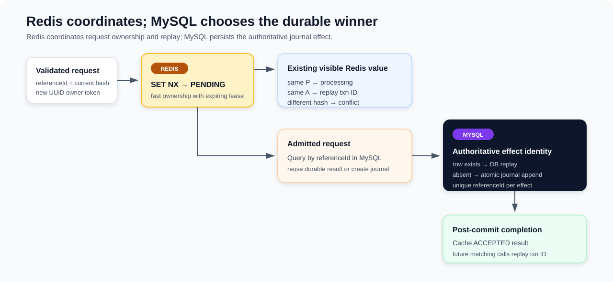

# Ledger Posting Idempotency, Concurrency, and Replay

**Design:** D-008
**Status:** Verified against the current implementation on 2026-09-09 (time-boxed pass)

**Module context:** [Ledger Service Overview](ledger-service-overview.md)

## Design in one minute



Ledger layers a fast Redis ownership protocol over a durable MySQL uniqueness boundary. Redis coordinates in-flight requests for a Ledger `referenceId`, distinguishes visible request hashes, and caches the completed Ledger transaction ID. MySQL owns the authoritative journal effect and guarantees at most one committed transaction header for that business identity.

Together, the two layers provide a short coordination path for active and recently completed requests, durable uniqueness for the accounting effect, and stable transaction-ID replay for recognized completed requests.

The generic Redis state protocol is described in [Redis Idempotency Coordination](../infrastructure/redis-idempotency-coordination.md). This document owns Ledger's identity definition, service decision tree, database replay, and posting-specific races. Journal validation and atomic entry persistence are owned by [Posting and Accounting Correctness](posting-and-accounting-correctness.md).

## Identity model

| Identity | Current value | Role |
|---|---|---|
| Business/idempotency key | `PostTransactionRequestPb.referenceId` | Redis key suffix and MySQL unique business identity. Wallet currently sends its Wallet transaction ID. |
| Request comparison | Service-built stable hash | Distinguishes request payloads only while the original hash is retained in Redis. |
| Attempt owner | `LEDGER-` plus UUID token | Protects release of the caller's exact `PENDING` value. |
| Durable result | generated `ledgerTxnId` | Stored in MySQL and returned on creation or replay. |

The Redis key is `idemp_k:ledger:post_ledger:{referenceId}`. A `PENDING` value stores `P:{hash}:{token}`; an `ACCEPTED` value stores `A:{hash}:{token}:{ledgerTxnId}`.

### Current request hash

`PostLedgerProcessor.getReqStableHash` builds a string from:

1. `referenceId`;
2. `description`;
3. all entries sorted by account reference, direction, amount, then asset ID;
4. for each entry: account reference, direction, amount, and asset ID.

It separates fields with `|`, hashes the string with Murmur3-128, and stores only Guava's signed 64-bit `asLong()` decimal value. Duplicate entries remain significant because sorting preserves their multiplicity. Original entry order is not significant in the current implementation. `description` is significant even though posting does not persist it.

These are current mechanics, not a confirmed future business identity contract. Entry-order and description semantics are deferred until the planned value-format refactor. The delimiter construction also has no escaping or length framing, so caller-controlled `|` characters can make different field boundaries serialize identically. Even with unambiguous encoding, the retained 64-bit non-cryptographic digest has a finite collision risk. The future contract needs a canonical representation and an explicitly selected digest/equality policy.

## Decision flow

Request accounting validation runs before Redis admission. For a valid request:

1. Generate a fresh owner token.
2. Atomically `SET NX` a `PENDING` value using the configured pending TTL plus jitter.
3. If the claim succeeds, still query MySQL by `referenceId`; Redis may have lost an earlier accepted value.
4. If the claim is rejected, read the existing value and compare its hash.
5. If Redis cannot supply a usable decision, fall back to the same MySQL lookup.
6. If MySQL contains the reference, return its `ledgerTxnId` as a DB replay and repopulate `ACCEPTED` best effort.
7. If MySQL has no row, build and atomically insert the journal.
8. After commit, mark Redis `ACCEPTED` best effort and return the created transaction ID.

The current configuration uses a 120-second pending TTL and a 24-hour accepted TTL with up to 99 ms positive jitter. These are pre-launch snapshots, not validated maximum-processing or retention contracts. The pending TTL's design purpose is to recover abandoned claims; if it is shorter than actual processing, it increases concurrent work and stale-owner races.

## Redis outcomes

| Observation | Ledger result | Database access in that invocation |
|---|---|---|
| Claim succeeds | Continue to lookup, then possibly post | Yes. |
| Matching `PENDING` | `REQUEST_IN_PROCESSING` | No. |
| Matching `ACCEPTED` | Successful replay of stored transaction ID | No; accepted content is trusted. |
| Different visible hash | `REQUEST_HASH_CONFLICT` | No. |
| Claim/read Redis failure | Log and fall back | Yes. |
| Key expires between rejected claim and read | Treat as no usable value and fall back | Yes, without owning a fresh Redis claim. |
| Malformed value | Force-delete best effort and fall back | Yes. |

The malformed-value recovery performs `GET` and delete as separate operations. A valid replacement installed between them can be deleted. This may degrade coordination and increase duplicate work, but the MySQL reference uniqueness still prevents two transaction headers for the same identity from committing.

Fast accepted replay trusts the Redis `ledgerTxnId` without checking MySQL. MySQL is therefore authoritative for committed effects, but not consulted for every response. A parseable stale or incorrectly overwritten accepted value can produce a misleading replay until Redis is repaired or expires.

## Durable duplicate boundary

`ledger_transactions` has unique keys on both `txn_id` and `reference_id`. The reference constraint is the business idempotency backstop. If multiple callers reach the database after Redis loss, lease expiry, or a read race, at most one header for that reference can commit. The winner's header and entries commit atomically as described in D-007.

This durable guarantee is narrower than “same key plus same request returns the same result”:

- the transaction row does not store the request hash or canonical payload;
- after Redis loss or accepted-TTL expiry, any request with the existing reference is treated as a replay, even if its entries or description differ;
- a caller losing the unique-insert race receives `LEDGER_DUPLICATED` rather than loading and replaying the winner;
- a generated `txn_id` or `entry_id` collision can also surface through generic duplicate handling, and `insertIgnore` does not identify which unique key matched.

Thus the current implementation guarantees one durable transaction effect per Ledger reference, but durable request equivalence and uniform replay outcomes are not implemented.

## Concurrency scenarios

### Identical requests while `PENDING` is live

The first Redis claimant proceeds. A matching concurrent caller returns `REQUEST_IN_PROCESSING`; it does not wait or query MySQL. Kafka may retry that result according to the async adapter, while the test-only gRPC caller sees it directly.

### Same reference, different request while Redis state is live

Hash comparison returns `REQUEST_HASH_CONFLICT`. This protection lasts only while a parseable original Redis value remains visible.

### Redis unavailable or a claim/read race

Multiple callers can query MySQL, observe no row, and attempt posting. MySQL chooses one durable winner by unique reference. The loser rolls back and currently receives `LEDGER_DUPLICATED`, so concurrent callers do not necessarily converge on the same successful response during the race.

### `PENDING` expires before the owner finishes

A second caller can claim and start work. If both reach MySQL, uniqueness limits the committed effect to one transaction. However, the old owner can later call unconditional `markIdempDone` and overwrite the newer owner's pending or accepted state. This does not create a second committed header, but it breaks token ownership at the coordination layer.

### Commit succeeds but completion fails

The created journal remains committed and the caller still receives success because `markIdempDone` is best effort. If the old `PENDING` value remains, immediate duplicates receive `REQUEST_IN_PROCESSING` and cannot reach the authoritative DB row until the value expires or the Redis read fails. In the async flow, the transport retry window can be exhausted before this recovery path opens.

There is also a separate blank-identity defect owned by D-007: a blank `referenceId` can reach and commit the journal, but creation of the successful `PostTransactionResult` then throws because success requires a nonblank reference. Redis may already be marked accepted, yet accepted and DB replay both attempt to construct another success with the same blank reference and throw again. Durable uniqueness prevents a second row, but the API cannot converge to a successful replay until input validation is fixed.

### Failure before commit

Returned posting failures call the exact-value Lua release with `P:{hash}:{token}`. Only the current owner can delete that value. An exception that escapes before this cleanup, including an uncertain transaction failure, can leave `PENDING` until expiry. A commit exception does not prove rollback; safe recovery must reuse the original reference and payload and inspect authoritative state through the idempotent path.

## State transitions and ownership

```text
ABSENT --SET NX--> PENDING(hash, token)
PENDING --current unconditional SET--> ACCEPTED(hash, token, txnId)
PENDING --exact-value Lua release--> ABSENT
PENDING / ACCEPTED --TTL--> ABSENT
malformed --force delete--> ABSENT
```

Only release is owner-checked today. Completion receives the token but does not compare it with the stored owner. There is no lease renewal, fencing token, or background Redis repair worker.

## Guarantees and limits

| Classification | Current behavior |
|---|---|
| **Database-guaranteed** | At most one `ledger_transactions` row can commit for one `reference_id`; the winning journal writes atomically. |
| **Redis-guaranteed while live** | `SET NX` admits one key owner; exact-value release cannot delete another owner's value. |
| **Application behavior** | Visible matching accepted state replays a transaction ID; visible hash mismatch returns conflict; visible matching pending returns processing. |
| **Best effort** | Redis completion and DB-replay cache repair; failures do not undo a committed journal. |
| **Not guaranteed** | Durable same-request equivalence, token-owned completion, winner replay after an insert race, accepted-content verification, or immediate recovery from stale `PENDING`. |

Transport-level duplicate delivery and bounded outbox retry are summarized in [Kafka and Outbox Reliability](../infrastructure/kafka-outbox-reliability.md). [Asynchronous Posting and Durable Replies](async-posting-and-reply.md) owns how posting results become durable replies; this document does not treat DLT or retry exhaustion as the business correctness mechanism.

## Observability and evidence

The shared client increments `zexchange.idempotency.errors` for normalized Redis, parse, contract, and hash-comparison failures with bounded service/scope/operation/error-type tags. Claim rejection, replay, and `REQUEST_IN_PROCESSING` are normal outcomes rather than infrastructure errors. Ledger business metrics separately classify created, idempotent replay, processing, and error results; detailed metric/dashboard coverage belongs to the observability design.

The k6 Ledger write workload deliberately overlaps identical requests, allows processing outcomes for immediate duplicates, delays another duplicate, and checks that successful duplicates return the same Ledger transaction ID. Its reconciliation SQL verifies one expected transaction/entry set. This is test tooling, not retained proof of a completed benchmark or every race above.

The service has no focused `PostLedgerProcessor` unit suite for Redis loss, visible conflict, pending ownership, malformed state, DB replay, duplicate-insert winner/loser behavior, or post-commit completion failure. The shared Redis integration test covers claim and token-owned release against a fixed external Redis address, but is excluded by the default Surefire naming pattern and was not rerun for this draft.

## Trade-offs

Keeping Redis off the database transaction makes Redis a soft dependency and keeps the authoritative write path available during cache failure. It also creates a two-system protocol in which a stale lease can temporarily hide a committed result.

An expiring pending claim recovers automatically from abandoned workers without a coordinator. The trade-off is that expiry is an admission timeout, not proof that the original worker stopped; overlapping work must still be safe at the database layer.

Using one durable reference uniqueness constraint cheaply prevents duplicate journal effects. Without a persisted request discriminator, it cannot distinguish a legitimate retry from accidental key reuse after Redis state disappears.

## Required future work and deferred decisions

1. **Decided, not implemented:** persist an immutable canonical request hash with the Ledger transaction and compare it on DB replay and duplicate-race resolution. Same hash should replay the winner; different hash should return conflict.
2. **Decided, not implemented:** replace unconditional completion with an atomic token-owned `PENDING → ACCEPTED` transition. Ownership loss must not overwrite a newer claim or turn a committed DB result into a business failure.
3. **Deferred with format refactor:** decide whether entry order belongs to identity and whether `description` remains part of identity despite not being persisted; introduce unambiguous canonical encoding and consciously select digest strength.
4. **Recovery prerequisite:** ensure an async retry uses the same logical reference and payload. The planned Wallet stuck-transaction re-drive is safe for the journal effect because of Ledger reference uniqueness, but clean reply convergence also depends on the separate reply-payload conflict being fixed.
5. **Deferred tests:** add deterministic concurrency and fault-injection tests for Redis loss/expiry, claim-read races, malformed replacement deletion, accepted-content trust, request conflicts before/after Redis expiry, DB winner replay, old-owner completion, post-commit failure, and unknown commit outcomes.
6. **D-007 prerequisite:** reject blank posting identities before Redis or database effects; otherwise the committed result cannot be represented or replayed successfully.
