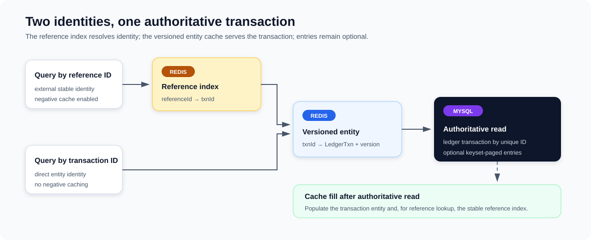

# Ledger Transaction Query and Cache Read Model

**Design:** D-010
**Status:** Verified against the current implementation on 2026-09-09 (time-boxed pass)

**Module context:** [Ledger Service Overview](ledger-service-overview.md)

## Design in one minute



Ledger exposes gRPC lookup by either its internal transaction ID or the caller's stable reference ID. A transaction-ID lookup uses a versioned Redis entity cache before MySQL. A reference lookup first uses a raw `referenceId → txnId` index cache and then follows the transaction-ID path. Journal entries are loaded from MySQL only when the caller requests them.

This split lets the stable external identity use negative caching while the entity value retains version-aware cache updates. The shared cache formats and Lua behavior are described in [Redis Cache Coherency](../infrastructure/redis-cache-coherency.md); this document owns the Ledger-specific lookup graph, freshness behavior, entry loading, and protobuf conversion.

## Public query contract

`PostServiceImpl` exposes two read RPCs:

| RPC | Lookup value | Optional work |
|---|---|---|
| `getTxnById` | `ledgerTxnId` | Load all entries when `includeEntries = true`. |
| `getTxnByRefId` | `referenceId` | Resolve the durable transaction, then optionally load all entries. |

Blank lookup values return `INVALID_REQUEST_PARAMETER`. A missing transaction returns `LEDGER_NOT_FOUND`. Cache or repository failures are normalized by the processor/boundary into the Ledger error contract; unexpected exceptions become `SERVER_ERROR` replies.

The transaction reply contains `ledgerTxnId`, `referenceId`, and stored JSON metadata. Entries contain entry ID, direction, amount, asset identity, and the current value placed in the protobuf `accountRef` field.

## Two-key cache model

| Cache | Redis key | Value model | Negative caching | Purpose |
|---|---|---|---|---|
| Reference index | `ledger:ref:{referenceId}` | Raw transaction ID | Enabled | Protect externally supplied reference misses and resolve to the authoritative entity identity. |
| Transaction entity | `ledger:id:{txnId}` | Versioned serialized `LedgerTxn` | Disabled | Serve the transaction record and apply version-aware writes. |

Both strategies use cache-aside reads, self-recovery by deleting malformed values, exception suppression for translated cache failures, and Micrometer decorators. Redis is an optimization: unsuccessful cache operations are logged and the main query continues through MySQL.

### Lookup by transaction ID

`LedgerTxnStore.getByTxnId` reads the versioned entity cache. A value hit returns immediately. A miss or tombstone loads `ledger_transactions` by unique `txn_id`; a database hit repopulates the versioned cache with the row's version.

Negative caching is disabled because the cache registration follows the codebase's assumption that transaction-ID lookup is an internal, low-miss path. The code still understands a generic negative result, but its configured strategy does not create one. The gRPC service nevertheless exposes `getTxnById`, so this low-miss assumption is a deployment/API-usage expectation rather than an enforced ingress boundary.

### Lookup by reference ID

`LedgerTxnStore.getByRefId` first reads the raw reference cache:

- a value hit supplies the transaction ID and follows `getByTxnId`;
- a negative hit returns not-found without renewing the negative TTL;
- a miss or tombstone loads by the unique database `reference_id`;
- a database hit populates both the reference index and entity cache;
- a database miss installs a temporary negative reference value.

If a positive reference index points to a transaction ID that no longer resolves, the store does not return a false not-found. It performs an authoritative database lookup by reference and repairs the caches from that result.

## Post-insert cache maintenance and tombstones

After the journal transaction commits, `LedgerTxnStore.postInsert` invokes both cache strategies. The cache-aside reference strategy places a tombstone rather than blindly publishing the new mapping. The versioned entity strategy has negative caching disabled, so its cache-aside `afterInsert` performs no Redis write; the entity is populated only when a later lookup misses Redis, loads MySQL, and calls `afterDbHit`.

The tombstone protects the following ordering race:

1. a query misses the reference cache and MySQL before the posting commits;
2. the posting commits and its post-insert action installs a tombstone;
3. the older query later attempts to cache its stale database miss;
4. cache strategy rules prevent that delayed negative fill from replacing the tombstone;
5. a subsequent tombstone read reloads MySQL and replaces the marker with the real mapping.

This reduces, but cannot eliminate, delayed stale cache fills. Tombstone expiry primarily bounds obsolete marker/key occupancy in Redis. A normal tombstone hit does not force all reads through MySQL for the entire TTL: its successful database reload replaces the marker with the regular cached value.

The TTL must cover the relevant request/cache-fill overlap window to be useful. The checked-in 120-second tombstone value, like the other cache durations, is a pre-launch snapshot and is not a validated contract.

## Entry loading

Entries are not embedded in either transaction cache. When `includeEntries` is true, `LedgerEntryRepository.getByTransactionId` repeatedly queries by `(txn_id, id)`:

```text
WHERE txn_id = ? AND id > lastId
ORDER BY id ASC
LIMIT pageSize
```

This keyset loop avoids offset scanning and uses the schema index on `(txn_id, id)`. It accumulates all pages in memory because the public RPC returns the complete entry set rather than exposing pagination. If the transaction exists but no entries are found, the processor treats it as an integrity failure and the gRPC boundary returns a generic server error.

The current page size is `3`. It is evidently useful for exercising pagination, but no representative workload validates it; larger transactions therefore issue many entry queries under the present configuration.

## Freshness and mutation model

Posted entries have no update path and are always queried from MySQL. Transaction metadata has an optimistic versioned update method and a version-aware cache refresh, but no active service API calls it. It is an unused extension point, not evidence that Ledger transactions are routinely mutable.

For currently exposed behavior, the reference mapping and transaction content are treated as stable after creation. Cache TTLs bound retention and resource use, while MySQL remains authoritative on cache miss, tombstone, detected stale reference, or cache error.

## Response-field mismatch

`ledger_entries` stores the resolved internal `account_id`, not the external account reference accepted during posting. `PbConverter` writes that internal ID into `LedgerEntryPb.accountRef`. The public field name therefore implies a value the service no longer retains.

The contract decision is deferred: either persist and return the original account reference, or rename/version the response field to express internal `accountId`. Until then, clients must not assume the field preserves the posting request's account reference.

## Failure behavior

| Condition | Current outcome |
|---|---|
| Redis read/write failure represented by the suppressing strategy | Log it and continue with or return the MySQL result. |
| Missing reference or transaction | Return `LEDGER_NOT_FOUND`; reference misses may be negatively cached. |
| Stale positive reference index | Recheck by reference in MySQL and repair cache state. |
| Transaction exists but requested entries are empty | Throw data-integrity failure; boundary returns `SERVER_ERROR`. |
| Post-insert reference-cache maintenance fails | Journal remains committed; later reads recover through MySQL. The entity cache is not eagerly populated on insert under the current strategy. |
| Malformed cache value | Best-effort delete/self-recovery, then database fallback. |

Cache metric decorators sit outside the exception-suppressing strategy; the generic isolation limit is documented in [Redis Cache Coherency](../infrastructure/redis-cache-coherency.md).

## Observability and performance evidence

Ledger business metrics distinguish lookup by transaction ID versus reference ID and tag gRPC ingress. Shared cache metrics distinguish the `ledger_txn` and `ledger_ref` cache types and their operations/outcomes. Database statement and transaction timers reveal entity lookup and entry-page cost.

The repository includes separate transaction-ID/reference-ID query workloads, working-set and miss controls, and query fixtures. No retained executed query benchmark was found, so this document makes no cache hit-rate, latency, or capacity claim.

## Trade-offs

Two cache keys add invalidation and repair logic, but avoid duplicating a complete entity under both public identities. Negative caching only the external reference index targets arbitrary miss traffic without retaining internal transaction-ID misses.

Keeping entries outside Redis avoids large, variable cached aggregates and entry-set invalidation. The cost is one or more MySQL queries whenever entries are requested, plus full in-memory accumulation before the RPC response.

## Required future work

1. Decide whether the query contract should return original account references or explicitly expose internal account IDs.
2. Select and validate an entry page size with representative transaction shapes; treat `3` only as the current snapshot.
3. Execute and retain transaction-ID/reference-ID, working-set, repeated-miss, and cold-miss query benchmarks.
4. Expand hermetic cache/store/processor coverage, including delayed stale negative fill across the tombstone boundary; the existing store unit test already covers stale positive reference repair.
5. Validate the tombstone duration only after representative request/cache-fill timing exists.
