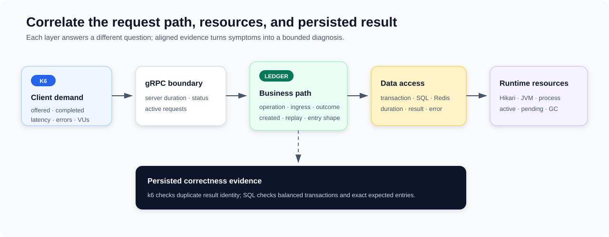

# Ledger Observability and Performance Evidence

**Design:** D-011
**Status:** Verified against the current implementation and retained evidence on 2026-09-09 (time-boxed pass)

**Module context:** [Ledger Service Overview](../ledger/ledger-service-overview.md)

## Design in one minute



Ledger performance is observed as a chain of bounded measurements: k6 records offered and completed client work; gRPC measures server entry; Ledger business timers identify posting and query operations; shared Redis and database metrics isolate infrastructure work; Hikari and JVM gauges show resource pressure. Comparing these layers on one time axis makes bottleneck diagnosis more reliable than treating a single latency percentile as capacity.

The repository contains repeatable write/query workloads, deterministic fixtures, SQL reconciliation, dashboards, and historical write-run evidence. Together, those artifacts demonstrate a reproducible measurement technique and an evolving latency investigation.

Shared metric implementation and safety are described in [Observability](observability.md). Database timer boundaries are described in [Database Foundation](../infrastructure/database-foundation.md). This document owns Ledger-specific signals, workload shape, retained results, and performance conclusions.

## What Ledger measures

### Business metrics

`LedgerBusinessMetrics` wraps posting and query entrypoints and is intended to preserve the original result or exception behavior while recording:

| Metric | Dimensions / meaning |
|---|---|
| `zexchange.ledger.requests` | Request count by operation, ingress, outcome, and bounded error code. |
| `zexchange.ledger.processing.duration` | Complete Ledger business-wrapper duration by operation, ingress, and outcome. |
| `zexchange.ledger.transactions.created` | Newly classified committed transaction count. |
| `zexchange.ledger.transactions.idempotent` | Successful replay count by gRPC/Kafka ingress and Redis/DB source. |
| `zexchange.ledger.entries.per_transaction` | Entry-count distribution for newly created transactions only. |

Operations are bounded to posting, query by transaction ID, and query by reference ID. Ingress is bounded to gRPC or Kafka. Request identities, account IDs, and transaction IDs are deliberately absent from metric tags.

Creation complexity and idempotent replay are separated: a replay increments the replay counter but does not inflate newly-created transactions or entries-per-transaction.

Unlike the explicitly defensive shared publisher/listener metric paths, these business metric registrations are not wrapped against Micrometer failures. A registry or recording exception can therefore affect or mask the observed call; the metrics are not a correctness-isolated side channel.

### Layered infrastructure signals

The service also exposes shared instrumentation:

- gRPC request duration, active calls, and status;
- Kafka listener delay/duration/outcomes, publisher duration/results, confirmed DLT delivery, and outbox delivery age;
- Redis operation/cache/idempotency outcomes and duration;
- database operation duration/errors close to JDBC statement execution;
- `DbTxnExecutor` transaction-boundary duration;
- Hikari active, idle, pending, maximum, acquisition, usage, and timeout signals from framework instrumentation;
- JVM/process CPU, memory, threads, and garbage collection through Actuator/Micrometer.

These timers are nested but their percentiles are not algebraically subtractable. For example, transaction p99 minus statement p99 is not a valid connection-acquisition percentile because each histogram represents a different population. Diagnosis relies on aligned curves, counts, and pool gauges.

There is no implemented outbox dispatcher-duration, backlog, exhaustion, claim, or finalization metric. Ledger config contains histogram settings for `zexchange.outbox.dispatch.duration`, but no code emits that timer; detailed shared observability gaps remain owned by [Observability](observability.md).

## Dashboard reading model

The Ledger service overview begins with instances, business request rate/errors, business processing latency, and created-versus-idempotent results. Its issue-locator row then points toward gRPC, database, Redis, or Kafka signals. Shared detail dashboards own the deeper subsystem views.

The stress dashboard keeps the generator and service on the same time axis:

1. offered, completed, and successful RPC rate;
2. overall and successful request p95/p99;
3. unexpected error rate and classified failures;
4. active gRPC writes;
5. k6 VUs and dropped iterations;
6. expected concurrent-duplicate processing responses;
7. Ledger business errors.

This prevents configured arrival rate from being mistaken for completed server throughput and prevents fast failures from making successful-request latency appear healthy.

## Write workload and correctness checks

The k6 write script calls direct gRPC `postTransaction`. It reaches the same posting processor and Redis/MySQL idempotency path as Kafka ingress, but excludes Kafka command intake and reply-outbox persistence/delivery. Results therefore characterize the synchronous processor path, not cross-service settlement throughput.

The workload uses a ramping-arrival-rate executor with configurable discovery, recovery, and soak profiles. Each VU reuses its gRPC connection. The deterministic transaction mix is:

| Shape | Share of logical transactions | Structure |
|---|---:|---|
| Small | 45% | 2 entries / 1 debit-credit pair. |
| Medium | 45% | 4 entries / 2 pairs. |
| Large | 10% | 20 entries / 10 pairs. |

Ten fixture assets and 100 fixture accounts distribute writes. Every 95 logical transactions create five additional attempts, producing exactly 5% duplicates per complete cycle; the mix includes concurrent and delayed repeats. Successful duplicates must return the same Ledger transaction ID.

The verification SQL reconstructs the expected entry multiset for the run prefix. It detects per-transaction/per-asset imbalance, missing or different expected entries, and unexpected persisted entries. A successful traffic run without this reconciliation is not treated as accounting-correctness evidence.

## Query workload

The query script independently selects lookup by transaction ID or reference ID and always requests entries. It supports:

- rising RPC-rate discovery;
- fixed-rate working-set growth;
- soak traffic;
- deterministic hit/miss ratios;
- repeated misses for negative-cache behavior;
- cold misses with a guard that fails the run if the supposedly cold key pool wraps.

It records offered/completed queries, valid hits, expected not-found responses, transport and unexpected failures, and separate hit/miss/overall latency. The fixture defaults and rates are configurable rather than guaranteed operating values.

No retained executed query results were found. The query suite is a capable test design, not evidence of query capacity or cache hit-rate today. The read model it exercises is described in [Transaction Query and Cache](../ledger/transaction-query-and-cache.md).

## Retained write evidence

The retained 2026-08 analyses are historical snapshots. Their configurations changed across runs; full host sizing, deployment topology, and revision provenance were not consistently retained; and the screenshots were not reproduced during this documentation pass.

| Investigation stage | Recorded observation | Defensible conclusion |
|---|---|---|
| Discovery runs near 600 logical transactions/s | Approximately 617–625 RPC/s, zero unexpected errors in cited runs, and successful SQL reconciliation; p95/p99 showed transient spikes. | The processor completed these ramps correctly, but ramps and interpolation do not prove a sustainable rate. |
| Expanded latency observability, Hikari max 10 | Pending borrowers reached 459; acquisition maximum was about 2.93 seconds while gRPC/business tails rose and GC stayed much smaller. | Connection acquisition/queueing was a major contributor to observed tail latency. |
| DB operation versus transaction instrumentation, Hikari max 10 | Transaction p99 reached about 1 second, individual displayed statements stayed in tens of milliseconds, pending exceeded 400, acquisition maximum reached about 3.07 seconds. | Requests accumulated around the transaction/pool boundary; the evidence did not yet prove the pool itself initiated the slowdown. |
| Pool/time-out tuning, Hikari max/min-idle 16 | Roughly 600 RPC/s ramp, no displayed non-OK/connection timeout, p99 reduced versus the prior run, and pending pressure dropped substantially. | Tuning improved this run's latency and stability; it still did not establish hard saturation or a durable capacity limit. |
| Periodic-stall analysis, Hikari max 32 | At roughly 127 RPC/s, SQL and transaction latency rose before pool exhaustion; at 75 RPC/s, periodic spikes remained with idle connections and no pending borrowers. | A DB-side or adjacent periodic stall can hold connections; Hikari amplified higher-load events but is not the initiating cause demonstrated by the low-load run. |

Historical provisional p99 boundaries from one tuned ramp—about 330 RPC/s below 500 ms and about 430 RPC/s below one second—belong only to that run and configuration. They are not current SLOs, production limits, or sustainable-capacity claims.

## Current bottleneck model

The evidence supports this causal model for the high-load events:

```text
periodic DB / storage / network / measurement event
→ SQL and transaction duration increase
→ connections remain occupied longer
→ idle pool drains and borrowers queue
→ business and gRPC tail latency rise
→ the event clears and the queue drains
```

The initiating event remains unresolved. Candidate explanations include MySQL or host periodic work, storage/network interference, and distortion from histogram quantiles computed over an overly short rate window. A route-policy timer was disabled for one diagnostic run and the pattern remained, but that exclusion depends on confirming the timer state on both relevant hosts.

The current application configuration uses a Hikari maximum of 32 and minimum idle of 16. These are pre-launch settings, not a benchmark-backed optimum. The evidence specifically argues against increasing the pool again until the initiating stall is identified.

## What the evidence does not establish

- sustainable write capacity at a fixed rate;
- production-safe p95/p99 objectives;
- Kafka-ingress and reply-outbox throughput;
- query capacity, cache hit rate, or working-set limit;
- recovery after overload or broker/database disruption;
- soak stability and resource leakage;
- the root cause of the periodic DB-side stall;
- performance of the current revision under the current complete configuration.

## Trade-offs in the test design

Direct gRPC isolates posting performance and produces a simpler diagnostic signal, but omits the active asynchronous integration cost. Deterministic fixtures and SQL reconstruction make correctness testable, but the small fixed asset/account set may create contention patterns unlike a future workload.

Arrival-rate execution exposes the server to controlled offered load. During ramps, however, interpolated rates and stage transitions complicate capacity interpretation. Fixed-rate holds, recovery observation, and soak runs are required before selecting an operating point.

High-resolution scraping makes short pool events visible, while very short histogram rate windows can make quantiles unstable. Gauges and latency histograms may need different observation windows even when displayed together.

## Future evidence plan

1. Re-run fixed rates such as 300–600 RPC/s with recorded code revision, environment, fixture, pool, timeout, and dashboard/query-window settings.
2. Accept a sustainable point only when completed rate follows offered rate, errors/dropped iterations remain controlled, latency reaches a stable plateau, and pending connections return to zero.
3. Run recovery and soak profiles after selecting a candidate operating point.
4. Correlate exact spike times with k6, MySQL, storage, network, CPU-steal, host timers, and persistent local/remote database probes.
5. Preserve long-window histogram quantiles while retaining faster gauge scraping for Hikari state.
6. Execute and retain the query matrix across identities, working sets, repeated/cold misses, and entry-set sizes.
7. Add Kafka command/reply and outbox measurements before making end-to-end settlement throughput claims.
