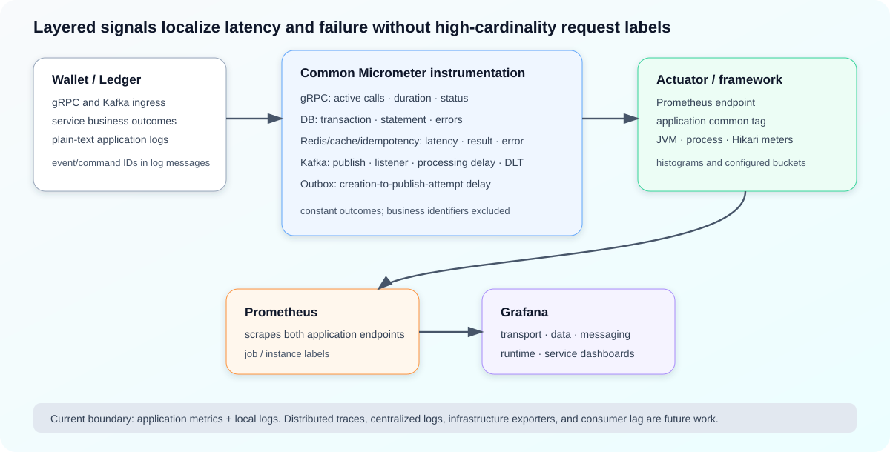

# Shared Application Observability Instrumentation

**Design:** D-006  
**Status:** Verified against the current implementation on 2026-09-09 (quick pass)

**Module overview:** [Common Util Overview](../infrastructure/common-util-overview.md)

## Observability model in one minute

Wallet and Ledger compose three visibility layers:

- common-util instruments reusable gRPC, database, Redis/cache/idempotency, Kafka, and outbox boundaries with Micrometer;
- each service adds business request/outcome metrics at its processor edge;
- Spring Boot Actuator contributes runtime and Hikari metrics, exposes Prometheus series, and applies the `application` tag.

Prometheus currently scrapes both application endpoints and Grafana provides shared transport, data-access, messaging, runtime, and service views. These metrics explain where time and failures accumulate, but they are not distributed tracing: there is no tracing library, span propagation, or MDC-based correlation context in the inspected runtime.

## Measurement boundaries

The same request can produce several observations, each answering a different question.

| Layer | Primary signals | Measurement meaning |
|---|---|---|
| gRPC transport | `zexchange.grpc.server.active`, `zexchange.grpc.server.duration` | In-flight calls and time until close, cancel, or listener failure, by service, method, and gRPC status. |
| Service business | `zexchange.wallet.*`, `zexchange.ledger.*` | Processor outcome and processing time by operation and ingress; includes errors embedded in protobuf replies. |
| DB transaction | `zexchange.db.transaction.duration` | Full `DbTxnExecutor` call through acquisition, callback, and commit or rollback. |
| SQL operation | `zexchange.db.operation.duration`, `.errors` | JDBC-adjacent MyBatis statement execution and result handling by mapper method. |
| Redis operation | `zexchange.redis.operation.duration` | Client-observed template, Lua-script, or Redisson client-cache call by bounded operation and outcome. |
| Cache strategy | `zexchange.cache.ops`, `.errors` | Read result semantics—value, miss, negative, tombstone, or error—and normalized failure type. |
| Idempotency | `zexchange.idempotency.errors` | Semantic or infrastructure failures by service, scope, operation, and bounded error type. |
| Kafka publisher/outbox | `zexchange.kafka.publisher.*`, `zexchange.outbox.delivery.delay` | Publish attempt through broker completion and age from outbox creation to that attempt's completion. |
| Kafka listener | `zexchange.kafka.listener.*`, `.dlt` | Listener outcome/duration, age from original record timestamp, and confirmed DLT-handler consumption. |

The layers are intentionally not interchangeable. SQL duration excludes connection acquisition and transaction completion; transaction duration includes both. Cache result metrics describe cache meaning, while Redis duration describes the dependency call. Kafka publisher duration ends at broker acknowledgment, not consumer processing. Outbox delivery delay begins at row creation, so retries expose queue or recovery delay that publisher latency alone cannot show.

### gRPC and business outcomes

`GrpcServerMetricsInterceptor` increments a per-method active gauge before handing control to service code. Close, cancel, startup failure, or listener callback failure races through an `AtomicBoolean`, so the gauge decrement and duration sample are attempted once. Labels are derived from the static gRPC method descriptor and status.

Wallet and Ledger usually embed `ErrorPb` in a normally completed reply. Consequently, gRPC status is generally `OK` even for a business rejection or a caught server exception. Service-owned metrics fill that semantic gap:

- Wallet records its four transaction/provisioning processors, two snapshot queries, and Kafka-driven Ledger completion with operation, ingress, outcome, and service error message.
- Ledger records posting on both gRPC and Kafka ingress, transaction queries, newly created transaction count, entry count, and successful idempotent replay source. Account creation is not currently wrapped by `LedgerBusinessMetrics`.

Thrown exceptions default to bounded `server_error` outcomes in business metric wrappers and then propagate to the service or Kafka boundary. [Result and Error Contract](../infrastructure/result-and-error-contract.md) owns how failures become stable service codes.

### Database and Redis/cache layers

The SQL interceptor transfers `MapperName.method` and command metadata from `Executor` to the narrower `StatementHandler` boundary through a one-shot `ThreadLocal`. It always clears that context, including cache hits and pre-JDBC failures. Missing metadata, missing handoff context, and overflow receive explicit bounded labels. Named statement-duration timers have an approximate 512-series admission cap; the error counter has no equivalent application-side cap.

Redis decorators time low-level `get`, `set`, `delete`, set-if-absent, versioned CAS, and token-owned release operations. Component labels distinguish normal template access, Lua execution, and Redisson client-side reads. Strategy metrics count cache reads and their semantic state; mutation successes are not counted as cache operations, while mutation failures contribute cache-error counters. Idempotency emits only errors, not total request or latency metrics.

### Kafka and outbox layers

`MeteredPublisher` observes the original future rather than returning a wrapper. It records success only when the delegate returns a successful result after broker completion; exceptions, null futures/results, timeouts, and failed results are errors. `source=immediate|retry` separates the latency optimization from scheduled recovery.

Listener request outcomes are the fixed set `success`, `failure_replied`, `ack_failure`, `retryable`, and `non_retryable`; duration collapses them to success or error. Processing delay uses the retry-topic original timestamp when present, otherwise the record timestamp. This is a cross-host wall-clock metric: negative values are clamped, but clock skew is not corrected. Listener duration ends before best-effort immediate reply publishing, preventing broker wait from being attributed to command handling.

DLT count is separate from non-retryable listener classification. It increments only in each service's `@DltHandler`, after a record actually reaches that handler. A non-retryable attempt and a confirmed DLT delivery are therefore related but not identical signals. [Kafka and Outbox Reliability](../infrastructure/kafka-outbox-reliability.md) owns the underlying retry and delivery semantics.

## Naming and cardinality contract

Project metrics use the `zexchange.<subsystem>.<signal>` namespace in Micrometer; Prometheus exports dots as underscores and appends `_total`, `_seconds`, `_count`, `_sum`, or `_bucket` as appropriate.

Stable labels are selected from configured endpoints, mapper IDs, enums, and constant vocabularies. Request IDs, transaction IDs, wallet/account IDs, Redis keys, SQL text, parameters, exception messages, and error detail are not metric labels.

`MetricTagSanitizer` replaces null or blank values with `unknown`; it does not enforce an allowlist or cap arbitrary non-blank values. Cardinality therefore still depends on service registrations keeping `cache_type`, listener, topic, event type, service, and idempotency scope bounded. Publisher failure meters, DLT original topics, cache/idempotency errors, and service business labels are registered on demand without an explicit general admission cap.

Spring configuration applies `application=${spring.application.name}` to emitted meters. Prometheus supplies scrape-level `job` and `instance`; those labels are not created by common-util.

## Export, dashboards, and diagnosis

Both services expose Actuator `health`, `info`, `metrics`, and `prometheus`. They enable histograms and checked-in SLO bucket snapshots for common duration metrics. Those numeric buckets and the current five-second scrape interval are pre-launch configuration, not validated operating guarantees.

The provisioned dashboards divide diagnosis by question:

| Dashboard | Primary question |
|---|---|
| Service gRPC overview | Is transport traffic slow, saturated, cancelled, or failing by method and status? |
| Service data-access overview | Is time accumulating in whole transactions, individual SQL, Hikari acquisition, Redis calls, cache behavior, or idempotency errors? |
| Kafka messaging overview | Are broker acknowledgments failing or slow, are outbox events aging, are listeners delayed or failing, and are records reaching DLT? |
| Service runtime overview | Do CPU, heap, GC pauses, or threads correlate with application latency? |
| Wallet or Ledger service overview | Which business operations and ingress paths fail, and which infrastructure signal best explains the change? |

The project owner has validated the provisioned dashboards against live `/actuator/prometheus` output from both services. The captures were not retained, so this draft records owner verification rather than independently reproducible evidence.

Prometheus currently scrapes application endpoints only. JVM, process, and Hikari series come from Actuator auto-instrumentation; no MySQL, Redis, Kafka broker or consumer-lag, node, or container exporter targets are configured. Grafana and Prometheus provisioning belongs to the repository deployment layer rather than common-util.

## Logging and context propagation

Both services use the same plain-text Logback pattern, console output, and a daily rolling service log with a 30-day history snapshot. Shared and service components log failures close to the operation; Kafka publisher and handler paths frequently include event ID, command ID, destination, or event type as message arguments.

There is no common request-context object, MDC injection, trace or span identifier, OpenTelemetry/Micrometer Tracing dependency, or cross-gRPC/Kafka trace propagation in the inspected code. Kafka's envelope retains event and command identity for explicit logging, but that is application correlation, not a distributed trace. Metrics intentionally omit those identifiers to protect cardinality.

The SQL `ThreadLocal` is only a one-shot metadata handoff inside one database thread. It does not propagate request context across threads. Likewise, the Kafka original-timestamp header supports delay measurement, not causal tracing.

## Failure isolation and guarantees

| Classification | Current behavior |
|---|---|
| **Implemented coverage** | Shared instrumentation spans gRPC, DB, Redis/cache/idempotency, Kafka publisher/listener/DLT, and outbox publish age in both services. |
| **Semantically separated** | Transport, business, transaction, SQL, dependency, cache, publisher, queue-age, listener, and DLT signals have distinct boundaries. |
| **Bounded by design on intended paths** | Core outcome and operation vocabularies are constants or enums; high-cardinality business identifiers are excluded. |
| **Best effort in selected components** | MyBatis, Kafka publisher/listener, and DLT recording explicitly suppress metric failures. |
| **Not globally failure-isolated** | gRPC, DB-transaction, Redis, cache, idempotency, and service business instrumentation do not all guard every registry, timer, or counter call. |
| **Not provided** | Distributed traces, centralized log collection, alert rules, infrastructure exporters, consumer lag, or complete outbox backlog/exhaustion/finalization metrics. |

Important failure cases are:

- **Metric registry or recording throws on an unguarded decorator:** instrumentation can alter that call's behavior. At gRPC boundaries this may become a server error; on inner hot paths it can mask the original operation. This is partial non-blocking hardening debt, not a correctness guarantee.
- **Business reply fails while gRPC status is OK:** transport panels remain green; business request and error-code panels reveal the failure.
- **Clock skew:** Kafka processing-delay histograms can be biased across producer and consumer hosts; clamping only removes negative samples.
- **Dynamic tag input appears:** the sanitizer accepts it, so series cardinality can grow unless the registration site constrains the vocabulary.
- **Metrics pipeline is unavailable:** local business processing continues where instrumentation is isolated, but data may be lost; no repository alerting path reports scrape or dashboard failure.
- **Outbox recovery stalls:** delivery-delay observations exist only when publish attempts complete. There is no current pending, dead, or oldest-age signal to reveal every stranded row.
- **Configured-but-unemitted timer:** Ledger config declares histogram and SLO settings for `zexchange.outbox.dispatch.duration`, but no implementation emits that metric.

## Trade-offs

Layered measurements localize bottlenecks without adding request identifiers to time-series labels. The trade-off is that correlation across layers is inferential—by service, time, operation, and ingress—rather than trace-exact.

Pre-registering or caching hot-path meters reduces repeated registry work, while on-demand rare-path meters keep code simple. Coverage is intentionally uneven, and cardinality protection is partly convention-based.

Embedding business failures in response payloads preserves the API's response contract but requires separate business metrics because transport status cannot represent the outcome.

## Future enhancements

1. Complete direct lifecycle/concurrency tests for `GrpcServerMetricsInterceptor` and review or guard all remaining decorators so metric failures cannot alter application behavior.
2. After the outbox `DEAD` policy is defined, add pending/dead counts, oldest pending age, exhaustion, claim, publish, and finalization signals. This is required operational visibility but lower priority than business correctness.
3. Add MySQL, Redis, Kafka broker/consumer-lag, node, and container exporters when infrastructure-level diagnosis becomes current scope.
4. Remove the unused `zexchange.outbox.dispatch.duration` distribution configuration or implement the metric as part of the outbox observability work.
5. Retain a dashboard-series verification artifact or automated metric-contract test so dashboard compatibility can be reproduced rather than relying only on owner confirmation.
6. Add tracing or bounded correlation context only if cross-service diagnosis needs trace-exact causality; keep business identifiers out of metric labels.

## Implementation evidence

Common metric names, tags, and gRPC behavior are implemented by `CommonMetrics`, `CommonMetricTags`, `CommonMetricTagValues`, `MetricTagSanitizer`, and `GrpcServerMetricsInterceptor`. Database, Redis, cache, idempotency, Kafka publisher/listener, and DLT instrumentation is implemented by their metered decorators and interceptors.

Current adoption is established by both service bootstraps and configuration classes, cache/listener/publisher registrations, Wallet/Ledger business metric wrappers, service and Kafka entrypoints, Actuator/Prometheus dependencies and configuration, Prometheus scraping, Grafana provisioning, and six operational dashboards. Focused tests cover SQL timing/context/cardinality, transaction outcomes, publisher completion semantics, listener delay/outcomes, DLT counting, Wallet business outcomes, and Wallet gRPC interceptor registration. Direct gRPC lifecycle/concurrency tests, equivalent Ledger business-metric tests, complete failure-isolation tests, and retained live scrape evidence remain absent.
