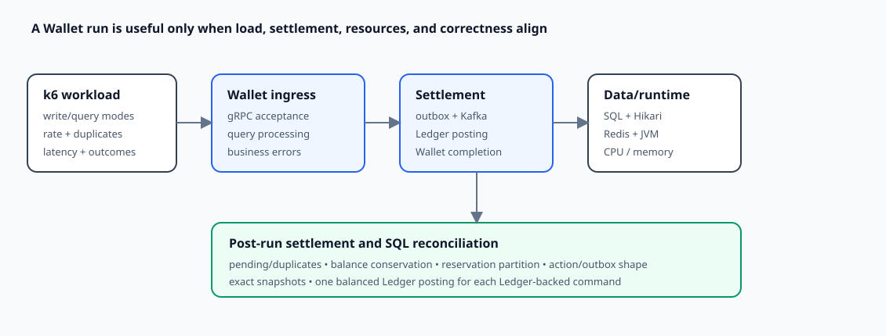

# Wallet Observability and Performance Evidence

**Design:** D-018  
**Status:** Verified as bounded current and historical evidence (2026-09-09)

**Module context:** [Wallet Service Overview](../wallet/wallet-service-overview.md)

## Design in one minute

Wallet performance has two clocks: foreground gRPC acceptance and asynchronous Ledger-backed completion. Measuring only RPC throughput can hide a growing settlement backlog. The repository therefore combines Wallet business metrics, transport/data/runtime metrics, controlled k6 write/query workloads, settlement waiting, and cross-database reconciliation.

Retained experiments demonstrate the intended evidence workflow: correlate layers on one timeline, change one controlled variable, observe recovery, and reconcile the resulting financial state. Detailed findings and their evidence limits appear later.



## What Wallet measures

`WalletBusinessMetrics` records a counter and timer at the explicit business boundary:

- `zexchange.wallet.requests` tagged by bounded `operation`, `ingress`, `outcome`, and `error_code`;
- `zexchange.wallet.processing.duration` tagged by `operation`, `ingress`, and `outcome`.

Operations cover create, atomic, reserve, apply reservation, query by Wallet ID, query by reference, and `complete_ledger_transaction`. gRPC uses `ingress=grpc`; Ledger reply finalization uses `ingress=kafka`. Returned protobuf errors and `Result` failures become business-error outcomes, while thrown exceptions are recorded as bounded server failures and rethrown.

The global gRPC interceptor adds method-level calls, active calls, status, and latency. Shared instrumentation adds database transaction/statement, Hikari, Redis/cache/idempotency, Kafka publisher/listener, and JVM/process metrics. Their implementation and cardinality rules are owned by [shared observability](observability.md).

## How to read a Wallet dashboard

A useful order is:

1. compare gRPC transaction success rate with Kafka `complete_ledger_transaction` success rate;
2. compare their latency and error codes over the same time window;
3. inspect outbox publishing, listener processing, retry/DLT, and consumer lag where available;
4. correlate DB transaction/statement latency with Hikari active, pending, acquisition time, and timeouts;
5. inspect Redis/cache outcomes for query/idempotency changes; and
6. use JVM/container/host/MySQL resource data to test—not assume—the saturation cause.

Listener processing includes Wallet business and database work, so high listener latency alone does not prove a Kafka broker bottleneck. Likewise, high host CPU does not identify which process is constrained.

## Write workload model

`wallet-grpc-write-stress.js` isolates four modes:

| Mode | Main cost and completion model |
|---|---|
| atomic | balance/reservation phase 1 + outbox/Kafka/Ledger + Wallet phase 2 |
| reserve | synchronous local hold; no Ledger |
| apply-release | synchronous local reservation/balance release when pure |
| apply-earmark | reservation pending state + asynchronous transfer settlement |

The script supports staged or fixed arrival-rate discovery, warm-up/ramp/reduction, bounded gRPC deadlines, distributed Wallet selection, and concurrent or delayed exact duplicates. It records offered, completed, successful, in-processing, connection, consistency, and unexpected-failure measurements rather than trusting configured arrival rate as achieved throughput.

The smoke flow separately proves the intended semantic sequence: reserve completes locally, pure release restores the snapshot, atomic returns pending, and polling eventually observes settled outgoing/incoming snapshots.

All load parameters are experiment inputs. None is a production SLO or supported capacity merely because it is checked in.

## Query workload model

`wallet-grpc-query-stress.js` separates Wallet-ID and reference-ID lookup. Its fixture/configuration surface varies working set, hit/miss shape, repeated misses, and USER versus SYSTEM ownership so normal cache-aside and promoted client-side strategies can be compared.

No retained query benchmark results were found. The scripts establish reproducible experiment design, not query latency/throughput evidence.

## Correctness gates

A fast run is not accepted solely from k6 success. Wallet SQL verification checks:

- no unexpected pending transactions after the bounded settlement wait;
- duplicate reference/idempotency shapes;
- no negative balance and fixture-fund conservation;
- reservation partition and expected terminal outcome;
- action counts/types/amounts by operation;
- expected outbox shape and finalized state;
- exact final snapshots reconstructed from actions, catching equal-and-opposite errors that total conservation misses.

Ledger-side verification joins Wallet expected commands to Ledger reference IDs, requires the expected entry count, and checks balanced Ledger postings. This separates acceptance speed from completed, correct accounting.

## Retained atomic-load investigation

The historical `atomic03` evidence used 1,000 Wallets, 5% duplicates, a 20 request/s warm-up, and +30 request/s stages every 90 seconds. Database/cache state was reset before each run. Exact current revision/configuration parity has not been established, so numbers below describe those recorded runs only.

### Run 1: query/index mismatch

Ledger-reply completion fell below 10 TPS and did not recover promptly after foreground load stopped. Database breakdown identified reservation lookup as dominant: the query filtered only `reference_id` while the available composite index began with `initiator`. An outbox claim query/index mismatch also existed. Commit `5faac0bc9f1d89a965f39e3cba757ecc17160819` is recorded as aligning the query patterns/indexes.

### Run 2: fixed query, pool saturation emerges

After the index fix, operation latency was much lower and completion recovered after foreground traffic stopped. Completion reached about 120 TPS before falling as gRPC approached roughly 268 TPS, then drained around 140–170 TPS after foreground load ceased. Hikari's then-maximum 12 connections saturated, pending acquisition rose, and acquisition approached its two-second boundary while individual SQL was comparatively faster.

This supported connection acquisition as the next controlled variable; it did not prove MySQL hardware saturation or CPU as root cause.

### Run 3: expanded shared pool still saturates

With Wallet Hikari maximum 32 and MySQL `max_connections` 80, atomic success plateaued around 300+ TPS; two dashboard queries/windows reported roughly 324–337 TPS. Completion initially reached about 115 TPS and then stayed at zero during the overload interval. Wallet gRPC p95/p99 reached about 3.39/4.29 seconds, completion p95 about 3.89 seconds, active pool connections reached 32, pending callers were about 400–430, and maximum acquisition approached 2.10 seconds.

When foreground traffic stopped, completion immediately recovered to roughly 139–143 TPS and the backlog began draining. This temporal alignment, fast individual SQL relative to transaction/acquisition wait, and the shared datasource used by gRPC plus three Kafka completion threads support shared Wallet DB-access/pool contention as the immediate observed limit.

The run does not establish that the MySQL server, Kafka broker, file descriptors, or host hardware reached their own limits. Increasing the pool alone may merely move the bottleneck.

## Current bottleneck model

Foreground transaction handlers and asynchronous completion workers compete for the same Hikari pool. When arrival exceeds sustainable DB-access capacity:

```text
more foreground concurrency
→ all connections active
→ acquisition queue and timeouts
→ gRPC latency/errors rise
→ fixed completion workers wait
→ settlement throughput collapses and backlog grows
```

The prompt recovery of completion after foreground traffic stops is strong intervention evidence for shared-resource competition. It is not proof that connection count is the only cause; lock contention, connection holding time, MySQL resources, and admission control still require measurement.

## Evidence limits

- Historical runs do not consistently bind every screenshot/number to a full revision, host sizing/deployment topology, schema, runtime configuration, and dashboard query.
- No current-revision rerun, stable-load soak, query benchmark, or controlled failure experiment was performed for this draft.
- Consumer-lag and MySQL/host/container attribution are incomplete for ruling in/out deeper saturation.
- gRPC acceptance throughput is not end-to-end settlement capacity.
- Pre-launch connection pools, listener concurrency, timeouts, retry schedules, cache TTLs, and page sizes are tunable snapshots.

Therefore this document makes no sustainable TPS, latency SLO, or production capacity claim.

## Trade-offs and experiment direction

A shared datasource preserves straightforward transaction management and resource utilization at ordinary load, but foreground bursts can starve correctness-critical completion. A larger pool delays contention while increasing pressure on MySQL. Admission control can preserve completion headroom without multiplying database connections; workload-isolated pools could offer stronger separation but complicate transaction-manager configuration and database budgeting.

The next controlled experiment should keep database limits fixed, cap foreground DB concurrency, and compare settlement throughput, Hikari pending/timeouts, consumer lag, MySQL sessions/locks/CPU/I/O, and end-state reconciliation. Only then should pool size or listener concurrency change independently.

## Future evidence plan

- reproduce discovery, overload recovery, and soak on a recorded revision/configuration;
- retain dashboard query definitions and synchronized time windows with every result;
- execute query matrices across lookup type, working set, cold/warm/repeated miss, and USER/SYSTEM ownership;
- add Redis, broker, MySQL, crash-after-commit, duplicate reply, and stuck-transaction recovery experiments after recovery exists;
- record load-generator health and achieved iteration rate separately from target arrival;
- gate every result on Wallet and Ledger reconciliation.

## Verification record

Verified on 2026-09-09 against current Wallet metric registration/tag semantics, dashboard queries, write/query/smoke scripts, fixture and reconciliation SQL, checked-in configuration, the retained `atomic03` narrative, and its available screenshots. The quoted observations match the retained narrative, but exact screenshot-query/revision provenance remains incomplete. No current benchmark, soak, query run, or controlled failure experiment was executed, so the document remains a qualified evidence record rather than a capacity claim.
