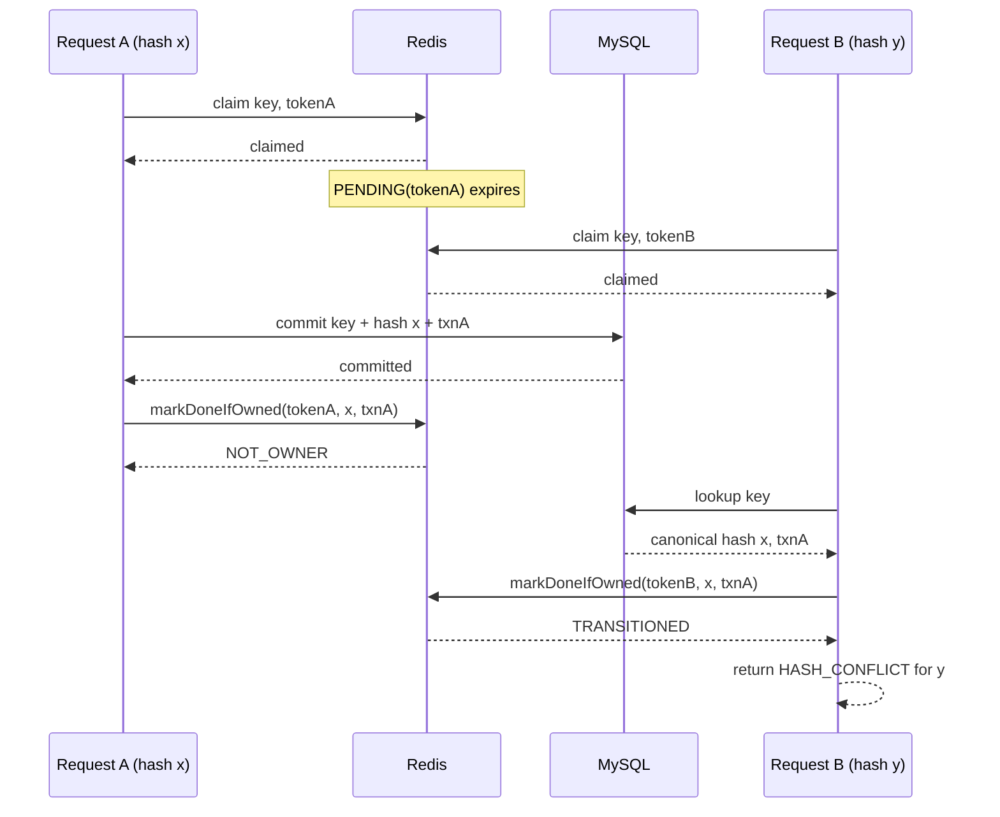

# Proposal: DB-Authoritative Idempotency with Redis-Owned Claims

> Status: proposed future design; not implemented.
>
> Scope: the shared Redis idempotency infrastructure and its Wallet/Ledger integration. This document specifies an optimization to implement. Statements in the target-design sections describe required future behavior, not current guarantees.

## 1. Executive summary

Redis should coordinate concurrent requests, but it should not decide whether two business requests are equivalent while their outcome is still uncertain. MySQL should remain the authoritative record of which request owns an idempotency key and which result was committed.

The target design is based on one primary invariant:

> An `ACCEPTED` cache entry must be populated only from the canonical DB record.

This leads to three decisions:

1. A Redis `PENDING` value contains only an ownership token. It does not contain a request hash and cannot produce a final hash-conflict decision.
2. Completion becomes an atomic compare-and-set operation named `markIdempDoneIfOwned`. It replaces `PENDING` only when the supplied token still owns the current Redis claim.
3. Wallet and Ledger persist a canonical request hash in MySQL and compare it on every DB replay, Redis fallback, and duplicate-insert race.

Redis remains a performance and concurrency layer. DB uniqueness, the stored request hash, and the business transaction remain the correctness layer.

## 2. Problem

The current Redis value contains a request hash in both `PENDING` and `ACCEPTED` states. A request that finds a different hash can therefore receive a conflict before the system knows whether a matching or conflicting request was committed to MySQL.

This becomes unsafe when a pending lease expires before its worker finishes:

```text
A claims key 1 and begins request hash x.
A's Redis PENDING entry expires.
B claims key 1 for request hash y.
A commits hash x to MySQL.
B discovers A's DB transaction, but the DB row cannot prove request equivalence.
```

Without a durable DB request hash, B may incorrectly return A's result as a replay of request `y`. Conversely, another request for `x` may observe B's provisional hash and receive a false conflict.

Completion also currently performs an unconditional Redis write. The ownership token is stored but is not checked, so an expired worker can overwrite a newer claimant's state.

The failure is not primarily that Redis can expire. Redis expiry is expected. The failure is allowing provisional Redis state to make a durable business-equivalence decision that only the database can establish.

## 3. Goals and non-goals

### Goals

- Guarantee that one DB idempotency scope and key has one immutable canonical request hash.
- Return the original result for the same key and same request.
- Return a hash conflict for the same key and a different request, including after Redis loss or expiry.
- Prevent an expired Redis claimant from completing or releasing another claimant's lease.
- Preserve the existing rule that Redis failure degrades to DB-backed correctness.
- Resolve concurrent duplicate inserts by inspecting the winning DB record.
- Keep cache failures and ownership loss from reversing an already committed business result.
- Align Redis key scope with the corresponding DB unique key.

### Non-goals

- Redis does not become the source of truth.
- This design does not provide distributed exactly-once execution.
- A Redis lease does not guarantee that the first request to arrive will be the DB winner after its lease expires.
- This change does not require redesigning the current request-hash algorithm. Hash canonicalization and collision resistance should be reviewed separately.
- Lease renewal is not required for initial correctness, although it may later reduce duplicate work for operations that can exceed the pending TTL.

## 4. Responsibility boundaries

| Layer | Owns | Must not own |
|---|---|---|
| `common-util` | Redis key/value encoding, claim, state reads, token-owned completion/release, Lua atomicity, cache error normalization, infrastructure metrics | Business request hashing, DB lookup semantics, declaring whether two business requests are equivalent |
| Wallet/Ledger processor | Canonical request construction/hash, DB lookup, hash comparison, replay/conflict decision, duplicate-race resolution, public error mapping | Redis command atomicity |
| MySQL transaction | Immutable request hash, unique idempotency scope/key, committed result reference, atomic business effects | Short-lived request coordination |
| Redis | Fast accepted-result lookup and short-lived processing lease | Durable request identity or durable completion |

The business layer may trust an `ACCEPTED` Redis entry only because the write path guarantees that its hash and result were copied from a canonical DB record.

## 5. Target data model

### 5.1 Database record

The existing transaction tables remain the authoritative idempotency records. Add an immutable request-hash column to both:

```sql
wallet_transactions.request_hash varchar(128) not null
ledger_transactions.request_hash varchar(128) not null
```

The existing result identifiers remain authoritative:

```text
wallet_transactions.txn_id
ledger_transactions.txn_id
```

The uniqueness rules remain based on scope and key, not hash:

```text
Wallet: (initiator, idempotency_key)
Ledger: reference_id
```

The hash must not be added to the unique key. A uniqueness rule such as `(scope, key, hash)` would allow two different requests using the same key to create two records, defeating idempotency.

The request hash and business effects must be inserted in the same DB transaction. Once inserted, the request hash is immutable.

### 5.2 Redis key scope

The Redis key must encode the same logical scope as the DB unique key.

Target logical key fields:

```text
service
operation scope
business scope
idempotency key
```

Required service mappings:

| Service flow | Business scope | Idempotency key |
|---|---|---|
| Wallet transaction | `initiator` | API `idempotency_key` |
| Ledger posting | one explicit global/posting scope | request `reference_id` |

Wallet must include `initiator` in its Redis identity because MySQL permits the same idempotency key for different initiators.

A delimiter-safe key encoding should be used, for example:

```text
idemp:<service>:<operation-scope>:<business-scope>:<idempotency-key>
```

Every variable segment must either be restricted to a safe character set or encoded with Base64 URL encoding. Concatenating unrestricted values with `:` is not sufficient.

### 5.3 Redis states

The semantic values are:

```text
PENDING
  owner token

ACCEPTED
  canonical DB request hash
  canonical DB result reference
```

The proposed serialized representation is JSON; the final JSON-versus-delimited encoding choice remains open:

```json
{"state":"PENDING","token":"<claim-token>"}
```

```json
{"state":"ACCEPTED","requestHash":"<db-request-hash>","resultRef":"<db-result-ref>"}
```

`PENDING` deliberately has no request hash. It represents only a temporary right to perform the DB check or attempt the operation.

`ACCEPTED` deliberately has no lease owner. It represents an immutable projection of the canonical DB record.

The pending serializer must be deterministic. The Lua implementation may compare the entire expected serialized `PENDING` value rather than parse JSON; either approach must establish exact state-and-token ownership atomically.

The existing defaults—approximately 120 seconds for pending and 24 hours for accepted, plus jitter—may remain initially. Their production values must be monitored rather than treated as correctness boundaries.

## 6. Target common-util API

The shared API should expose state and ownership without making business hash decisions.

Conceptual types:

```java
record IdempotencyKey(
    String service,
    String operationScope,
    String businessScope,
    String idempotencyKey
) {}

sealed interface IdempotencyState {
    record Missing() implements IdempotencyState {}
    record Pending() implements IdempotencyState {}
    record Accepted(String requestHash, String resultRef)
        implements IdempotencyState {}
}

enum CompletionOutcome {
    TRANSITIONED,
    ALREADY_ACCEPTED,
    NOT_OWNER,
    MISSING,
    INVARIANT_VIOLATION
}
```

Conceptual operations:

```java
Result<Boolean> claimIdempIfAbsent(
    IdempotencyKey key,
    String token,
    Duration pendingTtl
);

Result<IdempotencyState> getIdemp(IdempotencyKey key);

Result<CompletionOutcome> markIdempDoneIfOwned(
    IdempotencyKey key,
    String expectedToken,
    String canonicalDbHash,
    String canonicalDbResultRef,
    Duration doneTtl
);

Result<Boolean> releaseIdempIfOwned(
    IdempotencyKey key,
    String expectedToken
);
```

`getIdempAndVerifyHash` should be removed or deprecated. `common-util` should parse and return state; Wallet or Ledger should decide whether a canonical hash matches its request.

The API must not accept an arbitrary request hash as proof of completion. The parameters should be named `canonicalDbHash` and `canonicalDbResultRef`, and service call sites must obtain them from a committed/queried DB entity.

## 7. Atomic completion semantics

`markIdempDoneIfOwned` must execute comparison and replacement in one Redis Lua operation.

Conceptual behavior:

```text
current = GET key

if current is PENDING with expectedToken:
    SET key to ACCEPTED(canonicalDbHash, canonicalDbResultRef)
        with done TTL
    return TRANSITIONED

if current is ACCEPTED with the same canonical hash and result:
    return ALREADY_ACCEPTED

if current is PENDING with another token:
    return NOT_OWNER

if current is absent:
    return MISSING

if current is ACCEPTED with different canonical data or is malformed:
    do not overwrite
    return INVARIANT_VIOLATION
```

The compare operation must check both state and token, not merely search for the token in the value.

### Ownership expired or moved

If completion returns `NOT_OWNER` or `MISSING` after the DB transaction committed:

- do not overwrite another claimant's pending state;
- do not release another claimant's state;
- do not convert the committed business result into an error;
- return the committed result to the original caller;
- emit a bounded lost-ownership metric and diagnostic log;
- allow the current or next claimant to rebuild `ACCEPTED` from the DB.

This means Redis may temporarily remain missing or pending after DB commit. That is acceptable because Redis is an acceleration layer. The database remains correct and later access repairs the cache.

## 8. Business decision algorithm

### 8.1 Request preparation

Before touching Redis:

1. Validate the request.
2. Build the complete DB/Redis idempotency scope.
3. Compute the canonical request hash.
4. Generate a unique claim token.

The same canonicalization algorithm must be used for initial execution, replay, duplicate-race resolution, and cache population.

### 8.2 Redis claim succeeds

Claiming Redis does not prove that the DB record is absent. An accepted cache entry may have expired, Redis may have lost data, or a prior worker may have committed before refreshing Redis.

After a successful claim, query the DB by the authoritative scope and key:

```text
DB record absent
    → execute the new business operation

DB record exists and DB hash == request hash
    → mark the owned cache claim ACCEPTED using DB data
    → return the existing result as an idempotent replay

DB record exists and DB hash != request hash
    → mark the owned cache claim ACCEPTED using the existing DB data
    → return HASH_CONFLICT for the current request
```

Populating the cache on the mismatch path is safe and desirable. The current requester owns the Redis claim, but the cached accepted data comes from the canonical DB row, not from the conflicting request.

### 8.3 Redis claim fails because a value exists

Read the current state:

```text
PENDING
    → return REQUEST_IN_PROCESSING

ACCEPTED with hash == request hash
    → return the cached result as a replay

ACCEPTED with hash != request hash
    → return HASH_CONFLICT

MISSING because of an expiry/delete race
    → retry claim once or fall back to DB resolution
```

A `PENDING` value never produces a hash conflict because it contains no authoritative hash.

An `ACCEPTED` value may be used for fast replay/conflict because all accepted writes are constrained to DB-derived canonical data.

### 8.4 Redis failure

On Redis timeout, connection failure, script failure, or parsing failure, query the DB:

```text
DB record absent
    → proceed using DB uniqueness as the final concurrency guard

DB hash == request hash
    → replay the existing result

DB hash != request hash
    → return HASH_CONFLICT
```

Redis failure must never weaken request-equivalence checking.

### 8.5 New DB commit

For a new request:

1. Insert the business transaction with its request hash.
2. Apply all business state changes and create any required outbox record in the same DB transaction.
3. Commit.
4. Call `markIdempDoneIfOwned` using the hash and result reference from the committed entity.
5. Return the committed business result regardless of best-effort Redis completion failure.

The accepted cache write must happen only after successful DB commit.

### 8.6 Duplicate-insert race

Prechecking the DB cannot eliminate this race:

```text
A checks DB: absent
B checks DB: absent
A and B attempt the unique insert
```

The DB unique constraint chooses one winner. The loser must not return a generic duplicate error immediately.

After the losing transaction is safely rolled back, load the winning record in a clean DB context:

```text
winner hash == current request hash
    → replay winner result

winner hash != current request hash
    → return HASH_CONFLICT
```

If the loser still owns the Redis claim, it should populate `ACCEPTED` from the winning DB record before returning.

If the winning row is not yet visible, perform a small bounded retry appropriate to the DB isolation/commit behavior. Do not spin indefinitely.

### 8.7 Business failure and unknown DB outcome

Release the Redis claim only when the service knows that no idempotency/business row committed.

Safe release examples:

- deterministic validation failure before the DB transaction;
- transaction explicitly rolled back;
- business constraint failure with a known rollback result.

Do not immediately release on a timeout or exception whose commit outcome is unknown. First query the DB by idempotency scope/key:

- row found: compare hash and return/replay the canonical outcome;
- row absent and the transaction manager can positively establish rollback/non-commit: release if still owned and return the appropriate failure;
- row absent but commit is still uncertain: do not treat absence at one instant as proof of rollback; allow the pending lease to expire and return an unknown/retryable result rather than enabling an unsafe duplicate attempt.

## 9. Concurrency behavior

### 9.1 Expired owner, conflicting new claimant



Final state:

```text
MySQL: key → hash x, txnA
Redis: ACCEPTED(hash x, txnA)
A: success
B: hash conflict
```

### 9.2 Expired owner and same request

If B has the same hash as A, B queries the DB, populates `ACCEPTED` from A's row while it owns the new claim, and returns A's result as a replay.

### 9.3 Both requests reach DB before either commits

The Redis TTL no longer prevents overlapping execution. The DB unique key is the final arbiter:

- exactly one idempotency row may commit for one scope/key;
- all business state changes associated with the losing insert must roll back;
- the loser reads the winner and returns replay or conflict based on the persisted hash.

Which request wins is determined by DB transaction ordering, not necessarily arrival order. If first-arrival-wins is a future requirement, use lease renewal/fencing or a durable DB claim record; it is not guaranteed by this design.

### 9.4 Crash after DB commit and before Redis completion

The DB already contains the canonical hash/result. The next request may claim Redis, query the DB, and reconstruct `ACCEPTED`. No special reconciliation worker is required for correctness.

## 10. Service-specific changes

### 10.1 common-util

Affected implementation areas include:

- `IdempotencyClient` and `DefaultIdempotencyClient`
- `IdempRedisClient`
- `CommonIdempHelper`, `IdempValue`, and key/value parsing
- `RedisScriptExecutor` and `ScriptExecutor`
- Redis idempotency Lua resources
- idempotency error/outcome metrics

Required changes:

- remove the hash parameter from claim;
- introduce a scoped key object or equivalent explicit scope parameters;
- return parsed state without declaring hash conflict;
- replace `markIdempDone` with `markIdempDoneIfOwned`;
- add an atomic completion Lua script;
- simplify release to exact `PENDING(token)` ownership;
- use a delimiter-safe encoding after the JSON-versus-delimited choice is confirmed;
- return structured completion outcomes;
- preserve Result-returning Redis failure downgrade behavior.

### 10.2 Wallet

Affected implementation areas include:

- transaction request canonicalization;
- `IdempPrecheckProcessor`;
- `BeforePostLedgerProcessor`;
- `WalletTransaction` and its repository/mapper;
- the `wallet_transactions` schema.

Required changes:

- persist `request_hash` with the new wallet transaction;
- include `initiator` in the Redis idempotency scope;
- query by `(initiator, idempotency_key)` and compare the stored hash;
- never return a DB row as replay until the hash matches;
- resolve duplicate inserts by reading and comparing the winning row;
- populate accepted Redis state from the DB entity;
- keep Redis completion failure non-fatal after commit.

### 10.3 Ledger

Affected implementation areas include:

- ledger request canonicalization;
- `PostLedgerProcessor`;
- `LedgerTxn` and its repository/mapper;
- the `ledger_transactions` schema.

Required changes:

- persist `request_hash` with the ledger transaction;
- query by `reference_id` and compare the stored hash;
- never return a DB row as replay until the hash matches;
- resolve duplicate inserts by reading and comparing the winning row;
- populate accepted Redis state from the DB entity;
- keep Redis completion failure non-fatal after commit.

## 11. Error semantics

Business-visible outcomes should remain distinct:

| Condition | Outcome |
|---|---|
| Another request owns `PENDING` | `REQUEST_IN_PROCESSING` |
| Canonical DB/accepted-cache hash matches | idempotent replay |
| Canonical DB/accepted-cache hash differs | `HASH_CONFLICT` mapped to the service boundary |
| Redis unavailable but DB is available | DB-backed replay/conflict/new execution |
| Completion loses ownership after DB commit | original committed success; internal metric/log only |
| DB outcome cannot be determined | retryable unknown/unavailable result; do not claim success or release unsafely |
| Accepted cache contradicts canonical DB | internal invariant violation; DB wins and cache must be repaired or invalidated |

`NOT_OWNER` from completion is not a business error. It reports cache coordination state after the DB outcome is already authoritative.

## 12. Correctness guarantees after implementation

### Currently intended guarantee

After this design is implemented and verified:

```text
same scope + same idempotency key + same canonical request
    → same committed result

same scope + same idempotency key + different canonical request
    → hash conflict
```

This remains true when:

- the accepted Redis entry expires;
- Redis loses the key;
- Redis is unavailable;
- a worker crashes after DB commit;
- a pending owner loses its lease;
- two requests race at the DB unique constraint.

### Remaining limitations

- Two workers can execute concurrently after pending TTL expiry; the DB prevents duplicate commit, not duplicate computation or contention.
- A stale `PENDING` value can temporarily return `REQUEST_IN_PROCESSING` until TTL expiry.
- Correctness depends on deterministic request canonicalization and negligible/managed hash-collision risk.
- Replay returns the persisted result reference. Reproducing an exact historical response body requires storing any additional response data the API contract considers part of “same result.”
- Redis and DB may temporarily differ while a claim is pending. They converge because only DB-derived data may become `ACCEPTED`.

## 13. Observability

Use bounded tags only. Do not tag metrics with idempotency keys, tokens, hashes, transaction IDs, or request payloads.

Recommended counters:

```text
idempotency_claim_total{service,scope,outcome}
idempotency_db_resolution_total{service,scope,outcome}
idempotency_completion_total{service,scope,outcome}
idempotency_duplicate_resolution_total{service,scope,outcome}
```

Recommended outcomes:

```text
claim: claimed | exists | redis_error
db_resolution: absent | replay | hash_conflict | unknown
completion: transitioned | already_accepted | not_owner | missing | invariant_violation | redis_error
duplicate_resolution: replay | hash_conflict | winner_not_visible | db_error
```

Important operational signals:

- rising `completion:not_owner` suggests the pending TTL is shorter than real processing time or workers are stalling;
- rising DB fallback with stable traffic suggests Redis availability or TTL problems;
- any accepted-state invariant violation is correctness-significant and should alert;
- duplicate resolution shows how much work escapes Redis coordination and reaches DB uniqueness.

Logs may include service/scope and outcome but must not expose tokens or request payloads. Hashes should normally be omitted or truncated because they add little operational value.

## 14. Pre-production implementation

The system has not gone online, so this change does not require backward-compatible Redis keys, dual reads, persisted-data migration, or a protocol-version marker. Implement the target DB schema and Redis protocol directly.

1. Add a non-null `request_hash` to both transaction entities and schemas.
2. Rebuild non-production data stores where existing test data cannot satisfy the new invariant.
3. Add repository queries that return the stored hash and result reference.
4. Implement DB replay/conflict and duplicate-race resolution before relying on the new cache format.
5. Add the new key/value codec and completion Lua script, then switch both services together.
6. Remove `getIdempAndVerifyHash` and unconditional `markIdempDone`.
7. Enable alerts for invariant violations and abnormal lost ownership.

Protocol versioning should be introduced only when a future deployed-data migration actually requires old and new representations to coexist.

## 15. Test plan

### 15.1 common-util unit tests

- Claim writes `PENDING(token)` without a request hash.
- Pending and accepted values round-trip through the codec.
- Arbitrary result content cannot break parsing.
- `markIdempDoneIfOwned` transitions the exact owner.
- A different token returns `NOT_OWNER` without mutation.
- A missing key returns `MISSING` without creating accepted state.
- The same accepted hash/result returns `ALREADY_ACCEPTED`.
- Different accepted canonical data returns `INVARIANT_VIOLATION` without overwrite.
- Redis exceptions remain downgraded to typed failed Results.
- Metrics use bounded outcomes and do not contain request identifiers.

### 15.2 Redis integration tests

Run against an isolated test Redis instance rather than a fixed external address:

- atomic completion under competing tokens;
- release-versus-complete races;
- expiry immediately before completion;
- claim/GET expiry race;
- concurrent same-key completions;

### 15.3 Wallet and Ledger processor tests

For each service:

- Redis unavailable + no DB row → new execution path.
- Redis unavailable + same DB hash → replay.
- Redis unavailable + different DB hash → conflict.
- Successful Redis claim + same DB hash → accepted cache repair and replay.
- Successful Redis claim + different DB hash → accepted cache repair from DB and conflict.
- Pending cache entry → processing, not hash conflict.
- Accepted cache entry + same hash → fast replay.
- Accepted cache entry + different hash → fast conflict.
- DB commit succeeds + completion loses ownership → business success.
- Concurrent duplicate insert + same hash → winner result replay.
- Concurrent duplicate insert + different hash → conflict.
- Unknown DB outcome does not release the claim before DB resolution.

Wallet must additionally test that identical idempotency keys from different initiators do not share a Redis entry.

### 15.4 Required race tests

Use latches or controllable fakes to make ordering deterministic:

1. A claims, expires, B claims, A commits, A loses completion, B resolves from DB.
2. A commits and crashes before completion; B repairs from DB.
3. A and B both observe DB absence; A wins the unique insert; B resolves same hash.
4. A and B both observe DB absence; A wins; B resolves a different hash.
5. An accepted entry expires; same request reconstructs it from DB.
6. An accepted entry expires; different request receives DB-backed conflict.

Do not consider the implementation complete with mocked happy-path Redis tests alone. The Lua ownership transition and DB race behavior require integration-level coverage.

## 16. Implementation sequence

Recommended order:

1. Introduce DB `request_hash` fields and canonical hash accessors.
2. Add DB lookup/compare and duplicate-race resolution in Wallet and Ledger.
3. Add the new key scope and value types in `common-util`.
4. Add `markIdempDoneIfOwned` Lua support and structured outcomes.
5. Migrate business call sites to DB-derived accepted values.
6. Add deterministic concurrency and Redis integration tests.
7. Add metrics and alerts.
8. Remove the superseded APIs.

This order establishes DB correctness before changing the optimization layer.

## 17. Acceptance criteria

The optimization is complete only when all of the following hold:

- [ ] `PENDING` contains an ownership token and no request hash.
- [ ] `ACCEPTED` is created only from a canonical DB entity.
- [ ] Wallet and Ledger persist immutable request hashes atomically with business transactions.
- [ ] Redis and DB use identical idempotency scopes.
- [ ] Same-key/same-request DB fallback replays the original result.
- [ ] Same-key/different-request DB fallback returns hash conflict.
- [ ] Duplicate-insert races resolve by reading and comparing the winner.
- [ ] Completion and release atomically verify the pending owner token.
- [ ] Lost completion ownership cannot overwrite another claim or fail a committed business operation.
- [ ] Redis expiry and outage tests preserve replay/conflict semantics.
- [ ] The post-commit/pre-cache crash window recovers through DB lookup.
- [ ] Non-production data stores are recreated or updated to satisfy the new schema and protocol directly.
- [ ] No metric or log exposes high-cardinality idempotency identifiers or tokens.

## 18. Decisions and remaining confirmations

### Resolved decisions

**Mark-done ownership:** completion will become `markIdempDoneIfOwned` and atomically compare the pending token. If ownership expired or moved, it will not overwrite Redis and will not invalidate an already committed DB result.

**Conflict after Redis loss:** same-key/different-request conflict remains required after Redis loss or expiry. Wallet and Ledger will persist and compare an immutable canonical request hash in MySQL; no unmatched DB record may be returned as a successful replay.

**Pre-launch protocol versioning:** the target Redis key and value do not carry a `v2` marker. No production data or deployed older protocol requires compatibility, so the new schema and protocol will be introduced directly.

### Remaining implementation confirmations

- `TODO: NEED CONFIRMATION` — Confirm whether exact replay requires only the transaction/result reference or a persisted historical response snapshot for each API.
- `TODO: NEED CONFIRMATION` — Decide whether processing time can legitimately exceed the pending TTL often enough to justify lease renewal or fencing in a later phase.
- `TODO: NEED CONFIRMATION` — Select the canonical request serialization/hash algorithm; the idempotency protocol must treat its output as immutable once persisted.
