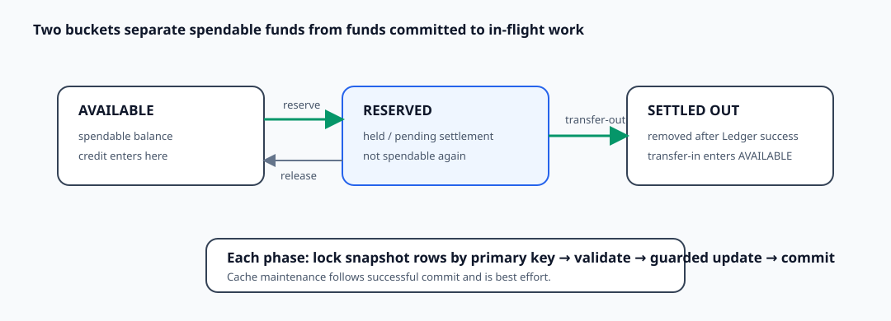

# Wallet Balance Model and Concurrency Correctness

**Design:** D-014  
**Status:** Verified against the current implementation (2026-09-09)

**Module context:** [Wallet Service Overview](wallet-service-overview.md)

## Design in one minute

Each Wallet balance snapshot uses two integer minor-unit buckets: `available` is spendable now, while `reserved` is already committed to a hold or an in-flight transfer. Outgoing work moves funds into reserved before a Ledger command is emitted; successful settlement removes them from reserved. Incoming settlement adds to available. This prevents the same units from remaining spendable while remote accounting is pending.

Every active multi-wallet update reloads the affected snapshot rows with `SELECT ... FOR UPDATE` in database primary-key order, validates the resulting buckets in application code, and persists with old-state predicates plus a version check inside one transaction.

## Bucket semantics

| Action | `available` | `reserved` | When applied |
|---|---:|---:|---|
| `RESERVE` | `-amount` | `+amount` | Wallet phase 1 |
| `RELEASE` | `+amount` | `-amount` | Wallet phase 1 |
| `TRANSFER_OUT` | unchanged | `-amount` | after Ledger success |
| `TRANSFER_IN` | `+amount` | unchanged | after Ledger success |

`CONSUME` changes reservation accounting, not the snapshot directly. A debit composes reserve plus consume plus transfer-out; this first isolates the money from new spending and later removes it only when Ledger acknowledges the accounting transfer.

The persisted values are `BIGINT`; the API and Java model use `long`/`Long`, avoiding floating-point monetary arithmetic.

## Active enforcement path

`UpdateBalanceSnapshotProcessor.updateSnapshots` is the active mutation coordinator in both pre-Ledger and post-Ledger phases:

1. collect distinct snapshot database IDs and sort them ascending;
2. reload them using `BalanceSnapshotRepository.selectInIdForUpdate`, which adds the same primary-key ordering and `FOR UPDATE`;
3. apply the phase-specific mutation to the locked current object;
4. reject null or negative final `available`/`reserved` values;
5. update changed rows using identity, status, old available, old reserved, and MyBatis `@Version` predicates; and
6. require exactly one affected row.

The row lock serializes cooperating writers. The old-value and version predicates are a defensive stale-state guard; a mismatch fails and the enclosing transaction rolls back.

### Exact guarantee classification

The live non-negative guarantee comes from locked-current-row mutation, explicit sufficiency/application validation, the final non-negative check, guarded update, and transaction rollback. It is not independently enforced by a schema `CHECK` constraint.

`BalanceSnapshotRepository` also contains arithmetic SQL helpers such as `reserveFromWalletId` and `transferOutFromWalletId`. No active main-source call sites were found. They must not be cited as the current transaction path's enforcement mechanism.

This follows the project database boundary: primary/unique keys, transactions, and CAS-like conditional updates remain safeguards, while cross-row/domain validation stays in the application.

## Transaction and lock boundaries

The first Wallet transaction updates all involved reservations and snapshots and inserts the Wallet transaction, actions, and optional Ledger command outbox. The reply transaction updates settlement reservations and snapshots and performs `PENDING → COMPLETED`. A failure in either callback returns a failed `Result`, causing that phase to roll back.

Sorting snapshot IDs provides a consistent lock order among snapshot updates. Reservation rows are also locked by their own updater; the cross-table order is reservations before snapshots in both lifecycle phases. This reduces deadlock opportunities but is not live contention evidence.

No database transaction spans Kafka or Ledger. The separation and API meaning are described in [transaction lifecycle and settlement](transaction-lifecycle-and-settlement.md).

## Conservation and transfer balance

Before phase 1, `TransactionValidateHelper.validateAssetInfo` sums `TRANSFER_IN` and `TRANSFER_OUT` by asset and requires equality. Within a snapshot:

- reserve/release preserves `available + reserved`;
- transfer-out decreases Wallet-held total only after accounting success;
- transfer-in increases Wallet-held total only after accounting success.

Multi-row rollback ensures a partially applied transfer cannot commit within a phase. Repository verification SQL reconstructs expected snapshots from actions and checks non-negative balances and fixture-wide conservation, but those scripts are evidence tooling rather than runtime enforcement.

The per-asset summation and bucket additions use ordinary signed `long` arithmetic. Explicit overflow detection is not implemented.

## Cache coupling

Database state is authoritative. `BalanceSnapshotStore.postDbUpdate` runs after a successful commit:

- normal snapshots receive version-aware cache-aside maintenance, including a tombstone during update;
- promoted system-owned snapshots use a post-refresh strategy;
- translated `CacheException`s are downgraded to failed results, so the normal Redis failure path cannot roll back committed money state. Unexpected runtime or metrics failures are outside that suppression boundary.

This is availability-oriented cache coherence, not strict read freshness. A process crash or Redis failure after commit can leave an older cache value until expiry or a later refresh. The complete query behavior is in [balance query and cache](balance-query-and-cache.md).

## Current guarantees

- Cooperating active writers lock snapshot rows in ascending primary-key order.
- A successful phase cannot commit a negative final snapshot through the active updater.
- Old-state/version mismatch aborts the whole phase instead of silently overwriting another update.
- All balance rows and the phase's related business records commit or roll back together.
- Per-asset incoming and outgoing transfer totals must balance before persistence.

These claims do not establish overflow safety, strict cache freshness, or protection from direct SQL writers outside the application protocol.

## Failure scenarios

| Failure | Effect |
|---|---|
| insufficient available/reserved | validation fails and the phase rolls back |
| snapshot missing or not `OPEN` | update is rejected |
| concurrent state/version mismatch | zero affected rows becomes a failed result and rollback |
| deadlock/DB error | translated failure; upstream retry safety depends on operation idempotency |
| post-commit Redis failure | financial commit remains valid; reads may temporarily observe older cache data |
| arithmetic overflow | not explicitly detected and therefore not currently guaranteed safe |

## Trade-offs

Pessimistic locking makes the application operate on current values and keeps multi-action reasoning straightforward, at the cost of holding row locks and creating hot-row contention. Guarded full-value updates add stale-state defense but do not provide the single-statement arithmetic guarantee of the unused helper methods. The design favors a demonstrable transaction/locking technique while retaining cache work outside the critical database transaction.

## Observability and performance

Database statement/transaction metrics, Hikari saturation, Wallet operation latency, and cache outcomes should be read together. Hot Wallet IDs can serialize on the same row even when the database pool is not saturated. Current pool, listener, cache, and timeout numbers are pre-launch settings, not supported capacity. Evidence and workload interpretation belong to [Wallet observability and performance](../operations/wallet-performance.md).

## Unresolved requirements and TODOs

- **Concurrency evidence:** run controlled multi-wallet and same-wallet contention tests for lock order, deadlock behavior, rollback, lost updates, and conservation.
- **Overflow:** define and implement overflow-safe per-asset aggregation and bucket addition.
- **Schema residue:** decide whether `balance_snapshots.last_txn_id`, absent from the Java model and active updates, should be removed or used as an applied-transaction fence.
- **Read consistency:** implement the intended explicit MySQL-bypass real-time query; current public queries use the cache store.
- **Owner review:** keep project-wide descriptions aligned with the executable lock-plus-validation path; the arithmetic SQL helpers are presently unused.

## Verification record

Verified on 2026-09-09 against every current balance mutation call site, `UpdateBalanceSnapshotProcessor`, repository query/update construction, phase transaction callbacks, schema, cache strategies, reconciliation SQL, and the current test suite. The source establishes ascending snapshot-primary-key locking and guarded updates; no real-MySQL contention, generated-SQL capture, overflow-boundary, or post-commit crash test was run.
