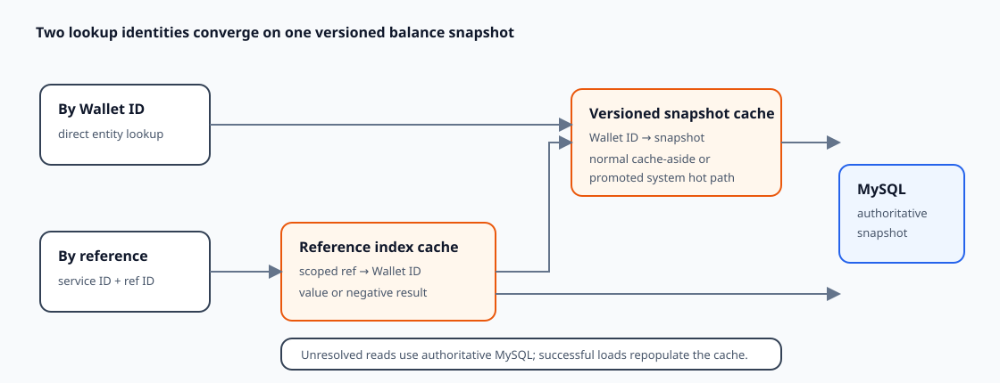

# Wallet Balance Query and Cache Read Model

**Design:** D-017  
**Status:** Verified against the current implementation (2026-09-09)

**Module context:** [Wallet Service Overview](wallet-service-overview.md)

## Design in one minute

Wallet exposes balance lookup by internal Wallet ID and by caller-facing `(serviceId, referenceId)`. The ID path reads a versioned mutable snapshot cache. The reference path first resolves a raw, service-scoped reference index to Wallet ID, then uses the same snapshot path. Unresolved cache reads continue to MySQL, the financial source of truth.

System-owned Wallets are promoted to a Redisson client-side, post-refresh strategy for both keys; normal Wallets use ordinary cache-aside behavior. Versioning prevents an older snapshot fill from replacing a newer cached version.

## Public query contract

`WalletService` exposes:

- `getSnapshotByWalletId(walletId)`;
- `getSnapshotByRefId(serviceId, referenceId)`.

The processor rejects blank lookup values and requires a known service for reference lookup. A found row is converted to `BalanceSnapshotPb`, including Wallet identity/status/owner, asset, available, and reserved amounts. A missing row becomes `BALANCE_SNAPSHOT_NOT_FOUND` rather than an empty successful snapshot.

Both public RPCs use `BalanceSnapshotStore`; there is no current public cache-bypass query.

## Cache keys and composition

| Logical cache | Key identity | Value | Mutation strategy |
|---|---|---|---|
| reference index | `serviceId.code + ":" + referenceId` under reference scope | Wallet ID or negative marker | raw cache |
| balance snapshot | Wallet ID under snapshot scope | version + serialized snapshot | versioned cache |

Reference scoping prevents the same textual reference from colliding across services. The entity key is globally generated Wallet ID.

## Wallet-ID read

`doGetByWalletId` selects normal or hot strategy based on the process-local promotion classifier:

1. a value hit returns the snapshot;
2. a negative hit returns absent (enabled for the hot strategy; disabled for normal snapshots);
3. tombstone, miss, malformed/self-recovered state, or suppressed cache failure reaches MySQL;
4. a DB hit is written back with its version; a miss invokes the selected negative behavior.

After a successful result, a system-owned snapshot promotes both its Wallet ID and scoped reference key.

## Reference read

The reference cache first returns a Wallet ID or a stable negative result. A negative hit returns absent without renewing its TTL. A positive value continues through Wallet-ID lookup.

If that positive reference points to no snapshot, Wallet treats the index as stale and queries MySQL by `(serviceId, referenceId)` instead of accepting the broken composition. A DB hit best-effort refreshes both caches; a DB miss writes the reference negative marker.

## Normal and promoted strategies

| Owner/path | Reader | Strategy | Update behavior |
|---|---|---|---|
| normal reference | normal Redis reader | cache-aside | populate on DB read; clear negative on insert |
| normal snapshot | normal Redis reader | versioned cache-aside | versioned tombstone after DB update |
| promoted reference | Redisson client-side reader | post-refresh | refresh on insert/load |
| promoted snapshot | Redisson client-side reader | versioned post-refresh | refresh after DB update; negative enabled |

Promotion is triggered after a successful load/insert when `ownerType == SYSTEM`. `DefaultPromotionClassifier` keeps an in-process promoted set; no demotion or cross-process promotion coordination was found. Redis client-side invalidation is therefore distinct from promotion membership.

The generic strategy, codec, tombstone, negative-cache, and failure-suppression mechanics are owned by [Redis cache coherency](../infrastructure/redis-cache-coherency.md).

## Mutation-to-read coupling

Database updates commit before cache work:

- insert first promotes system-owned keys, so their post-refresh strategies publish the reference and snapshot values; a normal reference install writes a tombstone to clear/protect a prior negative, while the normal snapshot insert performs no eager entity-cache write because negative entity caching is disabled;
- normal snapshot update uses version-aware tombstone/cache-aside handling;
- hot snapshot update writes the new version using post-refresh;
- translated cache failures are logged and do not roll back money state; unexpected runtime or metrics failures are outside the selected suppression wrapper.

A tombstone temporarily blocks a delayed older cache fill from freely installing stale data. It reduces rather than eliminates the stale-fill race. Its expiry primarily bounds obsolete marker/key occupancy in Redis; a tombstone read reloads MySQL and can replace the marker, so it does not force every read through MySQL for its full TTL.

## Freshness contract

MySQL is authoritative, but normal public reads are best-effort eventually consistent because post-commit cache maintenance may fail or the process may crash. Version comparison prevents older versions from overwriting newer versions through cooperating writes, but it cannot guarantee that a cached older value is immediately removed after every database commit.

The owner accepts occasional short-lived staleness for ordinary reads and intends a real-time path to bypass Redis. That path is not implemented, and “short-lived” has no verified numeric bound. Current TTL numbers are pre-launch snapshots.

## Database identity

Repositories use `selectOne` for Wallet ID and for `(serviceId, walletReferenceId)`. The schema uniquely enforces Wallet ID, but its other unique keys are `(service_id, reference_id, wallet_id)` and `(service_id, wallet_reference_id, wallet_id)`. Including Wallet ID means they do not independently enforce one row per public `(serviceId, referenceId)` identity.

Thus the application and cache assume a stronger reference uniqueness contract than the schema guarantees. This is a contract defect to resolve, not a cache property.

## Current guarantees

- Translated `CacheException` failures are soft and query falls back to MySQL through the selected strategy.
- Reference keys include the service scope.
- Stale positive references are repaired through an authoritative reference lookup.
- Versioned cache writes reject an older version from replacing a newer cached version.
- Negative reference hits do not perpetually extend their own absence TTL.

Strict freshness, distributed promotion membership, and unique public-reference identity are not currently guaranteed.

## Trade-offs

The two-key model avoids duplicating a mutable snapshot under multiple lookup keys: the reference key is a stable index and Wallet ID owns the entity. This adds one cache hop and requires stale-index recovery. Promoting system-owned Wallets targets shared hot rows with client-side reads and proactive refresh, while normal users retain simpler cache-aside behavior.

Soft cache failures protect financial availability but deliberately allow stale data. A future explicit DB path is the appropriate mechanism when a caller requires current authoritative state.

## Observability and performance

Wallet labels normal/hot reference and snapshot cache metrics separately, allowing hits, misses, negative hits, tombstones, failures, and latency to be compared by strategy. Query stress tooling varies lookup identity, working set, hit/miss shape, and owner type, but no retained query benchmark was found.

TTL, jitter, promotion lifetime, and working-set choices require representative memory/timing evidence before tuning claims. Wallet-specific evidence belongs to [Wallet observability and performance](../operations/wallet-performance.md).

## Unresolved requirements and TODOs

- **Schema identity:** enforce one row per supported `(serviceId, referenceId)` or redesign the public query/repository for multiplicity.
- **Real-time read:** add an explicit MySQL-bypass API/path and define when callers should select it.
- **Store tests:** reactivate coverage for every cache state, stale reference, failure fallback, insert/update, and normal/system promotion case.
- **Environment evidence:** validate Redisson client-side invalidation and deployment requirements against the actual Redis topology.
- **Configuration:** validate TTL, jitter, promotion memory, and tombstone timing later; current values are not final contracts.

## Verification record

Verified on 2026-09-09 against both public query routes, store composition, all four registered strategies, shared verified cache semantics, create/update hooks, repository lookups, schema, metrics, test sources, and query workload tooling. The current suite verifies strategy registration but its store test is fully commented and its JUnit 4 processor query tests are not discovered. No live Redis/MySQL state matrix, delayed-fill race, multi-process promotion, or duplicate-reference insert was run.
