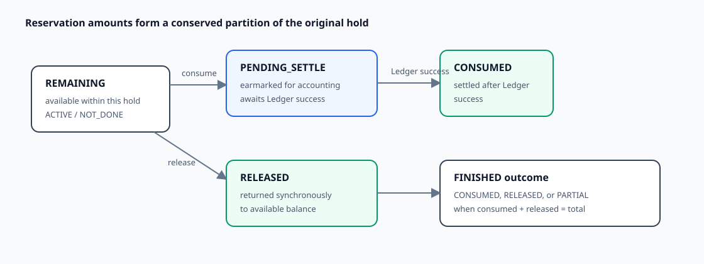

# Wallet Reservation Lifecycle and No-Double-Spend State

**Design:** D-015  
**Status:** Verified against the current implementation (2026-09-09)

**Module context:** [Wallet Service Overview](wallet-service-overview.md)

## Design in one minute

A reservation is durable proof that funds were moved out of the spendable balance before later consumption. Its original `total` is partitioned across `remaining`, `pendingSettle`, `consumed`, and `released`:

```text
total = remaining + pendingSettle + consumed + released
```

Consumption first moves units from `remaining` to `pendingSettle`. Only a successful Ledger reply moves those units to `consumed`. Release moves remaining units back to the Wallet's available balance. When consumed plus released reaches total, the reservation becomes `FINISHED` with an inferred outcome.



## Identity and ownership

The table stores both a generated internal `reservationId` and a client-facing `referenceId`. Current creation derives the reference as the Wallet transaction reference plus `:` plus Wallet ID. The schema uniquely scopes that reference by `(initiator, reference_id)`, and repository lookup uses the same initiator scope.

Each reservation also records Wallet ID/reference, asset, and the transaction that created the hold. `TransactionValidateHelper` and `WalletTxnHelper.actionReservationMatched` require a consuming/releasing action to match the reservation's Wallet and asset before mutation.

The response returns the derived reservation reference rather than the generated internal ID.

## State and amount model

| Field | Meaning |
|---|---|
| `total` | immutable original held amount by application convention |
| `remaining` | held amount still available for release or consumption |
| `pendingSettle` | consumption committed locally and awaiting Ledger confirmation |
| `consumed` | accounting-confirmed consumption |
| `released` | amount returned to available balance |

The active lifecycle uses `ACTIVE/NOT_DONE` while value remains unsettled. Once `consumed + released == total`, it assigns `FINISHED` and one of:

- `CONSUMED` when all value was consumed;
- `RELEASED` when all value was released;
- `PARTIAL` when both occurred.

`CLOSED` and `CANCELLED` exist in enums, but no active closure/cancellation flow was found.

## Creation variants

An explicit reserve begins as:

```text
remaining = total
pendingSettle = consumed = released = 0
status = ACTIVE, outcome = NOT_DONE
```

An atomic debit creates its reservation with the entire amount already in `pendingSettle`. Reserve and consume are part of the same accepted Wallet command, so no separately reusable remaining hold exists between them.

Reservation insert and the corresponding snapshot move from available to reserved occur in the same phase-1 database transaction. Full transaction choreography is described in [transaction lifecycle and settlement](transaction-lifecycle-and-settlement.md).

## Apply transitions

### Consume / earmark

Before Ledger, Wallet verifies `remaining >= amount`, subtracts from `remaining`, and adds to `pendingSettle`. The snapshot stays reserved at this point. The paired `TRANSFER_OUT` removes that amount from snapshot reserved only after Ledger success.

After a success reply, Wallet verifies `pendingSettle >= amount`, subtracts it, and adds it to `consumed`. Terminal status/outcome are inferred when the reservation is fully settled.

### Release

Wallet verifies `remaining >= amount`, subtracts it from `remaining`, and adds it to `released`. In the same database transaction, the snapshot moves the same units from reserved to available. Because pure release has no Ledger command, it completes synchronously.

Mixed apply requests can contain local releases and Ledger-bearing actions. Their phase-1 release effects commit together with the other pending work before Ledger settlement.

## Concurrency and atomicity

`UpdateReservationProcessor` reloads reservation rows using `SELECT ... FOR UPDATE`, mutates the locked database state, and updates with predicates over ID, old status, `remaining`, `pendingSettle`, `consumed`, and `released`. A concurrent stale writer therefore cannot silently overwrite a committed partition; zero affected rows fails the enclosing transaction.

Reservation and snapshot mutations occur within the same Wallet database transaction in each phase. That atomic coupling is what prevents a successful release from updating only the reservation or only the balance.

There is an important lock-order qualification: the updater comment claims primary-key order, but the current ID collection is not sorted and the repository query has no `ORDER BY`. Snapshot locking is explicitly sorted, while reservation ordering is currently left to query behavior. This is a concurrency gap, not part of the opening lifecycle contract.

There is also a reservation/action correlation defect for multi-reservation requests on one Wallet. Although validation proves that every referenced action matches some reservation, both phase mutation callbacks iterate all of that Wallet's actions for each locked reservation and do not require `action.reservationId == reservation.referenceId`. Multiple same-Wallet reservations can therefore receive one another's consume/release arithmetic or cause the phase to fail and roll back.

## Invariant enforcement

The partition is preserved by the implemented transition arithmetic and is checked by reconciliation SQL after stress runs. The application does not explicitly recompute and reject a broken partition before every update, and the schema has no `CHECK` constraint or FK enforcing it.

Accordingly:

- **currently enforced:** amount sufficiency for each consume/release/settle transition, row serialization, old-state conditional update, and phase rollback;
- **maintained by construction:** the full amount partition and valid status/outcome combinations;
- **not independently schema-enforced:** the partition, ownership relationships, or state machine.

## Failure-held state

If the Ledger command or usable reply is delayed, `pendingSettle` remains held and the corresponding amount remains in snapshot reserved, so it cannot be spent again through the normal Wallet path. If Ledger explicitly rejects the posting, current Wallet handling also leaves that state pending and routes the failed reply through terminal listener handling. A compensation transition is not implemented.

This protects against double-spend during uncertainty, but it can strand funds. DLT/retry exhaustion is operational evidence only; future Wallet recovery must repost the same logical command or compensate a confirmed rejection.

## Current guarantees

- Normal consuming/releasing actions resolve reservations within the caller's initiator scope and must match Wallet and asset.
- Locked-current-state and sufficiency checks prevent two normal applies from consuming/releasing the same remaining units successfully.
- Reservation and matching snapshot changes commit or roll back together in each phase.
- For the common shape with at most one affected reservation per Wallet, a successful Ledger settlement moves the stored consume amount from pending to consumed once in a successful finalization transaction.

These guarantees assume all writers use the application path and do not establish correctness for multiple affected reservations on one Wallet, deterministic reservation lock order, or schema-level partition enforcement.

## Trade-offs

The explicit `pendingSettle` bucket keeps uncertain remote work non-spendable and makes the eventual-consistency state visible. It also requires a recovery/compensation policy so funds do not remain held forever. Rich partition fields make audit and reconciliation clearer than a single mutable remaining balance, at the cost of more transition validation.

## Observability and testing

Wallet reconciliation SQL checks the partition, expected outcomes, action-derived states, pending transactions, and duplicate shapes. Business metrics expose acceptance and Ledger completion separately. There is no executed JUnit 5 state-machine/concurrent apply suite in the current baseline; older processor tests compile but are not discovered by the current test engine.

## Unresolved requirements and TODOs

- **Compensation:** define idempotent release/reversal and terminal status/outcome for a valid Ledger rejection.
- **Lock order:** sort reservation IDs and add an explicit primary-key `ORDER BY`, then prove the cross-table order under contention.
- **Invariant validation:** explicitly check the full partition, non-negative fields, allowed status/outcome, and immutable identity/total at transition boundaries.
- **Terminal states:** decide whether and how `CLOSED/CANCELLED` are used and whether apply must explicitly require `ACTIVE/NOT_DONE`.
- **Reference contract:** replace or formally define the derived client reference and its collision constraints.
- **Tests:** add concurrent consume/release, mixed apply, rollback, invalid-state, duplicate reply, and failure-held-state coverage.
- **Action correlation:** group reservation actions by reservation reference—not only Wallet ID—and cover multiple reservations on the same Wallet.

## Verification record

Verified on 2026-09-09 against reservation construction, action validation, both phase mutation callbacks, repository locking/update predicates, schema, protobuf responses, reconciliation SQL, and the current test suite. The review found the same-Wallet multi-reservation correlation defect above. No live-MySQL race/rollback run, complete terminal-outcome suite, or delayed/missing-reply experiment was performed.
