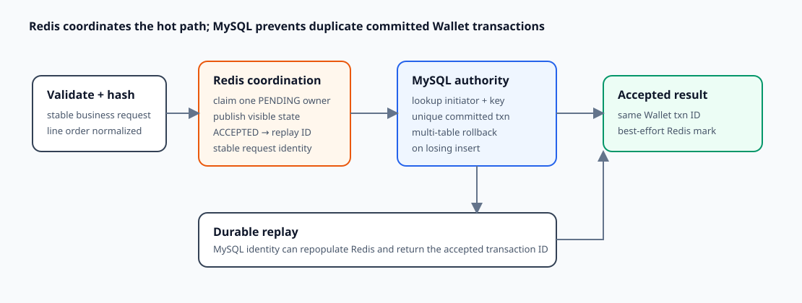

# Wallet Transaction Idempotency, Concurrency, and Replay

**Design:** D-016  
**Status:** Verified against the current implementation (2026-09-09)

**Module context:** [Wallet Service Overview](wallet-service-overview.md)

## Design in one minute

All three Wallet transaction APIs use the same layered idempotency path. Redis provides a fast claim and visible `PENDING`/`ACCEPTED` coordination state. MySQL provides the durable one-transaction backstop through a unique `(initiator, idempotency_key)` key. Financial mutations and the Wallet transaction insert share one database transaction, so a losing duplicate insert rolls back its earlier balance/reservation work.

A successful replay returns the original Wallet transaction ID, while MySQL remains the durable authority for committed transaction identity.

## Request identity

`RequestInfo.getStableHash` hashes:

- client reference ID;
- initiator/service ID;
- idempotency key;
- business type and internal transaction type;
- protobuf request message name; and
- every line's Wallet reference, asset, operation, amount, and reservation reference.

Lines are sorted by those fields first, so reordering the same multiset does not change identity. The per-attempt random owner token is deliberately excluded.

The Redis key scope uses Wallet's global service code, a Wallet transaction scope constant, and the caller's idempotency key. The database scope is `(initiator, idempotency_key)`. These scopes are inconsistent: while a Redis value exists, a second initiator reusing the textual key observes a different-hash conflict even though MySQL permits the pair. After Redis expiry/loss, DB fallback instead treats the initiators independently.

The hash input is assembled by concatenating caller-controlled fields with unescaped `|` delimiters before applying the stable hash. Sorting makes line order intentionally irrelevant, but the serialization does not unambiguously preserve field boundaries and is not a collision-resistant canonical request contract.

## Decision flow

Validation runs before claiming. `IdempPrecheckProcessor` then attempts an NX Redis claim with the stable hash and owner token.

| Redis observation | Wallet decision |
|---|---|
| claim succeeds | continue to database lookup and possible execution |
| identical `PENDING` | return `REQUEST_IN_PROCESSING` |
| identical `ACCEPTED` | replay stored Wallet transaction ID |
| different visible hash | return `REQUEST_HASH_CONFLICT` |
| malformed value | best-effort delete, then continue to DB fallback |
| Redis read/write failure | log and continue to DB fallback |

Even after winning a Redis claim, Wallet checks MySQL. If `(initiator, key)` exists, it returns that transaction ID and best-effort refreshes Redis as accepted. Otherwise it executes the Wallet database transaction.

The shared Redis state and Lua behavior are detailed in [Redis idempotency coordination](../infrastructure/redis-idempotency-coordination.md).

## Durable effect boundary

The phase-1 transaction mutates reservations and balance snapshots before inserting the Wallet transaction row, but all operations are inside the same `DbTxnExecutor` callback. `insertIgnore(walletTxn)` is protected by both unique `txn_id` and unique `(initiator, idempotency_key)`.

If a concurrent worker already committed the same database identity, this insert affects zero rows; Wallet returns a duplicate failure from the callback and the entire losing transaction rolls back. It cannot retain the earlier financial mutations.

On any pre-commit failure, Wallet uses token-owned release of the exact pending Redis value. After commit it marks Redis accepted with the transaction ID. This completion is best effort: database success remains successful even if Redis completion fails.

## Acceptance versus settlement replay

Idempotency protects acceptance of the Wallet business transaction; it does not mean asynchronous Ledger settlement has already completed. The stored transaction can move from `PENDING` to `COMPLETED` later while its identity remains the same.

Current replay response construction is operation-specific:

- atomic and apply replay return the original transaction ID;
- reserve replay also reloads reservations created by that transaction;
- the ID-only replay builders do not set protobuf transaction status, so it defaults to `Unknown` rather than reflecting the stored latest state.

The owner-selected direction is for replay to load and return the latest transaction/reservation state.

## Concurrency properties

Redis suppresses most simultaneous duplicate work while a visible pending lease exists. The database unique key is the durable one-effect barrier after Redis loss, expiry, or bypass. Row locks and transaction rollback protect balance/reservation changes when distinct requests contend on the same Wallet state.

These are separate responsibilities:

- Redis coordinates attempts and detects hash conflict while its value exists;
- MySQL prevents duplicate transaction rows/effects for the durable key;
- balance/reservation locks protect different business requests touching shared money;
- Ledger and reply consumers provide their own idempotency because messages may be delivered repeatedly.

## Current gaps and failure behavior

### Database cannot verify request equivalence

`wallet_transactions` does not persist the stable hash. After Redis loss or expiry, any request reusing `(initiator, key)` is replayed as the existing transaction—even if its business payload differs. The database therefore enforces one effect per key, but not the full “same key plus same request” equivalence contract.

### Redis owner completion race

Pending release is token-owned, but the current accepted completion primitive is not owner-conditional. If a pending TTL expires and a new owner claims the key, a slow old worker can later overwrite that Redis coordination state. MySQL still protects committed effects; Redis may misdirect subsequent callers.

### Duplicate insert response

A worker that loses the database insert race rolls back safely, but current code returns `WALLET_TRANSACTION_DUPLICATED` rather than loading the winner and replaying it. A caller retry can later find the winner through precheck.

### Post-commit ambiguity

If the database commits but the process fails before marking Redis or responding, the caller can retry. Database lookup returns the committed transaction ID, so duplicate effects are avoided. The response-shape/status limitation remains.

## Current guarantees

- One `(initiator, idempotency_key)` can produce at most one committed Wallet transaction row.
- A losing duplicate insert cannot commit its preceding balance/reservation mutations.
- While a valid Redis value exists, different stable hashes conflict and identical pending work is exposed as in processing.
- Redis unavailability does not remove the database one-effect barrier.
- Replays converge on the same Wallet transaction ID.

The current implementation does not guarantee durable same-request equivalence, owner-safe completion after lease turnover, or identical/latest replay response fields.

## Trade-offs

The Redis layer reduces hot duplicate pressure and provides early conflict/in-progress feedback; the database key supplies durability without requiring Redis for correctness of one effect. The layered design costs a more complex state protocol and demands precise distinction between attempt ownership and business authority.

The current database row is compact because it omits the request hash, but that choice sacrifices authoritative equivalence checks after Redis state disappears.

## Observability and performance

Idempotency metrics distinguish claim, verify, completion, malformed data, hash conflict, and failures. Wallet stress tooling injects immediate and delayed exact duplicates and reconciles transaction/action/reservation counts. Numeric pending/done TTL and jitter values are pre-launch snapshots; their suitability is not established by configuration alone.

## Unresolved requirements and TODOs

- **DB authority:** persist a canonical request hash and compare it on DB lookup and duplicate-insert races.
- **Ownership:** make accepted completion conditional on the pending owner token.
- **Replay:** return latest transaction status and reservation data, including post-Ledger completion.
- **Race convergence:** after duplicate insert rollback, load the winner and return replay/conflict based on persisted identity.
- **Redis key scope:** verify or align initiator scoping between Redis key and database uniqueness.
- **Canonical encoding:** replace unescaped delimiter concatenation with an unambiguous request representation and consciously select the digest/equality strength.
- **Token label:** processors currently generate owner tokens with the `LEDGER` label; use `WALLET` in a future cleanup. Key namespace remains Wallet.
- **Tests:** add live expiry/ownership, Redis-loss, different-payload DB fallback, concurrent duplicate, post-commit mark failure, and response-shape cases.

## Verification record

Verified on 2026-09-09 against all three transaction processors, request hashing, Redis decision handling, DB lookup/unique constraints, phase-1 rollback boundary, replay builders, shared verified idempotency behavior, and three passing focused idempotency tests within the 20-test Wallet suite. No live Redis lease-turnover test, simultaneous MySQL duplicate race, or latest-response integration test was run.
