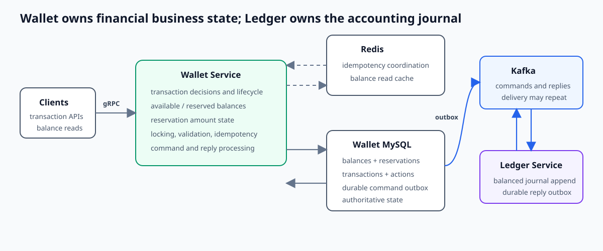
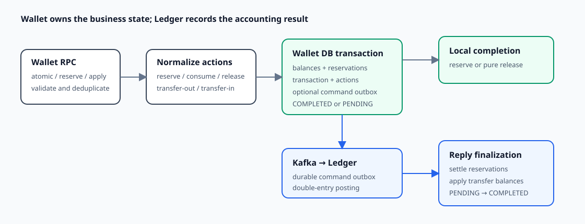
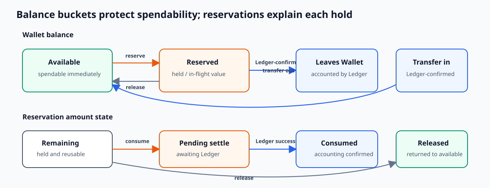

# Wallet Service Overview

**Scope:** Wallet-owned balances, reservations, transaction decisions, and asynchronous settlement  
**Evidence state:** synthesized from verified D-013–D-018 on 2026-09-09

## Wallet in five minutes



Wallet is the user-facing financial state machine. It decides whether funds may move, owns spendable and reserved balances, records why money is held or released, and tracks a transaction from local acceptance to final settlement. Ledger does not make those business decisions: Wallet converts an accepted transfer into accounting entries, while Ledger validates and appends the balanced journal.

MySQL is authoritative. Redis accelerates request coordination and balance reads. Kafka and transactional outboxes bridge Wallet and Ledger without holding a database transaction open across services.





The balance and reservation models describe the same money from different angles. Balance buckets protect spendability; a reservation partitions a particular hold into `remaining`, `pendingSettle`, `consumed`, and `released`. The transaction and its actions connect those states to the Ledger command and reply.

## Responsibilities and boundaries

| Wallet owns | Wallet relies on elsewhere |
|---|---|
| Transaction validation and lifecycle | Ledger append and per-asset double-entry validation |
| Available and reserved balances | Kafka/outbox duplicate-tolerant delivery and retry while rows remain eligible |
| Reservation identity, amount partition, and outcome | MySQL durability and transactional rollback |
| Concurrency control for Wallet financial state | Redis as a soft coordination/cache dependency |
| Idempotent client acceptance and reply finalization | Clients preserving idempotency identity across retries |

Wallet and balance-snapshot creation exist to provision the transaction path, including corresponding Ledger accounts, but provisioning is supporting context rather than a primary design boundary.

## Transaction and action model

The public transaction APIs reduce requests to five persisted action types: `RESERVE`, `CONSUME`, `RELEASE`, `TRANSFER_OUT`, and `TRANSFER_IN`. This small vocabulary lets the same processors update local money state and generate only the transfer entries that Ledger needs.

| Flow | Phase-1 Wallet effect | Ledger work | Completion meaning |
|---|---|---|---|
| reserve | available decreases; reserved and reservation remaining increase | none | returns `COMPLETED` after the local commit |
| apply release | reservation remaining becomes released; reserved returns to available | none when every line is release | returns `COMPLETED` after the local commit |
| apply earmark/consume | reservation remaining moves to pending settle | transfer-out posting | success reply moves pending to consumed and removes reserved funds |
| atomic transfer | outgoing funds move available → reserved; incoming credit waits | balanced transfer-out/in entries | success reply removes outgoing reserved and credits incoming available |

Each accepted request persists a Wallet transaction and its action audit trail. Local-only work becomes `COMPLETED` in the first database transaction. Ledger-backed work commits as `PENDING`, so the foreground RPC means durable acceptance rather than end-to-end settlement. A successful Ledger reply drives a second Wallet transaction to `COMPLETED`. See [Transaction Lifecycle and Asynchronous Settlement](transaction-lifecycle-and-settlement.md).

## Balance, reservation, and no-double-spend model

Balances use integer minor units and two buckets:

- `available`: spendable now;
- `reserved`: already committed to a hold or in-flight outgoing settlement.

Moving outgoing value into `reserved` before publishing the Ledger command prevents it from being spent again during remote uncertainty. A reservation preserves the more detailed amount identity:

```text
total = remaining + pendingSettle + consumed + released
```

Consume is deliberately two-stage. Phase 1 moves `remaining → pendingSettle`; Ledger success moves `pendingSettle → consumed`. Release instead moves `remaining → released` and returns the same amount from reserved to available in one local transaction. This makes uncertain funds non-spendable while retaining enough state for audit and future recovery. See [Balance and Concurrency Correctness](balance-and-concurrency-correctness.md) and [Reservation Lifecycle](reservation-lifecycle.md).

## Database transactions, locking, and concurrency

Wallet has two important transaction boundaries:

1. phase 1 atomically updates reservations and balance snapshots and inserts the transaction, actions, and optional Ledger command outbox;
2. phase 2 atomically settles reservations and balances and changes the transaction from `PENDING` to `COMPLETED`.

Active balance mutation reloads snapshot rows with `SELECT ... FOR UPDATE` in ascending primary-key order. It operates on the locked current values, checks the resulting buckets in application code, and persists through old-value plus version predicates. A missing, closed, insufficient, negative, or concurrently changed row fails the callback and rolls back the whole phase.

Reservation updates also lock current rows and use old-state predicates across their amount partition. Snapshot lock order is explicit; deterministic reservation lock order remains an implementation follow-up. No database transaction spans Kafka or Ledger.

The schema supplies primary/unique identities and conditional updates rather than independently encoding every cross-row domain rule. Transaction atomicity, row locks, application validation, and guarded writes work together; direct writers outside that protocol are not covered by the same guarantees.

## Idempotency and replay

All three transaction APIs share a layered path:

| Layer | Role |
|---|---|
| Redis `PENDING` / `ACCEPTED` | fast ownership, in-progress response, visible payload conflict, and completed-ID replay |
| MySQL unique `(initiator, idempotency_key)` | durable selection of at most one committed Wallet transaction |
| Financial database transaction | rolls back a duplicate insert loser's earlier balance/reservation mutations |

Redis failure degrades to the database path. A retry after an ambiguous client response can recover the committed Wallet transaction ID, and a duplicate Ledger reply sees the transaction's stored state before attempting another effect. The durable row currently proves one effect per key, but does not retain the canonical request hash; full request equivalence after Redis expiry is therefore not a database guarantee. Replay response status and owner-safe Redis completion also remain refinements. See [Transaction Idempotency and Replay](transaction-idempotency-and-replay.md).

## Ledger interaction and reliability

Wallet writes the Ledger command outbox in the same database transaction as phase-1 money state. The Wallet transaction ID becomes the Ledger business reference, command identity, and Kafka partition key. Only `TRANSFER_OUT` and `TRANSFER_IN` actions become Ledger entries.

Immediate publication is a latency optimization; the persisted outbox is the recovery boundary when publication fails. Ledger's unique business reference prevents a duplicate journal effect and another durable outbox carries its reply. Wallet tolerates repeated reply delivery through guarded state transitions. This avoids a Wallet-database/Kafka dual write and avoids holding locks during remote work; it does not recover an outbox row after its retry budget is exhausted.

If delivery is delayed, the transaction stays `PENDING` and its outgoing value stays reserved. Retry/DLT signals make the condition observable, but they are not business repair. The planned recovery direction is a Wallet-owned scan that reposts the same logical command with the same identity; explicit valid Ledger rejection still needs a compensation transition. Shared mechanics are summarized in [Kafka and Outbox Reliability](../infrastructure/kafka-outbox-reliability.md), while the Ledger half is in the [Ledger Service Overview](../ledger/ledger-service-overview.md).

## Balance reads and caching

Wallet queries snapshots by internal Wallet ID or caller-facing `(serviceId, referenceId)`. The latter first resolves a stable reference index and then reads the versioned mutable snapshot. MySQL remains authoritative; translated cache failures fall back to it.

Normal Wallets use cache-aside behavior. System-owned Wallets are process-locally promoted to Redisson client-side, post-refresh strategies. Version comparison prevents an older cooperating fill from replacing a newer cached snapshot, while negative entries and tombstones reduce repeated misses and stale-fill races. This is best-effort freshness, not a strict read-consistency contract; the intended explicit MySQL-bypass real-time query is not implemented. See [Balance Query and Cache Read Model](balance-query-and-cache.md).

## Observability and performance

Wallet measures foreground gRPC acceptance separately from Kafka `complete_ledger_transaction` processing. That distinction matters: high request throughput can coexist with a growing settlement backlog. Shared gRPC, listener, outbox, Redis, SQL/transaction, Hikari, JVM, and process metrics support dependency-level diagnosis.

The workload tooling covers atomic, reserve, release, earmark, duplicate, and query shapes, then uses Wallet/Ledger reconciliation rather than accepting transport success alone. Retained historical atomic runs exposed query/index mismatches and later shared Hikari-pool contention: foreground work could starve settlement, which recovered when foreground load stopped. Those observations demonstrate the investigation method, not a current capacity or latency promise. No current-revision soak or retained query benchmark exists. See [Wallet Observability and Performance Evidence](../operations/wallet-performance.md).

## Current guarantees and focused follow-ups

| Area | Current guarantee or mitigation | Focused follow-up |
|---|---|---|
| local financial phase | related balances, reservations, transaction, actions, and outbox commit or roll back together | add live contention and fault-injection evidence |
| spend safety | outgoing value is reserved before remote accounting; locked-state sufficiency checks reject normal overspend | add overflow-safe arithmetic and explicit partition validation |
| duplicate acceptance | one committed Wallet transaction per `(initiator, idempotency_key)` | persist canonical request identity and align Redis scope/ownership |
| asynchronous delivery | durable outbox plus idempotent endpoints tolerates repeated attempts | implement stuck-transaction re-drive and valid-rejection compensation |
| balance reads | authoritative DB fallback, version-aware cache writes, and stale-index repair | add an explicit authoritative read and representative cache tests |

Two current shape limits merit attention without defining the whole design: reservation rows are not explicitly locked in deterministic order, and multiple affected reservations on the same Wallet are not safely correlated to only their own actions. The detailed reservation/lifecycle documents own those fixes and test requirements. Configuration values remain pre-launch tuning snapshots, and Wallet's time-plus-process-local ID generator is not yet a horizontal multi-instance uniqueness claim.

## Documentation guide

- overall business architecture → [z-exchange System Overview](../business/system-overview.md)
- complete transaction walkthrough → [End-to-End Transaction Flow](../business/end-to-end-transaction-flow.md)
- cross-service failures and recovery boundaries → [Wallet–Ledger Consistency and Reliability](../consistency/wallet-ledger-consistency.md)
- transaction phases, action mapping, commands, replies, and recovery → [Transaction Lifecycle and Asynchronous Settlement](transaction-lifecycle-and-settlement.md)
- bucket arithmetic, locks, guarded updates, and conservation → [Balance and Concurrency Correctness](balance-and-concurrency-correctness.md)
- reservation identity, partition, transitions, and failure-held state → [Reservation Lifecycle](reservation-lifecycle.md)
- Redis/MySQL duplicate coordination and replay → [Transaction Idempotency and Replay](transaction-idempotency-and-replay.md)
- reference lookup, versioned snapshots, promotion, and tombstones → [Balance Query and Cache Read Model](balance-query-and-cache.md)
- metrics, workloads, reconciliation, and retained experiments → [Wallet Observability and Performance Evidence](../operations/wallet-performance.md)
- shared transaction, Redis, Kafka/outbox, error, and observability mechanisms → [Common-util Overview](../infrastructure/common-util-overview.md)
